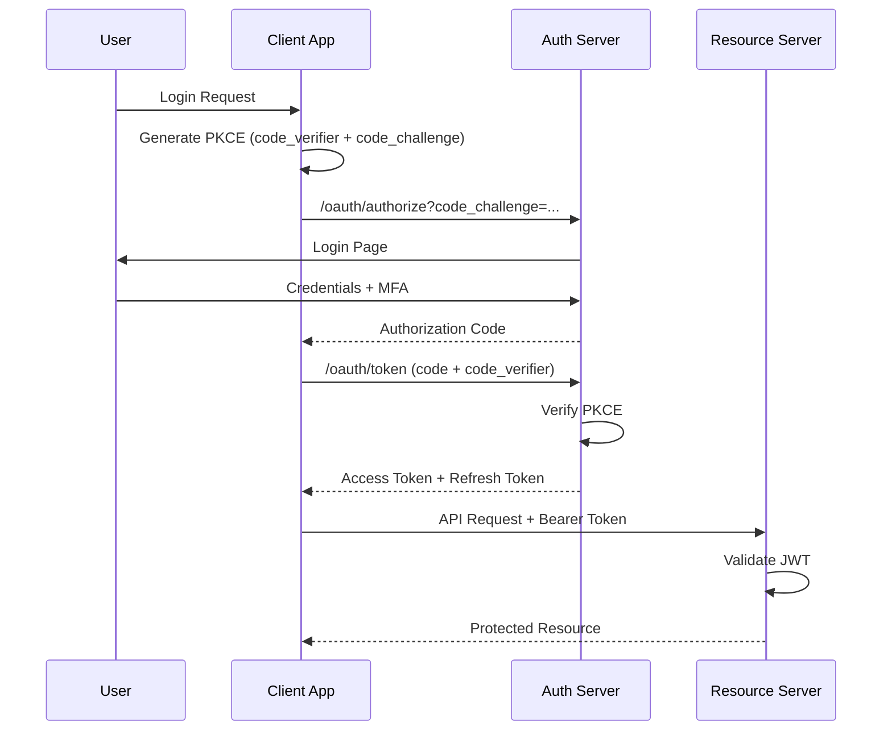
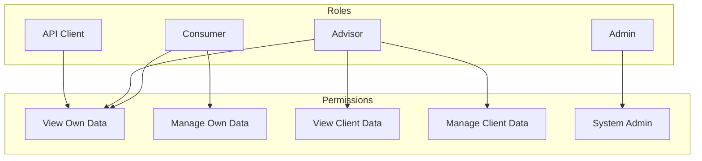

# Fiduciary OS™ - API Specification

## Table of Contents
1. [API Design Principles](#api-design-principles)
2. [Authentication & Authorization](#authentication--authorization)
3. [Core Endpoints](#core-endpoints)
4. [Navigator Endpoints](#navigator-endpoints)
5. [Webhook Specifications](#webhook-specifications)
6. [Rate Limiting & Throttling](#rate-limiting--throttling)
7. [Error Handling Standards](#error-handling-standards)
8. [OpenAPI Specification](#openapi-specification)

---

## API Design Principles

### RESTful Design Standards

| Principle | Implementation |
|-----------|----------------|
| **Resource-Based URLs** | Use nouns, not verbs: `/users/{id}` not `/getUser` |
| **HTTP Methods** | GET (read), POST (create), PUT/PATCH (update), DELETE (remove) |
| **Plural Nouns** | `/users`, `/accounts`, `/quotes` |
| **Hierarchical Resources** | `/users/{id}/accounts/{accountId}/transactions` |
| **Filtering** | Query parameters: `?status=active&sort=-created_at` |
| **Pagination** | Cursor-based for large datasets |
| **Versioning** | URL path versioning: `/api/v1/...` |

### Request/Response Format

**Base URL**: `https://api.fiduciaryos.com/api/v1`

**Headers**:
```http
Content-Type: application/json
Authorization: Bearer {access_token}
X-Request-ID: {uuid}
X-Client-Version: 6.0.0
```

**Standard Response Structure**:
```json
{
  "success": true,
  "data": { ... },
  "meta": {
    "request_id": "uuid",
    "timestamp": "2025-01-15T10:30:00Z",
    "pagination": {
      "cursor": "eyJpZCI6MTAwfQ==",
      "has_more": true,
      "total_count": 1500
    }
  },
  "links": {
    "self": "/api/v1/resource",
    "next": "/api/v1/resource?cursor=eyJpZCI6MTAwfQ==",
    "prev": null
  }
}
```

---

## Authentication & Authorization

### OAuth 2.0 + PKCE Flow



### Token Specifications

**Access Token (JWT)**:
```json
{
  "header": {
    "alg": "RS256",
    "typ": "JWT",
    "kid": "key-id-123"
  },
  "payload": {
    "sub": "user-uuid",
    "iss": "https://auth.fiduciaryos.com",
    "aud": "https://api.fiduciaryos.com",
    "iat": 1705315800,
    "exp": 1705319400,
    "scope": "read:profile read:accounts write:goals",
    "role": "client",
    "advisor_id": "advisor-uuid",
    "plan_tier": "premium"
  }
}
```

**Token Lifetimes**:
| Token Type | Lifetime | Refreshable |
|------------|----------|-------------|
| Access Token | 15 minutes | No |
| Refresh Token | 7 days | Yes |
| ID Token | 1 hour | No |

### Authorization Scopes

| Scope | Description | Access Level |
|-------|-------------|--------------|
| `read:profile` | Read user profile | User, Advisor |
| `write:profile` | Update user profile | User |
| `read:accounts` | Read linked accounts | User, Advisor |
| `write:accounts` | Link/unlink accounts | User |
| `read:quotes` | Read insurance quotes | User, Advisor |
| `write:quotes` | Request new quotes | User, Advisor |
| `read:analytics` | View analytics | Advisor, Admin |
| `write:advisor` | Manage advisor settings | Advisor |
| `admin:users` | Full user management | Admin |
| `admin:system` | System configuration | Admin |

### Role-Based Access Control (RBAC)



---

## Core Endpoints

### Authentication Endpoints

#### POST /auth/register
Register a new user account.

**Request**:
```json
{
  "email": "user@example.com",
  "password": "SecurePass123!",
  "first_name": "John",
  "last_name": "Doe",
  "phone": "+1-555-123-4567",
  "user_type": "consumer",
  "advisor_code": "ADV-12345",
  "accepted_terms": true,
  "accepted_privacy": true
}
```

**Response (201)**:
```json
{
  "success": true,
  "data": {
    "user_id": "usr_abc123",
    "email": "user@example.com",
    "status": "pending_verification",
    "verification_token": "verify_xyz789",
    "created_at": "2025-01-15T10:30:00Z"
  },
  "meta": {
    "request_id": "req_123",
    "timestamp": "2025-01-15T10:30:00Z"
  }
}
```

#### POST /auth/login
Authenticate user and obtain tokens.

**Request**:
```json
{
  "email": "user@example.com",
  "password": "SecurePass123!",
  "mfa_code": "123456"
}
```

**Response (200)**:
```json
{
  "success": true,
  "data": {
    "access_token": "eyJhbGciOiJSUzI1NiIs...",
    "refresh_token": "eyJhbGciOiJSUzI1NiIs...",
    "token_type": "Bearer",
    "expires_in": 900,
    "user": {
      "id": "usr_abc123",
      "email": "user@example.com",
      "first_name": "John",
      "last_name": "Doe",
      "role": "consumer",
      "plan_tier": "premium"
    }
  }
}
```

#### POST /auth/refresh
Refresh access token using refresh token.

**Request**:
```json
{
  "refresh_token": "eyJhbGciOiJSUzI1NiIs..."
}
```

#### POST /auth/mfa/enable
Enable multi-factor authentication.

**Request**:
```json
{
  "method": "authenticator_app",
  "phone": "+1-555-123-4567"
}
```

**Response (200)**:
```json
{
  "success": true,
  "data": {
    "qr_code": "data:image/png;base64,...",
    "secret": "JBSWY3DPEHPK3PXP",
    "backup_codes": ["12345678", "87654321", ...]
  }
}
```

### User Management Endpoints

#### GET /users/me
Get current user profile.

**Response (200)**:
```json
{
  "success": true,
  "data": {
    "id": "usr_abc123",
    "email": "user@example.com",
    "first_name": "John",
    "last_name": "Doe",
    "phone": "+1-555-123-4567",
    "date_of_birth": "1980-05-15",
    "address": {
      "street": "123 Main St",
      "city": "New York",
      "state": "NY",
      "zip": "10001",
      "country": "US"
    },
    "kyc_status": "verified",
    "created_at": "2024-01-15T10:30:00Z",
    "last_login": "2025-01-15T08:00:00Z",
    "settings": {
      "notifications": {
        "email": true,
        "sms": false,
        "push": true
      },
      "privacy": {
        "share_analytics": true,
        "marketing_emails": false
      }
    }
  }
}
```

#### PATCH /users/me
Update user profile.

**Request**:
```json
{
  "first_name": "Johnny",
  "phone": "+1-555-999-8888",
  "settings": {
    "notifications": {
      "sms": true
    }
  }
}
```

### Financial Profile Endpoints

#### GET /profile/financial
Get user's financial profile.

**Response (200)**:
```json
{
  "success": true,
  "data": {
    "annual_income": 150000,
    "monthly_expenses": 6000,
    "total_assets": 500000,
    "total_liabilities": 150000,
    "net_worth": 350000,
    "risk_tolerance": 3,
    "investment_style": "moderate",
    "retirement_age_target": 65,
    "financial_goals": ["retire_comfortably", "build_emergency_fund"],
    "time_horizon": "long_term",
    "dependents": 2,
    "employment_status": "employed_full_time",
    "tax_filing_status": "married_filing_jointly",
    "dna_score": 72,
    "last_updated": "2025-01-10T14:30:00Z"
  }
}
```

#### PUT /profile/financial
Update financial profile.

**Request**:
```json
{
  "annual_income": 160000,
  "monthly_expenses": 6500,
  "risk_tolerance": 4,
  "retirement_age_target": 62
}
```

### Account Linking Endpoints (Plaid Integration)

#### POST /plaid/link-token
Create a Plaid Link token.

**Request**:
```json
{
  "products": ["auth", "transactions", "investments"],
  "country_codes": ["US"],
  "language": "en",
  "webhook": "https://api.fiduciaryos.com/webhooks/plaid"
}
```

**Response (200)**:
```json
{
  "success": true,
  "data": {
    "link_token": "link-sandbox-123456",
    "expiration": "2025-01-15T11:30:00Z"
  }
}
```

#### POST /plaid/exchange
Exchange public token for access token.

**Request**:
```json
{
  "public_token": "public-sandbox-123456",
  "accounts": ["account-id-1", "account-id-2"],
  "institution": {
    "id": "ins_123",
    "name": "Chase"
  }
}
```

**Response (201)**:
```json
{
  "success": true,
  "data": {
    "linked_accounts": [
      {
        "id": "acc_abc123",
        "plaid_account_id": "plaid_acc_123",
        "institution": "Chase",
        "name": "Checking Account",
        "type": "depository",
        "subtype": "checking",
        "mask": "1234",
        "balance": {
          "available": 15000.00,
          "current": 15250.00,
          "currency": "USD"
        },
        "status": "active",
        "linked_at": "2025-01-15T10:35:00Z"
      }
    ]
  }
}
```

#### GET /accounts
List all linked accounts.

**Response (200)**:
```json
{
  "success": true,
  "data": {
    "accounts": [
      {
        "id": "acc_abc123",
        "institution": "Chase",
        "name": "Checking Account",
        "type": "depository",
        "balance": 15250.00,
        "currency": "USD",
        "status": "active"
      },
      {
        "id": "acc_def456",
        "institution": "Fidelity",
        "name": "401(k)",
        "type": "investment",
        "balance": 300000.00,
        "currency": "USD",
        "status": "active"
      }
    ],
    "total_balance": 315250.00
  }
}
```

---

## Navigator Endpoints

### Annuity Navigator

#### POST /annuity/quote
Generate annuity quotes.

**Request**:
```json
{
  "principal": 200000,
  "deferral_period_years": 5,
  "start_age": 60,
  "product_type": "fixed_indexed",
  "life_option": "joint_life",
  "cola_rider": "2_percent",
  "joint_annuitant": {
    "age": 58,
    "gender": "female"
  }
}
```

**Response (200)**:
```json
{
  "success": true,
  "data": {
    "quote_id": "quote_xyz789",
    "monthly_income": 1850.00,
    "annual_income": 22200.00,
    "yield_rate": 0.065,
    "ten_year_total": 222000.00,
    "twenty_year_total": 444000.00,
    "lifetime_estimate": 532800.00,
    "carrier_quotes": [
      {
        "carrier": "Athene",
        "product": "Ascent Pro 10",
        "rating": "A+",
        "monthly_income": 1920.00,
        "yield_rate": 0.0675,
        "features": ["high_cap_rate", "guaranteed_growth"],
        "fees": {
          "annual": 0.0,
          "surrender": [
            {"year": 1, "rate": 0.10},
            {"year": 2, "rate": 0.09}
          ]
        }
      },
      {
        "carrier": "Nationwide",
        "product": "Peak 10",
        "rating": "A+",
        "monthly_income": 1880.00,
        "yield_rate": 0.066,
        "features": ["liquidity_bonus", "free_withdrawal"]
      }
    ],
    "projections": {
      "labels": ["Age 65", "Age 70", "Age 75", "Age 80", "Age 85"],
      "values": [22200, 23310, 24476, 25700, 26985]
    }
  }
}
```

#### GET /annuity/rates
Get current annuity rates.

**Query Parameters**:
- `type`: fixed, indexed, variable, immediate
- `term`: 5, 10, 15, 20
- `carrier`: optional filter

**Response (200)**:
```json
{
  "success": true,
  "data": {
    "rates": [
      {
        "carrier": "Athene",
        "product": "Fixed 10-Year",
        "rate": 0.055,
        "min_premium": 10000,
        "max_premium": 1000000,
        "rating": "A+",
        "updated_at": "2025-01-15T09:00:00Z"
      }
    ],
    "as_of": "2025-01-15T09:00:00Z"
  }
}
```

### Life Insurance Navigator

#### POST /life/quote
Generate life insurance quotes.

**Request**:
```json
{
  "age": 40,
  "gender": "female",
  "health_class": "preferred",
  "tobacco_use": false,
  "annual_income": 150000,
  "existing_coverage": 200000,
  "term": 20,
  "coverage_amount": 1000000
}
```

**Response (200)**:
```json
{
  "success": true,
  "data": {
    "quote_id": "quote_life_123",
    "protection_gap": 1300000,
    "recommended_coverage": 1500000,
    "monthly_premium": 85.50,
    "annual_premium": 1026.00,
    "lifetime_cost": 20520.00,
    "carrier_quotes": [
      {
        "carrier": "Haven Life",
        "rating": "A++",
        "monthly_premium": 81.25,
        "annual_premium": 975.00,
        "conversion_option": true,
        "accelerated_death_benefit": true
      },
      {
        "carrier": "Protective",
        "rating": "A+",
        "monthly_premium": 78.65,
        "annual_premium": 943.80,
        "conversion_option": true
      }
    ]
  }
}
```

### Investment X-Ray

#### GET /investment/portfolio
Get portfolio analysis.

**Response (200)**:
```json
{
  "success": true,
  "data": {
    "portfolio_id": "port_abc123",
    "total_value": 500000.00,
    "total_cost_basis": 420000.00,
    "unrealized_gain": 80000.00,
    "allocation": {
      "us_equity": 52,
      "international_equity": 13,
      "fixed_income": 28,
      "alternatives": 3,
      "cash": 4
    },
    "risk_metrics": {
      "beta": 1.05,
      "standard_deviation": 0.142,
      "sharpe_ratio": 1.24,
      "sortino_ratio": 1.85,
      "max_drawdown": -0.224,
      "var_95": -45000.00
    },
    "fee_analysis": {
      "weighted_expense_ratio": 0.0075,
      "annual_fees": 3750.00,
      "fee_drag_10yr": 42000.00,
      "optimized_expense_ratio": 0.0003,
      "potential_savings": 39000.00
    },
    "holdings": [
      {
        "symbol": "VTI",
        "name": "Vanguard Total Stock Market ETF",
        "quantity": 500,
        "price": 252.30,
        "value": 126150.00,
        "allocation": 25.23,
        "expense_ratio": 0.0003
      }
    ],
    "rebalancing": {
      "drift_threshold": 0.05,
      "recommendations": [
        {
          "asset_class": "us_equity",
          "current": 52,
          "target": 50,
          "drift": 0.02,
          "action": "TRIM",
          "amount": 10000.00
        }
      ]
    }
  }
}
```

#### POST /investment/analyze
Run portfolio analysis with custom parameters.

**Request**:
```json
{
  "portfolio_id": "port_abc123",
  "time_horizon_years": 25,
  "annual_contribution": 18000,
  "expected_return": 0.07,
  "risk_profile": "moderate",
  "include_tax_analysis": true
}
```

**Response (200)**:
```json
{
  "success": true,
  "data": {
    "projected_value": 3245000.00,
    "total_contributions": 870000.00,
    "net_growth": 2375000.00,
    "projections": {
      "years": [0, 5, 10, 15, 20, 25],
      "values": [500000, 850000, 1250000, 1800000, 2450000, 3245000]
    },
    "tax_analysis": {
      "taxable_gains": 1500000.00,
      "estimated_tax": 300000.00,
      "tax_efficient_alternatives": [
        {
          "strategy": "tax_loss_harvesting",
          "potential_savings": 15000.00
        }
      ]
    }
  }
}
```

### Retirement Navigator

#### POST /retirement/analyze
Run retirement income analysis.

**Request**:
```json
{
  "portfolio_value": 1200000,
  "retirement_age": 65,
  "monthly_spending": 7500,
  "social_security_monthly": 2400,
  "pension_monthly": 0,
  "withdrawal_strategy": "dynamic",
  "life_expectancy": 95,
  "inflation_rate": 0.03,
  "expected_return": 0.06
}
```

**Response (200)**:
```json
{
  "success": true,
  "data": {
    "analysis_id": "ret_abc123",
    "success_probability": 0.92,
    "withdrawal_rate": 0.051,
    "sustainable_monthly": 7200,
    "projected_shortfall": 0,
    "monte_carlo_results": {
      "simulations": 10000,
      "success_rate": 0.92,
      "median_balance_age_95": 850000,
      "min_balance_age_95": 0,
      "max_balance_age_95": 3200000
    },
    "strategy_comparison": [
      {
        "strategy": "4_percent_rule",
        "success_rate": 0.95,
        "avg_ending_balance": 1200000,
        "min_ending_balance": 200000
      },
      {
        "strategy": "dynamic_spending",
        "success_rate": 0.92,
        "avg_ending_balance": 1500000,
        "min_ending_balance": 350000
      },
      {
        "strategy": "guardrails",
        "success_rate": 0.94,
        "avg_ending_balance": 1300000,
        "min_ending_balance": 400000
      }
    ],
    "projections": {
      "ages": [65, 70, 75, 80, 85, 90, 95],
      "balances": [1200000, 1150000, 1080000, 980000, 850000, 650000, 350000]
    }
  }
}
```

### Tax Planning

#### POST /tax/calculate
Calculate tax liability with strategies.

**Request**:
```json
{
  "filing_status": "married_filing_jointly",
  "annual_income": 150000,
  "deductions": {
    "standard": true,
    "itemized": null
  },
  "strategies": {
    "roth_conversion": 0,
    "four_o_one_k_contribution": 23000,
    "hsa_contribution": 8300,
    "tax_loss_harvesting": 5000,
    "qcd": 0
  },
  "state": "CA"
}
```

**Response (200)**:
```json
{
  "success": true,
  "data": {
    "base_tax": 28500.00,
    "state_tax": 12000.00,
    "total_base": 40500.00,
    "marginal_rate": 0.22,
    "effective_rate": 0.19,
    "niit_applies": false,
    "after_strategies": {
      "taxable_income": 118700,
      "federal_tax": 19800.00,
      "state_tax": 9496.00,
      "total": 29296.00
    },
    "total_savings": 11204.00,
    "recommendations": [
      {
        "strategy": "max_401k",
        "potential_savings": 5060.00,
        "description": "Contribute maximum to 401(k)"
      },
      {
        "strategy": "hsa_max",
        "potential_savings": 1826.00,
        "description": "Max out HSA contribution"
      }
    ]
  }
}
```

---

## Webhook Specifications

### Webhook Event Types

| Event | Description | Payload Size |
|-------|-------------|--------------|
| `account.linked` | New account linked via Plaid | ~2KB |
| `account.updated` | Account balances/txns updated | ~5KB |
| `quote.generated` | New quote generated | ~10KB |
| `portfolio.analyzed` | Portfolio analysis complete | ~50KB |
| `alert.triggered` | Proactive alert fired | ~1KB |
| `document.processed` | NLP document analysis complete | ~5KB |
| `user.goal.milestone` | Financial goal milestone reached | ~1KB |

### Webhook Payload Structure

```json
{
  "event_id": "evt_abc123",
  "event_type": "account.linked",
  "timestamp": "2025-01-15T10:30:00Z",
  "webhook_id": "whk_def456",
  "data": {
    "user_id": "usr_abc123",
    "account_id": "acc_xyz789",
    "institution": "Chase",
    "account_type": "checking",
    "linked_at": "2025-01-15T10:30:00Z"
  }
}
```

### Webhook Security

**Signature Verification**:
```
X-Webhook-Signature: sha256={hex_digest}
```

**Verification Code (Node.js)**:
```javascript
const crypto = require('crypto');

function verifyWebhook(payload, signature, secret) {
  const expected = crypto
    .createHmac('sha256', secret)
    .update(payload)
    .digest('hex');
  return crypto.timingSafeEqual(
    Buffer.from(signature),
    Buffer.from(expected)
  );
}
```

### Webhook Retry Policy

| Attempt | Delay | Total Delay |
|---------|-------|-------------|
| 1 | Immediate | 0s |
| 2 | 5 seconds | 5s |
| 3 | 25 seconds | 30s |
| 4 | 2 minutes | 2.5m |
| 5 | 10 minutes | 12.5m |
| 6 | 1 hour | 1h 12.5m |
| 7+ | 4 hours | 5h+ |

**Max Retries**: 24 hours or 10 attempts, whichever comes first

---

## Rate Limiting & Throttling

### Rate Limit Tiers

| Tier | Requests/Minute | Burst | Concurrent |
|------|-----------------|-------|------------|
| Free | 60 | 10 | 5 |
| Basic | 300 | 50 | 20 |
| Premium | 1000 | 200 | 50 |
| Enterprise | 5000 | 1000 | 200 |
| Internal | Unlimited | Unlimited | Unlimited |

### Rate Limit Headers

```http
X-RateLimit-Limit: 1000
X-RateLimit-Remaining: 999
X-RateLimit-Reset: 1705316400
X-RateLimit-Retry-After: 60
```

### Rate Limit Response (429)

```json
{
  "success": false,
  "error": {
    "code": "RATE_LIMIT_EXCEEDED",
    "message": "Rate limit exceeded. Please retry after 60 seconds.",
    "details": {
      "limit": 1000,
      "window": "1 minute",
      "retry_after": 60
    }
  },
  "meta": {
    "request_id": "req_123",
    "timestamp": "2025-01-15T10:30:00Z"
  }
}
```

### Endpoint-Specific Limits

| Endpoint | Limit | Window |
|----------|-------|--------|
| POST /auth/login | 5 | 5 minutes |
| POST /auth/register | 3 | 15 minutes |
| POST /plaid/link-token | 10 | 1 minute |
| POST /annuity/quote | 30 | 1 minute |
| POST /life/quote | 30 | 1 minute |
| GET /investment/portfolio | 60 | 1 minute |
| GET /accounts | 120 | 1 minute |

---

## Error Handling Standards

### Error Response Structure

```json
{
  "success": false,
  "error": {
    "code": "ERROR_CODE",
    "message": "Human-readable error message",
    "details": {
      "field": "specific_field",
      "reason": "validation_failed"
    },
    "documentation_url": "https://docs.fiduciaryos.com/errors/ERROR_CODE"
  },
  "meta": {
    "request_id": "req_123",
    "timestamp": "2025-01-15T10:30:00Z"
  }
}
```

### HTTP Status Codes

| Code | Usage |
|------|-------|
| 200 | Successful GET, PUT, PATCH |
| 201 | Successful POST (resource created) |
| 204 | Successful DELETE |
| 400 | Bad Request - validation error |
| 401 | Unauthorized - authentication required |
| 403 | Forbidden - insufficient permissions |
| 404 | Resource not found |
| 409 | Conflict - resource already exists |
| 422 | Unprocessable Entity - business logic error |
| 429 | Too Many Requests - rate limit exceeded |
| 500 | Internal Server Error |
| 502 | Bad Gateway - upstream error |
| 503 | Service Unavailable - maintenance |

### Error Codes

| Code | HTTP | Description |
|------|------|-------------|
| `INVALID_REQUEST` | 400 | Malformed request |
| `VALIDATION_ERROR` | 400 | Field validation failed |
| `UNAUTHORIZED` | 401 | Authentication required |
| `TOKEN_EXPIRED` | 401 | Access token expired |
| `FORBIDDEN` | 403 | Insufficient permissions |
| `RESOURCE_NOT_FOUND` | 404 | Requested resource not found |
| `DUPLICATE_RESOURCE` | 409 | Resource already exists |
| `INSUFFICIENT_FUNDS` | 422 | Financial constraint violated |
| `RATE_LIMIT_EXCEEDED` | 429 | Too many requests |
| `INTERNAL_ERROR` | 500 | Unexpected server error |
| `SERVICE_UNAVAILABLE` | 503 | Service temporarily unavailable |
| `THIRD_PARTY_ERROR` | 502 | External service error |

### Validation Error Example

```json
{
  "success": false,
  "error": {
    "code": "VALIDATION_ERROR",
    "message": "Request validation failed",
    "details": {
      "errors": [
        {
          "field": "email",
          "message": "Invalid email format",
          "code": "INVALID_EMAIL"
        },
        {
          "field": "password",
          "message": "Password must be at least 8 characters",
          "code": "PASSWORD_TOO_SHORT"
        }
      ]
    }
  }
}
```

---

## OpenAPI Specification

### API Versioning

- Current Version: `v1`
- Base Path: `/api/v1`
- OpenAPI Spec: `https://api.fiduciaryos.com/openapi.json`

### OpenAPI 3.0 Example

```yaml
openapi: 3.0.3
info:
  title: Fiduciary OS API
  description: Financial advisory platform API
  version: 1.0.0
  contact:
    name: API Support
    email: api@fiduciaryos.com
  license:
    name: Proprietary

servers:
  - url: https://api.fiduciaryos.com/api/v1
    description: Production
  - url: https://api-staging.fiduciaryos.com/api/v1
    description: Staging
  - url: https://api-sandbox.fiduciaryos.com/api/v1
    description: Sandbox

security:
  - BearerAuth: []

paths:
  /auth/login:
    post:
      summary: Authenticate user
      tags:
        - Authentication
      security: []
      requestBody:
        required: true
        content:
          application/json:
            schema:
              $ref: '#/components/schemas/LoginRequest'
      responses:
        '200':
          description: Successful authentication
          content:
            application/json:
              schema:
                $ref: '#/components/schemas/LoginResponse'
        '401':
          $ref: '#/components/responses/Unauthorized'

components:
  securitySchemes:
    BearerAuth:
      type: http
      scheme: bearer
      bearerFormat: JWT

  schemas:
    LoginRequest:
      type: object
      required:
        - email
        - password
      properties:
        email:
          type: string
          format: email
        password:
          type: string
          minLength: 8
        mfa_code:
          type: string
          pattern: '^[0-9]{6}$'

    LoginResponse:
      type: object
      properties:
        success:
          type: boolean
        data:
          type: object
          properties:
            access_token:
              type: string
            refresh_token:
              type: string
            expires_in:
              type: integer
            user:
              $ref: '#/components/schemas/User'

    User:
      type: object
      properties:
        id:
          type: string
        email:
          type: string
        first_name:
          type: string
        last_name:
          type: string
        role:
          type: string
          enum: [consumer, advisor, admin]

  responses:
    Unauthorized:
      description: Authentication required
      content:
        application/json:
          schema:
            $ref: '#/components/schemas/Error'

    Error:
      type: object
      properties:
        success:
          type: boolean
          example: false
        error:
          type: object
          properties:
            code:
              type: string
            message:
              type: string
```

---

## SDK & Client Libraries

### Official SDKs

| Language | Package | Installation |
|----------|---------|--------------|
| JavaScript/TypeScript | `@fiduciaryos/sdk` | `npm install @fiduciaryos/sdk` |
| Python | `fiduciaryos` | `pip install fiduciaryos` |
| Go | `github.com/fiduciaryos/go-sdk` | `go get github.com/fiduciaryos/go-sdk` |
| Ruby | `fiduciaryos` | `gem install fiduciaryos` |

### JavaScript SDK Example

```javascript
import { FiduciaryOS } from '@fiduciaryos/sdk';

const client = new FiduciaryOS({
  apiKey: 'your_api_key',
  environment: 'production'
});

// Get user profile
const profile = await client.users.me();

// Generate annuity quote
const quote = await client.annuity.quote({
  principal: 200000,
  deferral_period_years: 5,
  product_type: 'fixed_indexed'
});

// Listen to webhooks
client.webhooks.on('account.linked', (event) => {
  console.log('New account linked:', event.data);
});
```

---

## Changelog

| Version | Date | Changes |
|---------|------|---------|
| 1.0.0 | 2025-01-15 | Initial API release |

---

*Document Version: 1.0*
*Last Updated: January 2025*
*Owner: API Engineering Team*
