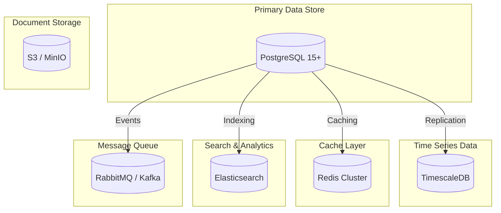
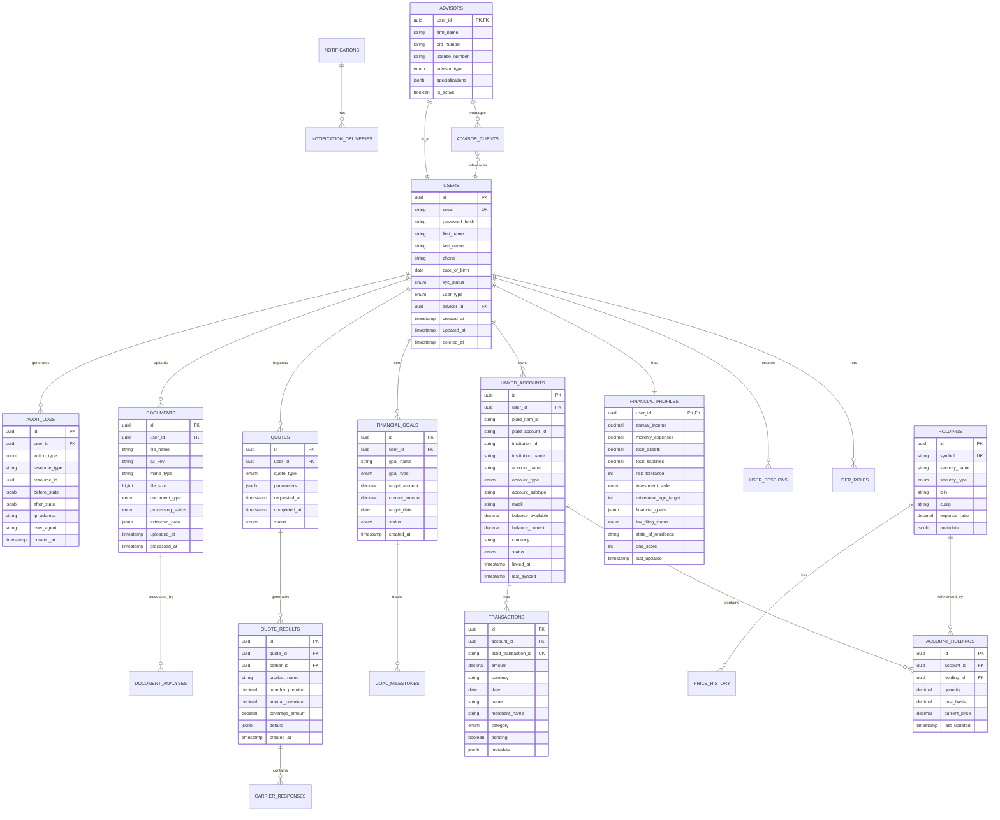
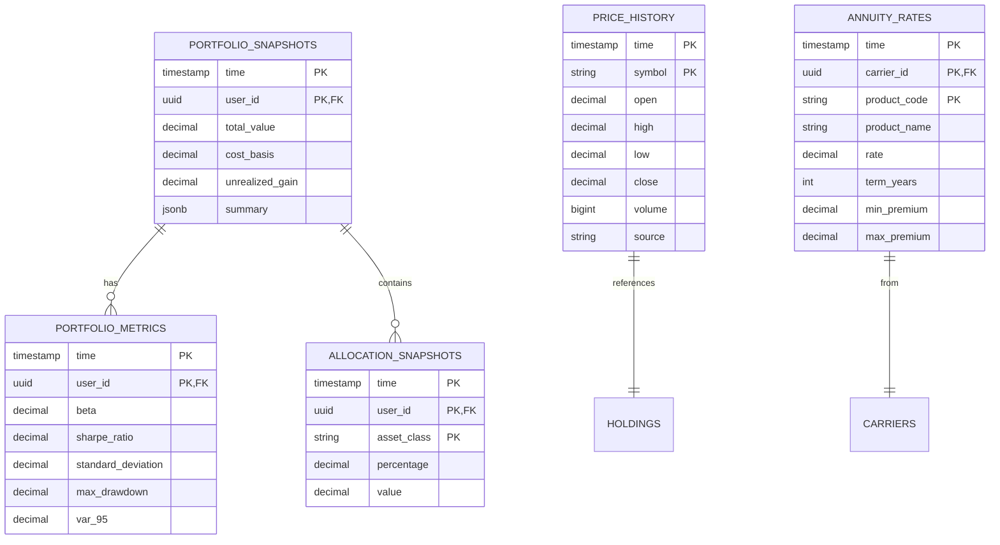
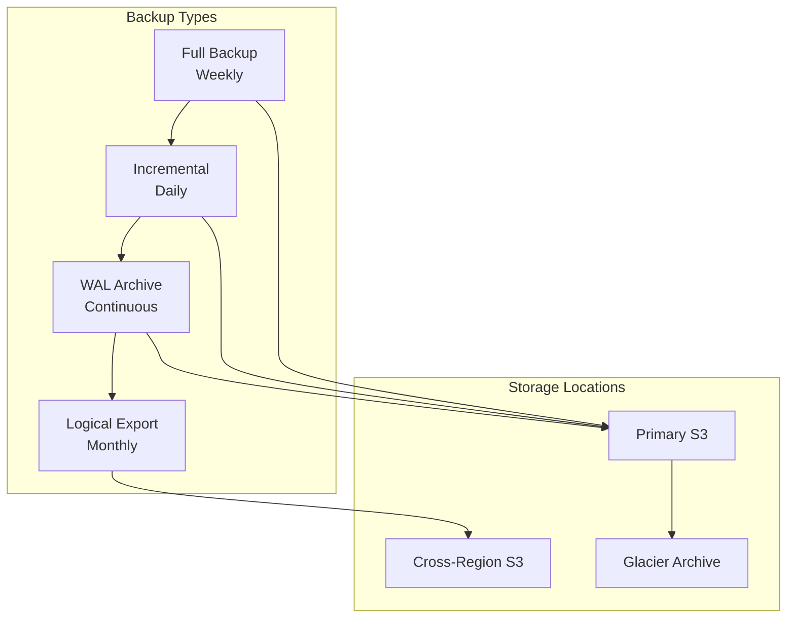

# Fiduciary OS™ - Database Design

## Table of Contents
1. [Data Model Overview](#data-model-overview)
2. [Entity Relationship Diagrams](#entity-relationship-diagrams)
3. [Schema Designs](#schema-designs)
4. [Data Retention Policies](#data-retention-policies)
5. [Backup and Disaster Recovery](#backup-and-disaster-recovery)
6. [Performance Optimization](#performance-optimization)

---

## Data Model Overview

### Database Architecture



### Data Classification

| Category | Data Types | Storage | Retention |
|----------|------------|---------|-----------|
| **Identity** | User profiles, credentials | PostgreSQL | Permanent |
| **Financial** | Account balances, transactions | PostgreSQL + TimescaleDB | 7 years |
| **Analytical** | Portfolio history, quotes | TimescaleDB | 7 years |
| **Documents** | Statements, policies | S3 + PostgreSQL metadata | 7 years |
| **Sessions** | Login sessions, tokens | Redis | 30 days |
| **Audit** | Security events, access logs | PostgreSQL + S3 | 7 years |
| **Cache** | API responses, computed data | Redis | TTL-based |

---

## Entity Relationship Diagrams

### Core Domain Model



### Time Series Data Model



---

## Schema Designs

### 1. Users & Authentication

```sql
-- Users table
CREATE TABLE users (
    id UUID PRIMARY KEY DEFAULT gen_random_uuid(),
    email VARCHAR(255) UNIQUE NOT NULL,
    password_hash VARCHAR(255) NOT NULL,
    first_name VARCHAR(100) NOT NULL,
    last_name VARCHAR(100) NOT NULL,
    phone VARCHAR(20),
    date_of_birth DATE,
    kyc_status VARCHAR(20) DEFAULT 'pending' CHECK (kyc_status IN ('pending', 'in_review', 'verified', 'rejected')),
    user_type VARCHAR(20) DEFAULT 'consumer' CHECK (user_type IN ('consumer', 'advisor', 'admin')),
    advisor_id UUID REFERENCES users(id),
    email_verified_at TIMESTAMP,
    phone_verified_at TIMESTAMP,
    mfa_enabled BOOLEAN DEFAULT FALSE,
    mfa_secret VARCHAR(255),
    mfa_backup_codes TEXT[],
    last_login_at TIMESTAMP,
    login_attempts INT DEFAULT 0,
    locked_until TIMESTAMP,
    accepted_terms_at TIMESTAMP,
    accepted_privacy_at TIMESTAMP,
    created_at TIMESTAMP DEFAULT CURRENT_TIMESTAMP,
    updated_at TIMESTAMP DEFAULT CURRENT_TIMESTAMP,
    deleted_at TIMESTAMP,
    
    CONSTRAINT valid_email CHECK (email ~* '^[A-Za-z0-9._%+-]+@[A-Za-z0-9.-]+\.[A-Za-z]{2,}$')
);

CREATE INDEX idx_users_email ON users(email);
CREATE INDEX idx_users_advisor ON users(advisor_id) WHERE advisor_id IS NOT NULL;
CREATE INDEX idx_users_deleted ON users(deleted_at) WHERE deleted_at IS NULL;

-- User roles
CREATE TABLE user_roles (
    id UUID PRIMARY KEY DEFAULT gen_random_uuid(),
    user_id UUID NOT NULL REFERENCES users(id) ON DELETE CASCADE,
    role VARCHAR(50) NOT NULL CHECK (role IN ('consumer', 'advisor', 'admin', 'super_admin')),
    granted_by UUID REFERENCES users(id),
    granted_at TIMESTAMP DEFAULT CURRENT_TIMESTAMP,
    expires_at TIMESTAMP,
    UNIQUE(user_id, role)
);

CREATE INDEX idx_user_roles_user ON user_roles(user_id);

-- User sessions
CREATE TABLE user_sessions (
    id UUID PRIMARY KEY DEFAULT gen_random_uuid(),
    user_id UUID NOT NULL REFERENCES users(id) ON DELETE CASCADE,
    session_token_hash VARCHAR(255) NOT NULL,
    refresh_token_hash VARCHAR(255),
    ip_address INET,
    user_agent TEXT,
    device_fingerprint VARCHAR(255),
    mfa_verified BOOLEAN DEFAULT FALSE,
    expires_at TIMESTAMP NOT NULL,
    created_at TIMESTAMP DEFAULT CURRENT_TIMESTAMP,
    last_activity_at TIMESTAMP DEFAULT CURRENT_TIMESTAMP
);

CREATE INDEX idx_sessions_user ON user_sessions(user_id);
CREATE INDEX idx_sessions_token ON user_sessions(session_token_hash);
CREATE INDEX idx_sessions_expires ON user_sessions(expires_at);
```

### 2. Financial Profiles

```sql
-- Financial profiles
CREATE TABLE financial_profiles (
    user_id UUID PRIMARY KEY REFERENCES users(id) ON DELETE CASCADE,
    annual_income DECIMAL(15,2),
    monthly_expenses DECIMAL(12,2),
    total_assets DECIMAL(15,2) DEFAULT 0,
    total_liabilities DECIMAL(15,2) DEFAULT 0,
    risk_tolerance INT CHECK (risk_tolerance BETWEEN 1 AND 5),
    investment_style VARCHAR(30) CHECK (investment_style IN ('passive', 'active_blend', 'dividend_focus', 'growth')),
    retirement_age_target INT CHECK (retirement_age_target BETWEEN 50 AND 80),
    financial_goals JSONB DEFAULT '[]',
    time_horizon VARCHAR(20) CHECK (time_horizon IN ('short_term', 'medium_term', 'long_term')),
    tax_filing_status VARCHAR(30) CHECK (tax_filing_status IN ('single', 'married_filing_jointly', 'married_filing_separately', 'head_of_household')),
    state_of_residence VARCHAR(2),
    employment_status VARCHAR(30),
    dependents INT DEFAULT 0,
    dna_score INT CHECK (dna_score BETWEEN 0 AND 100),
    crypto_comfort_pct DECIMAL(5,2) DEFAULT 5.00,
    notes TEXT,
    last_updated TIMESTAMP DEFAULT CURRENT_TIMESTAMP,
    created_at TIMESTAMP DEFAULT CURRENT_TIMESTAMP
);

CREATE INDEX idx_profiles_dna ON financial_profiles(dna_score);

-- Financial goals
CREATE TABLE financial_goals (
    id UUID PRIMARY KEY DEFAULT gen_random_uuid(),
    user_id UUID NOT NULL REFERENCES users(id) ON DELETE CASCADE,
    goal_name VARCHAR(255) NOT NULL,
    goal_type VARCHAR(50) CHECK (goal_type IN ('emergency_fund', 'retirement', 'home_purchase', 'education', 'debt_payoff', 'vacation', 'other')),
    target_amount DECIMAL(15,2) NOT NULL,
    current_amount DECIMAL(15,2) DEFAULT 0,
    target_date DATE,
    priority INT DEFAULT 3 CHECK (priority BETWEEN 1 AND 5),
    status VARCHAR(20) DEFAULT 'active' CHECK (status IN ('active', 'paused', 'completed', 'cancelled')),
    created_at TIMESTAMP DEFAULT CURRENT_TIMESTAMP,
    completed_at TIMESTAMP
);

CREATE INDEX idx_goals_user ON financial_goals(user_id);
CREATE INDEX idx_goals_status ON financial_goals(status);
```

### 3. Linked Accounts (Plaid Integration)

```sql
-- Plaid items (institution connections)
CREATE TABLE plaid_items (
    id UUID PRIMARY KEY DEFAULT gen_random_uuid(),
    user_id UUID NOT NULL REFERENCES users(id) ON DELETE CASCADE,
    plaid_item_id VARCHAR(255) UNIQUE NOT NULL,
    plaid_access_token_encrypted TEXT NOT NULL,
    institution_id VARCHAR(50),
    institution_name VARCHAR(255),
    status VARCHAR(20) DEFAULT 'active' CHECK (status IN ('active', 'error', 'paused')),
    error_code VARCHAR(50),
    error_message TEXT,
    last_synced_at TIMESTAMP,
    created_at TIMESTAMP DEFAULT CURRENT_TIMESTAMP,
    updated_at TIMESTAMP DEFAULT CURRENT_TIMESTAMP
);

CREATE INDEX idx_plaid_items_user ON plaid_items(user_id);
CREATE INDEX idx_plaid_items_plaid ON plaid_items(plaid_item_id);

-- Linked accounts
CREATE TABLE linked_accounts (
    id UUID PRIMARY KEY DEFAULT gen_random_uuid(),
    user_id UUID NOT NULL REFERENCES users(id) ON DELETE CASCADE,
    plaid_item_id UUID REFERENCES plaid_items(id),
    plaid_account_id VARCHAR(255),
    institution_id VARCHAR(50),
    institution_name VARCHAR(255),
    account_name VARCHAR(255),
    account_type VARCHAR(50) CHECK (account_type IN ('depository', 'credit', 'loan', 'investment', 'other')),
    account_subtype VARCHAR(50),
    mask VARCHAR(4),
    balance_available DECIMAL(15,2),
    balance_current DECIMAL(15,2),
    balance_limit DECIMAL(15,2),
    currency VARCHAR(3) DEFAULT 'USD',
    status VARCHAR(20) DEFAULT 'active' CHECK (status IN ('active', 'inactive', 'error')),
    is_manual BOOLEAN DEFAULT FALSE,
    linked_at TIMESTAMP DEFAULT CURRENT_TIMESTAMP,
    last_synced_at TIMESTAMP,
    UNIQUE(user_id, plaid_account_id)
);

CREATE INDEX idx_accounts_user ON linked_accounts(user_id);
CREATE INDEX idx_accounts_type ON linked_accounts(account_type);
CREATE INDEX idx_accounts_status ON linked_accounts(status);

-- Account holdings
CREATE TABLE account_holdings (
    id UUID PRIMARY KEY DEFAULT gen_random_uuid(),
    account_id UUID NOT NULL REFERENCES linked_accounts(id) ON DELETE CASCADE,
    security_id UUID REFERENCES securities(id),
    symbol VARCHAR(20),
    security_name VARCHAR(255),
    quantity DECIMAL(18,8) NOT NULL,
    cost_basis DECIMAL(15,4),
    cost_basis_total DECIMAL(15,2),
    current_price DECIMAL(15,4),
    current_value DECIMAL(15,2),
    unrealized_gain DECIMAL(15,2),
    last_updated TIMESTAMP DEFAULT CURRENT_TIMESTAMP,
    UNIQUE(account_id, symbol)
);

CREATE INDEX idx_holdings_account ON account_holdings(account_id);
CREATE INDEX idx_holdings_symbol ON account_holdings(symbol);

-- Securities master
CREATE TABLE securities (
    id UUID PRIMARY KEY DEFAULT gen_random_uuid(),
    symbol VARCHAR(20) UNIQUE NOT NULL,
    security_name VARCHAR(255) NOT NULL,
    security_type VARCHAR(50) CHECK (security_type IN ('stock', 'etf', 'mutual_fund', 'bond', 'option', 'crypto', 'other')),
    isin VARCHAR(12),
    cusip VARCHAR(9),
    sedol VARCHAR(7),
    expense_ratio DECIMAL(6,4),
    sector VARCHAR(100),
    industry VARCHAR(100),
    country VARCHAR(2),
    currency VARCHAR(3) DEFAULT 'USD',
    metadata JSONB,
    created_at TIMESTAMP DEFAULT CURRENT_TIMESTAMP,
    updated_at TIMESTAMP DEFAULT CURRENT_TIMESTAMP
);

CREATE INDEX idx_securities_symbol ON securities(symbol);
CREATE INDEX idx_securities_type ON securities(security_type);
```

### 4. Transactions

```sql
-- Transactions (partitioned by date)
CREATE TABLE transactions (
    id UUID,
    account_id UUID NOT NULL REFERENCES linked_accounts(id) ON DELETE CASCADE,
    plaid_transaction_id VARCHAR(255),
    amount DECIMAL(15,2) NOT NULL,
    currency VARCHAR(3) DEFAULT 'USD',
    date DATE NOT NULL,
    name VARCHAR(500),
    merchant_name VARCHAR(255),
    category VARCHAR(100),
    category_detailed VARCHAR(255),
    pending BOOLEAN DEFAULT FALSE,
    payment_channel VARCHAR(20),
    transaction_type VARCHAR(20),
    location JSONB,
    metadata JSONB,
    created_at TIMESTAMP DEFAULT CURRENT_TIMESTAMP,
    updated_at TIMESTAMP DEFAULT CURRENT_TIMESTAMP,
    
    PRIMARY KEY (id, date)
) PARTITION BY RANGE (date);

-- Create monthly partitions
CREATE TABLE transactions_2025_01 PARTITION OF transactions
    FOR VALUES FROM ('2025-01-01') TO ('2025-02-01');
CREATE TABLE transactions_2025_02 PARTITION OF transactions
    FOR VALUES FROM ('2025-02-01') TO ('2025-03-01');
-- ... continue for each month

CREATE INDEX idx_transactions_account ON transactions(account_id);
CREATE INDEX idx_transactions_date ON transactions(date);
CREATE INDEX idx_transactions_plaid ON transactions(plaid_transaction_id);
CREATE INDEX idx_transactions_category ON transactions(category);
```

### 5. Quotes & Insurance

```sql
-- Carriers
CREATE TABLE carriers (
    id UUID PRIMARY KEY DEFAULT gen_random_uuid(),
    carrier_name VARCHAR(255) NOT NULL,
    carrier_code VARCHAR(50) UNIQUE NOT NULL,
    am_best_rating VARCHAR(10),
    s_p_rating VARCHAR(10),
    moody_rating VARCHAR(10),
    website VARCHAR(255),
    support_phone VARCHAR(20),
    is_active BOOLEAN DEFAULT TRUE,
    api_config JSONB,
    created_at TIMESTAMP DEFAULT CURRENT_TIMESTAMP
);

-- Quotes
CREATE TABLE quotes (
    id UUID PRIMARY KEY DEFAULT gen_random_uuid(),
    user_id UUID NOT NULL REFERENCES users(id) ON DELETE CASCADE,
    quote_type VARCHAR(50) CHECK (quote_type IN ('annuity', 'life_insurance', 'disability', 'long_term_care')),
    parameters JSONB NOT NULL,
    status VARCHAR(20) DEFAULT 'pending' CHECK (status IN ('pending', 'processing', 'completed', 'failed', 'expired')),
    expires_at TIMESTAMP,
    requested_at TIMESTAMP DEFAULT CURRENT_TIMESTAMP,
    completed_at TIMESTAMP,
    error_message TEXT
);

CREATE INDEX idx_quotes_user ON quotes(user_id);
CREATE INDEX idx_quotes_type ON quotes(quote_type);
CREATE INDEX idx_quotes_status ON quotes(status);

-- Quote results
CREATE TABLE quote_results (
    id UUID PRIMARY KEY DEFAULT gen_random_uuid(),
    quote_id UUID NOT NULL REFERENCES quotes(id) ON DELETE CASCADE,
    carrier_id UUID REFERENCES carriers(id),
    product_code VARCHAR(100),
    product_name VARCHAR(255),
    monthly_premium DECIMAL(12,2),
    annual_premium DECIMAL(12,2),
    coverage_amount DECIMAL(15,2),
    monthly_income DECIMAL(12,2),
    annual_income DECIMAL(12,2),
    yield_rate DECIMAL(6,4),
    term_years INT,
    features JSONB,
    fees JSONB,
    rating VARCHAR(10),
    is_recommended BOOLEAN DEFAULT FALSE,
    recommendation_reason TEXT,
    created_at TIMESTAMP DEFAULT CURRENT_TIMESTAMP
);

CREATE INDEX idx_quote_results_quote ON quote_results(quote_id);
CREATE INDEX idx_quote_results_carrier ON quote_results(carrier_id);
```

### 6. Documents (The Vault)

```sql
-- Documents
CREATE TABLE documents (
    id UUID PRIMARY KEY DEFAULT gen_random_uuid(),
    user_id UUID NOT NULL REFERENCES users(id) ON DELETE CASCADE,
    file_name VARCHAR(255) NOT NULL,
    s3_bucket VARCHAR(100) NOT NULL,
    s3_key VARCHAR(500) NOT NULL,
    s3_etag VARCHAR(255),
    mime_type VARCHAR(100),
    file_size BIGINT,
    checksum_sha256 VARCHAR(64),
    encryption_key_id VARCHAR(100),
    document_type VARCHAR(50) CHECK (document_type IN ('insurance_policy', 'tax_document', 'estate_document', 'investment_statement', 'identification', 'other')),
    processing_status VARCHAR(20) DEFAULT 'pending' CHECK (processing_status IN ('pending', 'processing', 'completed', 'failed')),
    extracted_data JSONB,
    ocr_text TEXT,
    tags TEXT[],
    uploaded_at TIMESTAMP DEFAULT CURRENT_TIMESTAMP,
    processed_at TIMESTAMP,
    expires_at TIMESTAMP
);

CREATE INDEX idx_documents_user ON documents(user_id);
CREATE INDEX idx_documents_type ON documents(document_type);
CREATE INDEX idx_documents_status ON documents(processing_status);
CREATE INDEX idx_documents_tags ON documents USING GIN(tags);

-- Document shares
CREATE TABLE document_shares (
    id UUID PRIMARY KEY DEFAULT gen_random_uuid(),
    document_id UUID NOT NULL REFERENCES documents(id) ON DELETE CASCADE,
    shared_by UUID NOT NULL REFERENCES users(id),
    shared_with UUID REFERENCES users(id),
    share_token_hash VARCHAR(255),
    permissions VARCHAR(20) CHECK (permissions IN ('read', 'write')),
    expires_at TIMESTAMP,
    accessed_at TIMESTAMP,
    created_at TIMESTAMP DEFAULT CURRENT_TIMESTAMP
);

CREATE INDEX idx_doc_shares_document ON document_shares(document_id);
```

### 7. Audit & Compliance

```sql
-- Audit logs
CREATE TABLE audit_logs (
    id UUID,
    user_id UUID REFERENCES users(id),
    action_type VARCHAR(50) NOT NULL CHECK (action_type IN ('login', 'logout', 'create', 'update', 'delete', 'view', 'export', 'share')),
    resource_type VARCHAR(50) NOT NULL,
    resource_id UUID,
    before_state JSONB,
    after_state JSONB,
    changes JSONB,
    ip_address INET,
    user_agent TEXT,
    session_id UUID,
    request_id VARCHAR(100),
    created_at TIMESTAMP DEFAULT CURRENT_TIMESTAMP,
    
    PRIMARY KEY (id, created_at)
) PARTITION BY RANGE (created_at);

-- Monthly partitions for audit logs
CREATE TABLE audit_logs_2025_01 PARTITION OF audit_logs
    FOR VALUES FROM ('2025-01-01') TO ('2025-02-01');

CREATE INDEX idx_audit_user ON audit_logs(user_id);
CREATE INDEX idx_audit_action ON audit_logs(action_type);
CREATE INDEX idx_audit_resource ON audit_logs(resource_type, resource_id);
CREATE INDEX idx_audit_created ON audit_logs(created_at);

-- GDPR data requests
CREATE TABLE gdpr_requests (
    id UUID PRIMARY KEY DEFAULT gen_random_uuid(),
    user_id UUID NOT NULL REFERENCES users(id),
    request_type VARCHAR(20) CHECK (request_type IN ('access', 'deletion', 'portability', 'rectification')),
    status VARCHAR(20) DEFAULT 'pending' CHECK (status IN ('pending', 'in_progress', 'completed', 'failed')),
    request_details JSONB,
    result_url VARCHAR(500),
    completed_at TIMESTAMP,
    created_at TIMESTAMP DEFAULT CURRENT_TIMESTAMP
);

CREATE INDEX idx_gdpr_user ON gdpr_requests(user_id);
CREATE INDEX idx_gdpr_status ON gdpr_requests(status);
```

### 8. Time Series Tables (TimescaleDB)

```sql
-- Portfolio snapshots (hypertable)
CREATE TABLE portfolio_snapshots (
    time TIMESTAMPTZ NOT NULL,
    user_id UUID NOT NULL,
    total_value DECIMAL(15,2) NOT NULL,
    cost_basis DECIMAL(15,2),
    unrealized_gain DECIMAL(15,2),
    realized_gain_ytd DECIMAL(15,2),
    summary JSONB,
    PRIMARY KEY (time, user_id)
);

-- Convert to hypertable
SELECT create_hypertable('portfolio_snapshots', 'time', chunk_time_interval => INTERVAL '1 day');

CREATE INDEX idx_portfolio_user ON portfolio_snapshots(user_id, time DESC);

-- Price history (hypertable)
CREATE TABLE price_history (
    time TIMESTAMPTZ NOT NULL,
    symbol VARCHAR(20) NOT NULL,
    open DECIMAL(15,4),
    high DECIMAL(15,4),
    low DECIMAL(15,4),
    close DECIMAL(15,4) NOT NULL,
    volume BIGINT,
    adjusted_close DECIMAL(15,4),
    source VARCHAR(50),
    PRIMARY KEY (time, symbol)
);

SELECT create_hypertable('price_history', 'time', chunk_time_interval => INTERVAL '1 week');

CREATE INDEX idx_price_symbol ON price_history(symbol, time DESC);

-- Annuity rates history (hypertable)
CREATE TABLE annuity_rates_history (
    time TIMESTAMPTZ NOT NULL,
    carrier_id UUID NOT NULL,
    product_code VARCHAR(100) NOT NULL,
    product_name VARCHAR(255),
    rate DECIMAL(6,4) NOT NULL,
    term_years INT,
    min_premium DECIMAL(15,2),
    max_premium DECIMAL(15,2),
    PRIMARY KEY (time, carrier_id, product_code)
);

SELECT create_hypertable('annuity_rates_history', 'time', chunk_time_interval => INTERVAL '1 day');

CREATE INDEX idx_annuity_carrier ON annuity_rates_history(carrier_id, time DESC);
```

---

## Data Retention Policies

### Retention Matrix

| Data Type | Retention Period | Action After Retention | Legal Basis |
|-----------|------------------|------------------------|-------------|
| User accounts | 7 years after closure | Anonymize | FINRA, SEC |
| Transaction history | 7 years | Archive to cold storage | FINRA 4511 |
| Portfolio snapshots | 7 years | Aggregate and archive | Client service |
| Quotes | 3 years | Delete | Business need |
| Documents | 7 years | Archive to glacier | Regulatory |
| Audit logs | 7 years | Archive to S3 Glacier | Compliance |
| Session data | 30 days | Delete | Security |
| API logs | 90 days | Delete | Operations |
| Error logs | 30 days | Delete | Operations |
| Cache data | TTL-based | Auto-expire | Performance |

### Automated Retention Implementation

```sql
-- TimescaleDB retention policies
SELECT add_retention_policy('portfolio_snapshots', INTERVAL '7 years');
SELECT add_retention_policy('price_history', INTERVAL '2 years');
SELECT add_retention_policy('annuity_rates_history', INTERVAL '3 years');

-- PostgreSQL partition management (automated via cron)
-- Create new partitions monthly
-- Drop old partitions after retention period

-- Soft delete implementation for users
CREATE OR REPLACE FUNCTION soft_delete_user(user_uuid UUID)
RETURNS VOID AS $$
BEGIN
    UPDATE users SET 
        deleted_at = CURRENT_TIMESTAMP,
        email = 'deleted_' || id || '@deleted.fiduciaryos.com',
        password_hash = NULL,
        phone = NULL,
        first_name = 'Deleted',
        last_name = 'User'
    WHERE id = user_uuid;
    
    -- Delete sensitive data from related tables
    DELETE FROM user_sessions WHERE user_id = user_uuid;
    DELETE FROM plaid_items WHERE user_id = user_uuid;
    
    -- Log the deletion
    INSERT INTO audit_logs (user_id, action_type, resource_type, resource_id, after_state)
    VALUES (user_uuid, 'delete', 'user', user_uuid, '{"status": "soft_deleted"}'::jsonb);
END;
$$ LANGUAGE plpgsql;

-- GDPR data export function
CREATE OR REPLACE FUNCTION export_user_data(user_uuid UUID)
RETURNS JSONB AS $$
DECLARE
    result JSONB;
BEGIN
    SELECT jsonb_build_object(
        'user', (SELECT to_jsonb(u.*) FROM users u WHERE u.id = user_uuid),
        'profile', (SELECT to_jsonb(fp.*) FROM financial_profiles fp WHERE fp.user_id = user_uuid),
        'accounts', (SELECT jsonb_agg(to_jsonb(la.*)) FROM linked_accounts la WHERE la.user_id = user_uuid),
        'transactions', (SELECT jsonb_agg(to_jsonb(t.*)) FROM transactions t 
                         JOIN linked_accounts la ON t.account_id = la.id 
                         WHERE la.user_id = user_uuid),
        'quotes', (SELECT jsonb_agg(to_jsonb(q.*)) FROM quotes q WHERE q.user_id = user_uuid),
        'documents', (SELECT jsonb_agg(to_jsonb(d.*)) FROM documents d WHERE d.user_id = user_uuid),
        'goals', (SELECT jsonb_agg(to_jsonb(fg.*)) FROM financial_goals fg WHERE fg.user_id = user_uuid)
    ) INTO result;
    
    RETURN result;
END;
$$ LANGUAGE plpgsql;
```

---

## Backup and Disaster Recovery

### Backup Strategy



### Backup Configuration

```sql
-- PostgreSQL backup configuration
-- postgresql.conf settings:
wal_level = replica
archive_mode = on
archive_command = 'aws s3 cp %p s3://fiduciaryos-wal-archive/%f'
max_wal_senders = 3

-- pgBackRest configuration
-- Full backup: Sundays at 2 AM
-- Incremental: Daily at 2 AM
-- Retention: 4 full backups
```

### Backup Schedule

| Type | Frequency | Retention | Storage |
|------|-----------|-----------|---------|
| Full Database | Weekly | 4 weeks | S3 Standard |
| Incremental | Daily | 7 days | S3 Standard |
| WAL Archive | Continuous | 7 days | S3 Standard |
| Logical Export | Monthly | 12 months | S3 Glacier |
| Cross-Region | Weekly | 4 weeks | S3 Cross-Region |

### Disaster Recovery Procedures

#### RTO/RPO Targets

| Scenario | RTO | RPO |
|----------|-----|-----|
| Single AZ failure | 5 minutes | 0 (synchronous replica) |
| Region failure | 1 hour | 5 minutes (async replica) |
| Database corruption | 30 minutes | 1 hour (point-in-time) |
| Complete disaster | 4 hours | 24 hours |

#### Failover Procedures

```sql
-- Promote read replica to primary
-- On replica server:
SELECT pg_promote();

-- Update application connection strings
-- Verify replication lag is 0
SELECT EXTRACT(EPOCH FROM (now() - pg_last_xact_replay_timestamp())) AS lag_seconds;

-- Point-in-time recovery
-- Use pgBackRest restore
pgbackrest restore --type=time --target="2025-01-15 10:00:00"
```

---

## Performance Optimization

### Indexing Strategy

```sql
-- Composite indexes for common queries
CREATE INDEX idx_transactions_account_date 
    ON transactions(account_id, date DESC);

CREATE INDEX idx_holdings_account_symbol 
    ON account_holdings(account_id, symbol);

-- Partial indexes for active records
CREATE INDEX idx_active_accounts 
    ON linked_accounts(user_id) 
    WHERE status = 'active';

-- GIN indexes for JSONB
CREATE INDEX idx_quotes_params 
    ON quotes USING GIN(parameters);

-- Expression indexes for case-insensitive search
CREATE INDEX idx_users_email_lower 
    ON users(LOWER(email));
```

### Query Optimization

```sql
-- Materialized view for dashboard metrics
CREATE MATERIALIZED VIEW user_dashboard_metrics AS
SELECT 
    u.id as user_id,
    u.email,
    fp.total_assets,
    fp.dna_score,
    COUNT(DISTINCT la.id) as linked_accounts_count,
    COUNT(DISTINCT fg.id) as active_goals_count,
    (SELECT total_value FROM portfolio_snapshots ps 
     WHERE ps.user_id = u.id ORDER BY time DESC LIMIT 1) as latest_portfolio_value
FROM users u
LEFT JOIN financial_profiles fp ON u.id = fp.user_id
LEFT JOIN linked_accounts la ON u.id = la.user_id AND la.status = 'active'
LEFT JOIN financial_goals fg ON u.id = fg.user_id AND fg.status = 'active'
WHERE u.deleted_at IS NULL
GROUP BY u.id, fp.total_assets, fp.dna_score;

-- Refresh every 15 minutes
-- CREATE OR REPLACE FUNCTION refresh_dashboard_metrics()
-- Could use pg_cron for scheduling
```

### Connection Pooling (PgBouncer)

```ini
; pgbouncer.ini
databases]
fiduciaryos = host=localhost port=5432 dbname=fiduciaryos

[pgbouncer]
listen_port = 6432
listen_addr = 0.0.0.0
auth_type = md5
auth_file = /etc/pgbouncer/userlist.txt

; Pool settings
pool_mode = transaction
max_client_conn = 10000
default_pool_size = 25
min_pool_size = 5
reserve_pool_size = 5
reserve_pool_timeout = 3

; Timeouts
server_idle_timeout = 600
server_lifetime = 3600
client_idle_timeout = 0
client_login_timeout = 60
```

---

## Next Steps

1. **Schema Migration Tool**: Implement Flyway or Liquibase for version control
2. **Data Seeding**: Create development and test data sets
3. **Performance Baseline**: Establish query performance benchmarks
4. **Monitoring Setup**: Configure query performance monitoring
5. **Security Review**: Conduct database security audit

---

*Document Version: 1.0*
*Last Updated: January 2025*
*Owner: Data Engineering Team*
