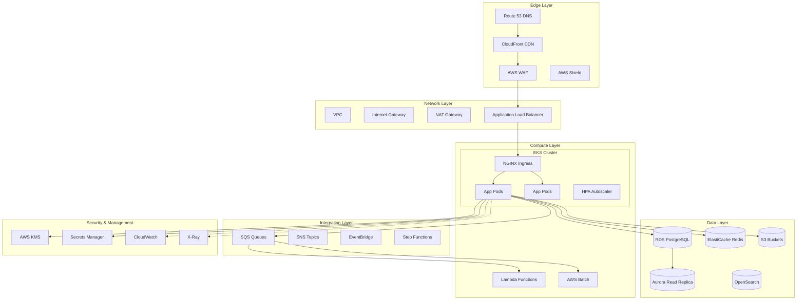
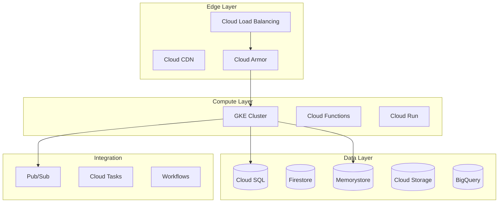
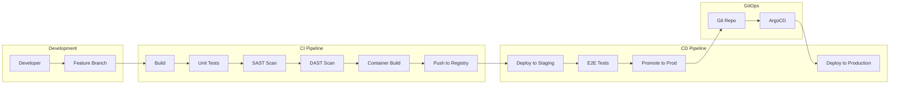
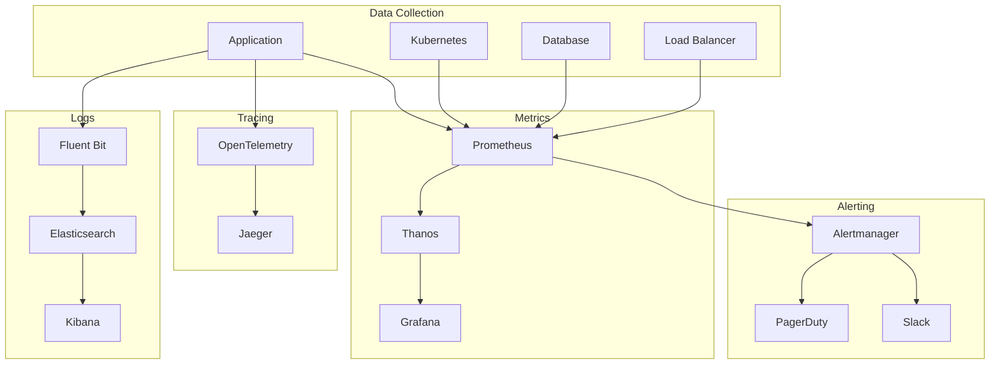
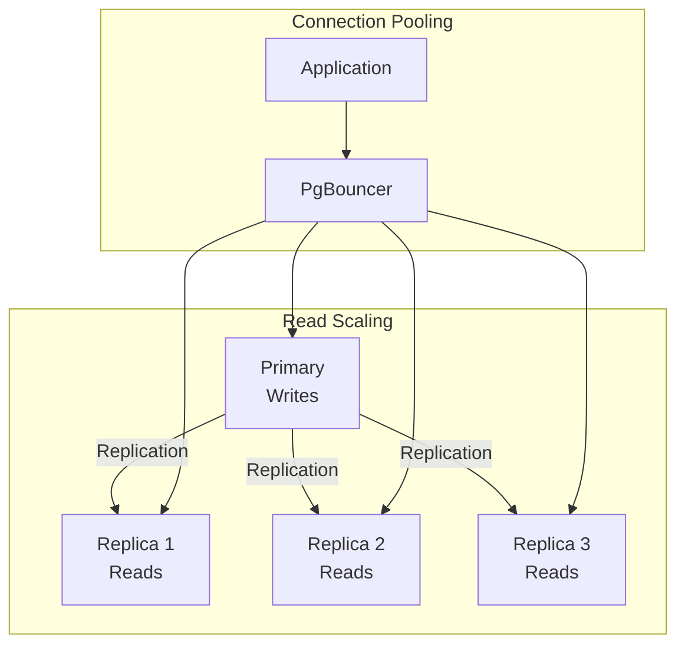
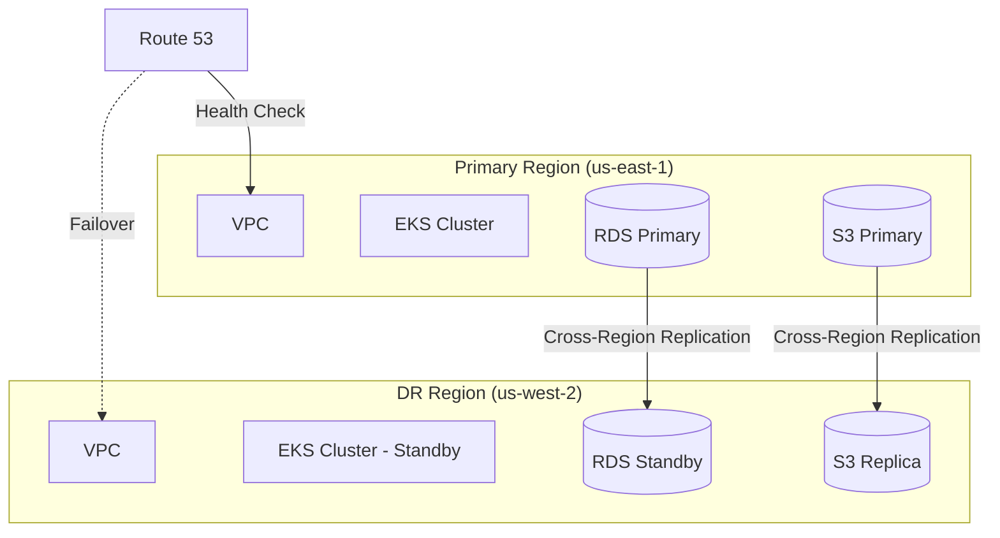

# Fiduciary OS™ - Deployment Architecture

## Table of Contents
1. [Cloud Infrastructure Recommendations](#cloud-infrastructure-recommendations)
2. [CI/CD Pipeline Design](#cicd-pipeline-design)
3. [Environment Strategy](#environment-strategy)
4. [Monitoring and Observability](#monitoring-and-observability)
5. [Scaling Strategy](#scaling-strategy)

---

## Cloud Infrastructure Recommendations

### AWS Reference Architecture



### GCP Alternative Architecture



### Infrastructure as Code (Terraform)

```hcl
# main.tf - AWS Infrastructure
terraform {
  required_providers {
    aws = {
      source  = "hashicorp/aws"
      version = "~> 5.0"
    }
    kubernetes = {
      source  = "hashicorp/kubernetes"
      version = "~> 2.0"
    }
  }
  
  backend "s3" {
    bucket = "fiduciaryos-terraform-state"
    key    = "infrastructure/terraform.tfstate"
    region = "us-east-1"
    encrypt = true
  }
}

# VPC Configuration
module "vpc" {
  source  = "terraform-aws-modules/vpc/aws"
  version = "5.0.0"

  name = "fiduciaryos-vpc"
  cidr = "10.0.0.0/16"

  azs             = ["us-east-1a", "us-east-1b", "us-east-1c"]
  private_subnets = ["10.0.1.0/24", "10.0.2.0/24", "10.0.3.0/24"]
  public_subnets  = ["10.0.101.0/24", "10.0.102.0/24", "10.0.103.0/24"]
  database_subnets = ["10.0.201.0/24", "10.0.202.0/24", "10.0.203.0/24"]

  enable_nat_gateway = true
  single_nat_gateway = false
  enable_vpn_gateway = false

  tags = {
    Environment = var.environment
    Project     = "fiduciaryos"
  }
}

# EKS Cluster
module "eks" {
  source  = "terraform-aws-modules/eks/aws"
  version = "19.0.0"

  cluster_name    = "fiduciaryos-${var.environment}"
  cluster_version = "1.28"

  vpc_id     = module.vpc.vpc_id
  subnet_ids = module.vpc.private_subnets

  eks_managed_node_groups = {
    general = {
      desired_size = 3
      min_size     = 2
      max_size     = 10

      instance_types = ["m6i.xlarge"]
      capacity_type  = "ON_DEMAND"

      labels = {
        workload = "general"
      }
    }
    
    spot = {
      desired_size = 2
      min_size     = 1
      max_size     = 20

      instance_types = ["m6i.large", "m5.large", "m5a.large"]
      capacity_type  = "SPOT"

      labels = {
        workload = "batch"
      }
      
      taints = [{
        key    = "spot"
        value  = "true"
        effect = "NO_SCHEDULE"
      }]
    }
  }

  cluster_addons = {
    coredns = {
      most_recent = true
    }
    kube-proxy = {
      most_recent = true
    }
    vpc-cni = {
      most_recent = true
    }
    aws-ebs-csi-driver = {
      most_recent = true
    }
  }
}

# RDS PostgreSQL
module "rds" {
  source  = "terraform-aws-modules/rds/aws"
  version = "6.0.0"

  identifier = "fiduciaryos-${var.environment}"

  engine               = "postgres"
  engine_version       = "15.4"
  family               = "postgres15"
  major_engine_version = "15"
  instance_class       = var.environment == "production" ? "db.r6g.xlarge" : "db.t3.medium"

  allocated_storage     = 100
  max_allocated_storage = 1000

  db_name  = "fiduciaryos"
  username = "postgres"
  port     = 5432

  multi_az               = var.environment == "production"
  db_subnet_group_name   = module.vpc.database_subnet_group_name
  vpc_security_group_ids = [aws_security_group.rds.id]

  backup_retention_period = 7
  backup_window          = "03:00-04:00"
  maintenance_window     = "Mon:04:00-Mon:05:00"

  enabled_cloudwatch_logs_exports = ["postgresql", "upgrade"]

  deletion_protection = var.environment == "production"
}

# ElastiCache Redis
module "elasticache" {
  source  = "terraform-aws-modules/elasticache/aws"
  version = "1.0.0"

  cluster_id           = "fiduciaryos-${var.environment}"
  engine               = "redis"
  engine_version       = "7.0"
  node_type            = var.environment == "production" ? "cache.r6g.large" : "cache.t3.micro"
  num_cache_nodes      = var.environment == "production" ? 2 : 1
  parameter_group_name = "default.redis7"
  port                 = 6379

  subnet_group_name  = aws_elasticache_subnet_group.redis.name
  security_group_ids = [aws_security_group.redis.id]

  at_rest_encryption_enabled = true
  transit_encryption_enabled = true
}

# Application Load Balancer
module "alb" {
  source  = "terraform-aws-modules/alb/aws"
  version = "9.0.0"

  name = "fiduciaryos-${var.environment}"

  load_balancer_type = "application"
  internal           = false

  vpc_id  = module.vpc.vpc_id
  subnets = module.vpc.public_subnets

  security_groups = [aws_security_group.alb.id]

  listeners = {
    https = {
      port            = 443
      protocol        = "HTTPS"
      certificate_arn = aws_acm_certificate.main.arn
      
      fixed_response = {
        content_type = "text/plain"
        message_body = "OK"
        status_code  = "200"
      }
    }
  }

  target_groups = {
    api = {
      name_prefix          = "api-"
      protocol             = "HTTPS"
      port                 = 8080
      target_type          = "ip"
      deregistration_delay = 30
      
      health_check = {
        enabled             = true
        healthy_threshold   = 2
        interval            = 30
        matcher             = "200"
        path                = "/health"
        port                = "traffic-port"
        protocol            = "HTTPS"
        timeout             = 5
        unhealthy_threshold = 3
      }
    }
  }
}
```

---

## CI/CD Pipeline Design

### GitOps Workflow



### GitHub Actions Workflow

```yaml
# .github/workflows/ci-cd.yml
name: CI/CD Pipeline

on:
  push:
    branches: [main, develop]
  pull_request:
    branches: [main]

env:
  AWS_REGION: us-east-1
  ECR_REPOSITORY: fiduciaryos
  EKS_CLUSTER: fiduciaryos-production

jobs:
  build:
    runs-on: ubuntu-latest
    steps:
      - uses: actions/checkout@v4
      
      - name: Setup Node.js
        uses: actions/setup-node@v4
        with:
          node-version: '20'
          cache: 'npm'
      
      - name: Install dependencies
        run: npm ci
      
      - name: Lint
        run: npm run lint
      
      - name: Unit Tests
        run: npm run test:unit -- --coverage
      
      - name: Upload coverage
        uses: codecov/codecov-action@v3
        with:
          files: ./coverage/lcov.info

  security-scan:
    runs-on: ubuntu-latest
    needs: build
    steps:
      - uses: actions/checkout@v4
      
      - name: Run SAST (SonarCloud)
        uses: SonarSource/sonarcloud-github-action@master
        env:
          GITHUB_TOKEN: ${{ secrets.GITHUB_TOKEN }}
          SONAR_TOKEN: ${{ secrets.SONAR_TOKEN }}
      
      - name: Run Dependency Check
        uses: snyk/actions/node@master
        env:
          SNYK_TOKEN: ${{ secrets.SNYK_TOKEN }}
        with:
          args: --severity-threshold=high
      
      - name: Secret Detection
        uses: trufflesecurity/trufflehog@main
        with:
          path: ./
          base: main
          head: HEAD

  build-image:
    runs-on: ubuntu-latest
    needs: [build, security-scan]
    if: github.ref == 'refs/heads/main'
    steps:
      - uses: actions/checkout@v4
      
      - name: Configure AWS credentials
        uses: aws-actions/configure-aws-credentials@v4
        with:
          aws-access-key-id: ${{ secrets.AWS_ACCESS_KEY_ID }}
          aws-secret-access-key: ${{ secrets.AWS_SECRET_ACCESS_KEY }}
          aws-region: ${{ env.AWS_REGION }}
      
      - name: Login to Amazon ECR
        id: login-ecr
        uses: aws-actions/amazon-ecr-login@v2
      
      - name: Build and push image
        env:
          ECR_REGISTRY: ${{ steps.login-ecr.outputs.registry }}
          IMAGE_TAG: ${{ github.sha }}
        run: |
          docker build -t $ECR_REGISTRY/$ECR_REPOSITORY:$IMAGE_TAG .
          docker push $ECR_REGISTRY/$ECR_REPOSITORY:$IMAGE_TAG
          docker tag $ECR_REGISTRY/$ECR_REPOSITORY:$IMAGE_TAG $ECR_REGISTRY/$ECR_REPOSITORY:latest
          docker push $ECR_REGISTRY/$ECR_REPOSITORY:latest
      
      - name: Scan image with Trivy
        uses: aquasecurity/trivy-action@master
        with:
          image-ref: ${{ steps.login-ecr.outputs.registry }}/${{ env.ECR_REPOSITORY }}:${{ github.sha }}
          format: 'sarif'
          output: 'trivy-results.sarif'
      
      - name: Upload scan results
        uses: github/codeql-action/upload-sarif@v2
        with:
          sarif_file: 'trivy-results.sarif'

  deploy-staging:
    runs-on: ubuntu-latest
    needs: build-image
    environment: staging
    steps:
      - uses: actions/checkout@v4
      
      - name: Configure AWS credentials
        uses: aws-actions/configure-aws-credentials@v4
        with:
          aws-access-key-id: ${{ secrets.AWS_ACCESS_KEY_ID }}
          aws-secret-access-key: ${{ secrets.AWS_SECRET_ACCESS_KEY }}
          aws-region: ${{ env.AWS_REGION }}
      
      - name: Update kubeconfig
        run: aws eks update-kubeconfig --name fiduciaryos-staging
      
      - name: Deploy to staging
        run: |
          kubectl set image deployment/api api=${{ steps.login-ecr.outputs.registry }}/${{ env.ECR_REPOSITORY }}:${{ github.sha }} -n staging
          kubectl rollout status deployment/api -n staging --timeout=300s
      
      - name: Run smoke tests
        run: npm run test:smoke -- --env staging

  e2e-tests:
    runs-on: ubuntu-latest
    needs: deploy-staging
    steps:
      - uses: actions/checkout@v4
      
      - name: Run E2E tests
        run: npm run test:e2e
        env:
          BASE_URL: https://staging.fiduciaryos.com
      
      - name: Upload test results
        uses: actions/upload-artifact@v3
        if: failure()
        with:
          name: e2e-screenshots
          path: cypress/screenshots/

  deploy-production:
    runs-on: ubuntu-latest
    needs: e2e-tests
    environment: production
    if: github.ref == 'refs/heads/main'
    steps:
      - uses: actions/checkout@v4
      
      - name: Configure AWS credentials
        uses: aws-actions/configure-aws-credentials@v4
        with:
          aws-access-key-id: ${{ secrets.AWS_ACCESS_KEY_ID }}
          aws-secret-access-key: ${{ secrets.AWS_SECRET_ACCESS_KEY }}
          aws-region: ${{ env.AWS_REGION }}
      
      - name: Update kubeconfig
        run: aws eks update-kubeconfig --name ${{ env.EKS_CLUSTER }}
      
      - name: Deploy to production (Canary)
        run: |
          # Deploy canary (10% traffic)
          kubectl apply -f k8s/canary-deployment.yaml
          kubectl set image deployment/api-canary api=${{ steps.login-ecr.outputs.registry }}/${{ env.ECR_REPOSITORY }}:${{ github.sha }} -n production
          kubectl rollout status deployment/api-canary -n production --timeout=300s
      
      - name: Monitor canary
        run: |
          # Wait and monitor error rates
          sleep 300
          ERROR_RATE=$(kubectl exec -it deployment/monitoring -n production -- curl -s http://prometheus:9090/api/v1/query?query='sum(rate(http_requests_total{status=~"5.."}[5m]))/sum(rate(http_requests_total[5m]))' | jq -r '.data.result[0].value[1]')
          if (( $(echo "$ERROR_RATE > 0.01" | bc -l) )); then
            echo "Error rate too high: $ERROR_RATE"
            kubectl rollout undo deployment/api-canary -n production
            exit 1
          fi
      
      - name: Promote to full deployment
        run: |
          kubectl set image deployment/api api=${{ steps.login-ecr.outputs.registry }}/${{ env.ECR_REPOSITORY }}:${{ github.sha }} -n production
          kubectl rollout status deployment/api -n production --timeout=600s
      
      - name: Notify Slack
        uses: 8398a7/action-slack@v3
        with:
          status: ${{ job.status }}
          channel: '#deployments'
          text: 'Production deployment complete: ${{ github.sha }}'
        env:
          SLACK_WEBHOOK_URL: ${{ secrets.SLACK_WEBHOOK_URL }}
```

### Kubernetes Deployment Manifests

```yaml
# k8s/base/deployment.yaml
apiVersion: apps/v1
kind: Deployment
metadata:
  name: api
  namespace: production
  labels:
    app: api
    version: v1
spec:
  replicas: 3
  strategy:
    type: RollingUpdate
    rollingUpdate:
      maxSurge: 25%
      maxUnavailable: 0
  selector:
    matchLabels:
      app: api
  template:
    metadata:
      labels:
        app: api
      annotations:
        prometheus.io/scrape: "true"
        prometheus.io/port: "8080"
        prometheus.io/path: "/metrics"
    spec:
      serviceAccountName: api-service-account
      securityContext:
        runAsNonRoot: true
        runAsUser: 1000
        fsGroup: 1000
      containers:
        - name: api
          image: fiduciaryos/api:latest
          imagePullPolicy: Always
          ports:
            - name: http
              containerPort: 8080
              protocol: TCP
          env:
            - name: NODE_ENV
              value: "production"
            - name: DATABASE_URL
              valueFrom:
                secretKeyRef:
                  name: api-secrets
                  key: database-url
            - name: REDIS_URL
              valueFrom:
                secretKeyRef:
                  name: api-secrets
                  key: redis-url
          resources:
            requests:
              memory: "512Mi"
              cpu: "250m"
            limits:
              memory: "1Gi"
              cpu: "1000m"
          livenessProbe:
            httpGet:
              path: /health/live
              port: 8080
            initialDelaySeconds: 30
            periodSeconds: 10
            timeoutSeconds: 5
            failureThreshold: 3
          readinessProbe:
            httpGet:
              path: /health/ready
              port: 8080
            initialDelaySeconds: 5
            periodSeconds: 5
            timeoutSeconds: 3
            failureThreshold: 3
          securityContext:
            allowPrivilegeEscalation: false
            readOnlyRootFilesystem: true
            capabilities:
              drop:
                - ALL
          volumeMounts:
            - name: tmp
              mountPath: /tmp
      volumes:
        - name: tmp
          emptyDir: {}
      affinity:
        podAntiAffinity:
          preferredDuringSchedulingIgnoredDuringExecution:
            - weight: 100
              podAffinityTerm:
                labelSelector:
                  matchExpressions:
                    - key: app
                      operator: In
                      values:
                        - api
                topologyKey: kubernetes.io/hostname
---
# k8s/base/hpa.yaml
apiVersion: autoscaling/v2
kind: HorizontalPodAutoscaler
metadata:
  name: api-hpa
  namespace: production
spec:
  scaleTargetRef:
    apiVersion: apps/v1
    kind: Deployment
    name: api
  minReplicas: 3
  maxReplicas: 50
  metrics:
    - type: Resource
      resource:
        name: cpu
        target:
          type: Utilization
          averageUtilization: 70
    - type: Resource
      resource:
        name: memory
        target:
          type: Utilization
          averageUtilization: 80
    - type: Pods
      pods:
        metric:
          name: http_requests_per_second
        target:
          type: AverageValue
          averageValue: "1000"
  behavior:
    scaleUp:
      stabilizationWindowSeconds: 60
      policies:
        - type: Percent
          value: 100
          periodSeconds: 60
    scaleDown:
      stabilizationWindowSeconds: 300
      policies:
        - type: Percent
          value: 10
          periodSeconds: 60
---
# k8s/base/canary.yaml
apiVersion: flagger.app/v1beta1
kind: Canary
metadata:
  name: api
  namespace: production
spec:
  targetRef:
    apiVersion: apps/v1
    kind: Deployment
    name: api
  service:
    port: 8080
    gateways:
      - istio-gateway
    hosts:
      - api.fiduciaryos.com
  analysis:
    interval: 30s
    threshold: 5
    maxWeight: 50
    stepWeight: 10
    metrics:
      - name: request-success-rate
        thresholdRange:
          min: 99
        interval: 1m
      - name: request-duration
        thresholdRange:
          max: 500
        interval: 1m
    webhooks:
      - name: load-test
        url: http://flagger-loadtester.test/
        timeout: 5s
        metadata:
          cmd: "hey -z 1m -q 10 -c 2 http://api:8080/"
```

---

## Environment Strategy

### Environment Matrix

| Environment | Purpose | Data | Availability | Access |
|-------------|---------|------|--------------|--------|
| **Local** | Development | Mock/Synthetic | Developer machine | Developers |
| **Dev** | Feature testing | Synthetic | On-demand | Developers |
| **Staging** | Integration testing | Anonymized prod | 24/7 | Team |
| **Production** | Live system | Real customer | 99.9% SLA | Limited |
| **DR** | Disaster recovery | Replicated | Standby | On failover |

### Environment Configuration

```yaml
# config/environments/production.yaml
environment: production

server:
  port: 8080
  timeout:
    read: 30s
    write: 30s
    idle: 120s

database:
  pool:
    min: 10
    max: 50
  timeout: 30s
  retries: 3

redis:
  cluster: true
  nodes: 6
  timeout: 5s

features:
  new_navigator: false
  ai_recommendations: true
  advanced_analytics: true

logging:
  level: info
  format: json
  sampling:
    initial: 100
    thereafter: 10000

metrics:
  enabled: true
  endpoint: /metrics
  port: 9090

tracing:
  enabled: true
  sampler:
    type: probabilistic
    param: 0.1
```

### Feature Flags

```typescript
// Feature flag service
interface FeatureFlag {
    name: string;
    enabled: boolean;
    rolloutPercentage: number;
    targetUsers?: string[];
    targetSegments?: string[];
}

class FeatureFlagService {
    private flags: Map<string, FeatureFlag> = new Map();
    private redis: Redis;

    async isEnabled(flagName: string, userId?: string): Promise<boolean> {
        const flag = await this.getFlag(flagName);
        
        if (!flag) return false;
        if (flag.enabled === false) return false;
        if (flag.rolloutPercentage === 100) return true;
        if (flag.rolloutPercentage === 0) return false;
        
        // Check targeted users
        if (userId && flag.targetUsers?.includes(userId)) {
            return true;
        }
        
        // Percentage-based rollout
        if (userId) {
            const hash = this.hashUserId(userId, flagName);
            return hash <= flag.rolloutPercentage;
        }
        
        return false;
    }

    private hashUserId(userId: string, flagName: string): number {
        const crypto = require('crypto');
        const hash = crypto
            .createHash('md5')
            .update(`${userId}:${flagName}`)
            .digest('hex');
        return parseInt(hash.substring(0, 4), 16) % 100;
    }

    private async getFlag(name: string): Promise<FeatureFlag | null> {
        // Check cache first
        const cached = await this.redis.get(`flag:${name}`);
        if (cached) return JSON.parse(cached);
        
        // Fetch from database
        const flag = await db.featureFlags.findOne({ name });
        if (flag) {
            await this.redis.setex(`flag:${name}`, 60, JSON.stringify(flag));
        }
        
        return flag;
    }
}
```

---

## Monitoring and Observability

### Observability Stack



### Key Metrics

| Category | Metric | Target | Alert Threshold |
|----------|--------|--------|-----------------|
| **Availability** | Uptime | 99.9% | < 99.5% |
| **Latency** | p95 Response Time | < 200ms | > 500ms |
| **Latency** | p99 Response Time | < 500ms | > 1000ms |
| **Errors** | Error Rate | < 0.1% | > 1% |
| **Saturation** | CPU Utilization | < 70% | > 85% |
| **Saturation** | Memory Utilization | < 80% | > 90% |
| **Saturation** | Database Connections | < 80% | > 90% |
| **Business** | Daily Active Users | Growth | Decline |
| **Business** | Quote Conversion Rate | > 5% | < 2% |

### Prometheus Alert Rules

```yaml
# prometheus/alerts.yaml
groups:
  - name: api_alerts
    rules:
      - alert: HighErrorRate
        expr: |
          sum(rate(http_requests_total{status=~"5.."}[5m])) 
          / sum(rate(http_requests_total[5m])) > 0.01
        for: 5m
        labels:
          severity: critical
        annotations:
          summary: "High error rate detected"
          description: "Error rate is {{ $value | humanizePercentage }}"

      - alert: HighLatency
        expr: |
          histogram_quantile(0.95, 
            sum(rate(http_request_duration_seconds_bucket[5m])) by (le)
          ) > 0.5
        for: 10m
        labels:
          severity: warning
        annotations:
          summary: "High latency detected"
          description: "p95 latency is {{ $value }}s"

      - alert: DatabaseConnectionsHigh
        expr: |
          postgres_stat_activity_count / postgres_settings_max_connections > 0.8
        for: 5m
        labels:
          severity: warning
        annotations:
          summary: "Database connections high"
          description: "{{ $value | humanizePercentage }} of connections used"

      - alert: PodCrashLooping
        expr: |
          rate(kube_pod_container_status_restarts_total[15m]) > 0
        for: 5m
        labels:
          severity: critical
        annotations:
          summary: "Pod is crash looping"
          description: "Pod {{ $labels.pod }} is restarting frequently"

      - alert: CertificateExpiringSoon
        expr: |
          (certmanager_certificate_expiration_timestamp_seconds - time()) / 86400 < 30
        for: 1h
        labels:
          severity: warning
        annotations:
          summary: "TLS certificate expiring soon"
          description: "Certificate expires in {{ $value }} days"
```

### Grafana Dashboard

```json
{
  "dashboard": {
    "title": "Fiduciary OS - API Overview",
    "panels": [
      {
        "title": "Request Rate",
        "type": "graph",
        "targets": [
          {
            "expr": "sum(rate(http_requests_total[5m])) by (status)"
          }
        ]
      },
      {
        "title": "Response Time (p95)",
        "type": "graph",
        "targets": [
          {
            "expr": "histogram_quantile(0.95, sum(rate(http_request_duration_seconds_bucket[5m])) by (le))"
          }
        ]
      },
      {
        "title": "Error Rate",
        "type": "singlestat",
        "targets": [
          {
            "expr": "sum(rate(http_requests_total{status=~\"5..\"}[5m])) / sum(rate(http_requests_total[5m]))"
          }
        ]
      },
      {
        "title": "Pod Status",
        "type": "table",
        "targets": [
          {
            "expr": "kube_pod_status_phase{namespace=\"production\"}"
          }
        ]
      }
    ]
  }
}
```

### Distributed Tracing

```typescript
// OpenTelemetry configuration
import { NodeSDK } from '@opentelemetry/sdk-node';
import { JaegerExporter } from '@opentelemetry/exporter-jaeger';
import { getNodeAutoInstrumentations } from '@opentelemetry/auto-instrumentations-node';

const sdk = new NodeSDK({
    traceExporter: new JaegerExporter({
        endpoint: 'http://jaeger:14268/api/traces',
    }),
    instrumentations: [getNodeAutoInstrumentations()],
    serviceName: 'fiduciaryos-api',
});

sdk.start();

// Custom span example
import { trace } from '@opentelemetry/api';

const tracer = trace.getTracer('fiduciaryos');

async function processQuote(quoteParams: QuoteParams) {
    return tracer.startActiveSpan('process-quote', async (span) => {
        try {
            span.setAttribute('quote.type', quoteParams.type);
            span.setAttribute('quote.principal', quoteParams.principal);
            
            // Fetch from carriers
            const quotes = await fetchCarrierQuotes(quoteParams);
            
            span.setAttribute('quotes.count', quotes.length);
            
            return quotes;
        } catch (error) {
            span.recordException(error as Error);
            throw error;
        } finally {
            span.end();
        }
    });
}
```

---

## Scaling Strategy

### Horizontal Pod Autoscaling

```yaml
apiVersion: autoscaling/v2
kind: HorizontalPodAutoscaler
metadata:
  name: api-hpa
spec:
  scaleTargetRef:
    apiVersion: apps/v1
    kind: Deployment
    name: api
  minReplicas: 3
  maxReplicas: 100
  metrics:
    - type: Resource
      resource:
        name: cpu
        target:
          type: Utilization
          averageUtilization: 70
  behavior:
    scaleUp:
      stabilizationWindowSeconds: 60
      policies:
        - type: Percent
          value: 100
          periodSeconds: 60
        - type: Pods
          value: 10
          periodSeconds: 60
      selectPolicy: Max
    scaleDown:
      stabilizationWindowSeconds: 300
      policies:
        - type: Percent
          value: 10
          periodSeconds: 60
        - type: Pods
          value: 4
          periodSeconds: 60
      selectPolicy: Min
```

### Database Scaling



### Caching Strategy

| Cache Layer | Technology | TTL | Use Case |
|-------------|------------|-----|----------|
| CDN | CloudFront | 1 hour | Static assets |
| Edge Cache | Cloudflare | 5 min | API responses |
| Application Cache | Redis | Variable | Computed data |
| Database Cache | PostgreSQL | N/A | Query results |

```typescript
// Multi-layer caching
class CacheManager {
    private redis: Redis;
    private localCache: Map<string, any> = new Map();

    async get<T>(key: string, fetcher: () => Promise<T>, ttl: number): Promise<T> {
        // Check local cache first
        const local = this.localCache.get(key);
        if (local && local.expires > Date.now()) {
            return local.value;
        }

        // Check Redis
        const cached = await this.redis.get(key);
        if (cached) {
            const value = JSON.parse(cached);
            this.localCache.set(key, { value, expires: Date.now() + 60000 });
            return value;
        }

        // Fetch from source
        const value = await fetcher();
        
        // Cache in Redis
        await this.redis.setex(key, ttl, JSON.stringify(value));
        
        // Cache locally
        this.localCache.set(key, { value, expires: Date.now() + 60000 });

        return value;
    }

    async invalidate(pattern: string): Promise<void> {
        // Invalidate Redis keys
        const keys = await this.redis.keys(pattern);
        if (keys.length > 0) {
            await this.redis.del(...keys);
        }
        
        // Clear local cache
        for (const key of this.localCache.keys()) {
            if (key.match(pattern)) {
                this.localCache.delete(key);
            }
        }
    }
}
```

### Load Testing

```yaml
# k6 load test
# tests/load/quote-api.js
import http from 'k6/http';
import { check, sleep } from 'k6';

export const options = {
    stages: [
        { duration: '2m', target: 100 },   // Ramp up
        { duration: '5m', target: 100 },   // Steady state
        { duration: '2m', target: 200 },   // Ramp up
        { duration: '5m', target: 200 },   // Steady state
        { duration: '2m', target: 0 },     // Ramp down
    ],
    thresholds: {
        http_req_duration: ['p(95)<500'],
        http_req_failed: ['rate<0.01'],
    },
};

export default function () {
    const payload = JSON.stringify({
        principal: 200000,
        deferral_period_years: 5,
        product_type: 'fixed_indexed',
    });

    const headers = {
        'Content-Type': 'application/json',
        'Authorization': `Bearer ${__ENV.API_TOKEN}`,
    };

    const response = http.post(
        'https://api.fiduciaryos.com/api/v1/annuity/quote',
        payload,
        { headers }
    );

    check(response, {
        'status is 200': (r) => r.status === 200,
        'response time < 500ms': (r) => r.timings.duration < 500,
    });

    sleep(1);
}
```

### Capacity Planning

| Metric | Current | 6 Months | 12 Months |
|--------|---------|----------|-----------|
| Daily Active Users | 10,000 | 50,000 | 200,000 |
| API Requests/Day | 1M | 5M | 20M |
| Peak RPS | 100 | 500 | 2,000 |
| Database Size | 100GB | 500GB | 2TB |
| Storage (Documents) | 1TB | 5TB | 20TB |

---

## Disaster Recovery

### DR Architecture



### DR Runbook

```markdown
# Disaster Recovery Runbook

## RTO/RPO Targets
- RTO: 1 hour
- RPO: 5 minutes

## Failover Procedure

### 1. Detection (T+0)
- Automated alert triggers
- Verify with secondary monitoring
- Declare incident

### 2. Assessment (T+5min)
- Determine scope of impact
- Confirm primary region is down
- Initiate failover decision

### 3. Failover (T+15min)
```bash
# Promote RDS standby
aws rds promote-read-replica \
  --db-instance-identifier fiduciaryos-dr \
  --region us-west-2

# Update Route 53
aws route53 change-resource-record-sets \
  --hosted-zone-id Z123456 \
  --change-batch file://failover.json

# Scale up DR EKS
kubectl scale deployment api --replicas=10 -n production
```

### 4. Verification (T+30min)
- Health checks passing
- Smoke tests complete
- Notify stakeholders

### 5. Recovery (T+1hr)
- Full production traffic
- Monitor closely
- Document incident
```

---

*Document Version: 1.0*
*Last Updated: January 2025*
*Owner: Platform Engineering Team*
