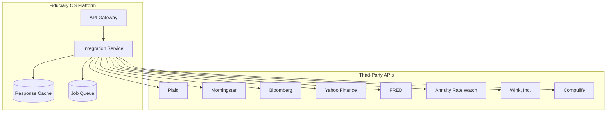
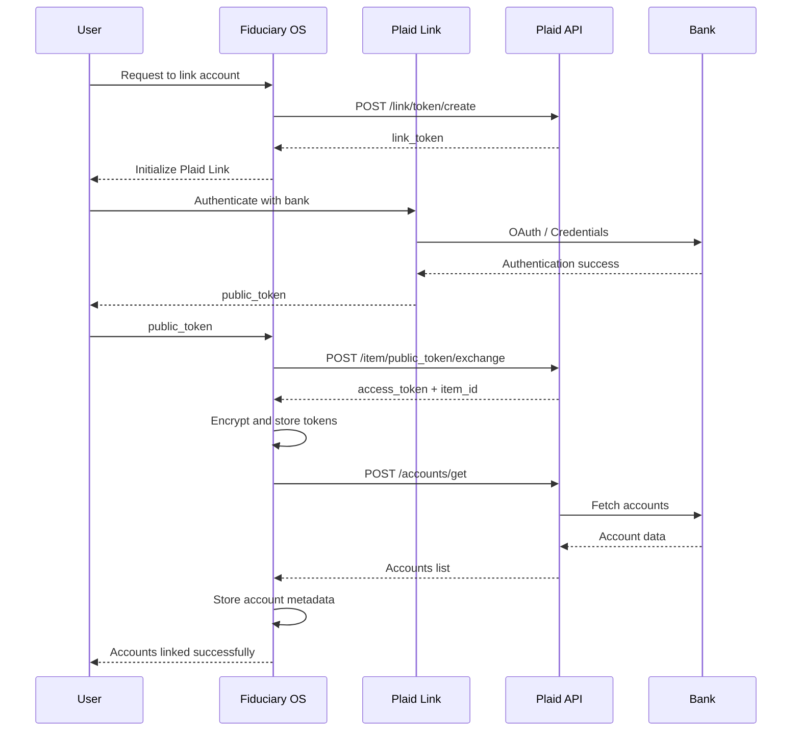
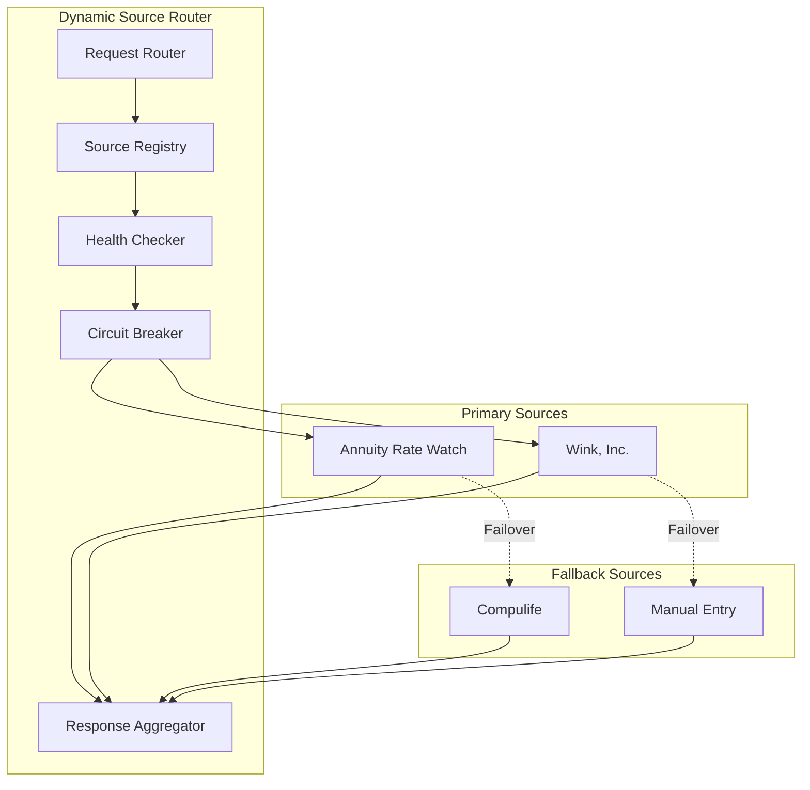
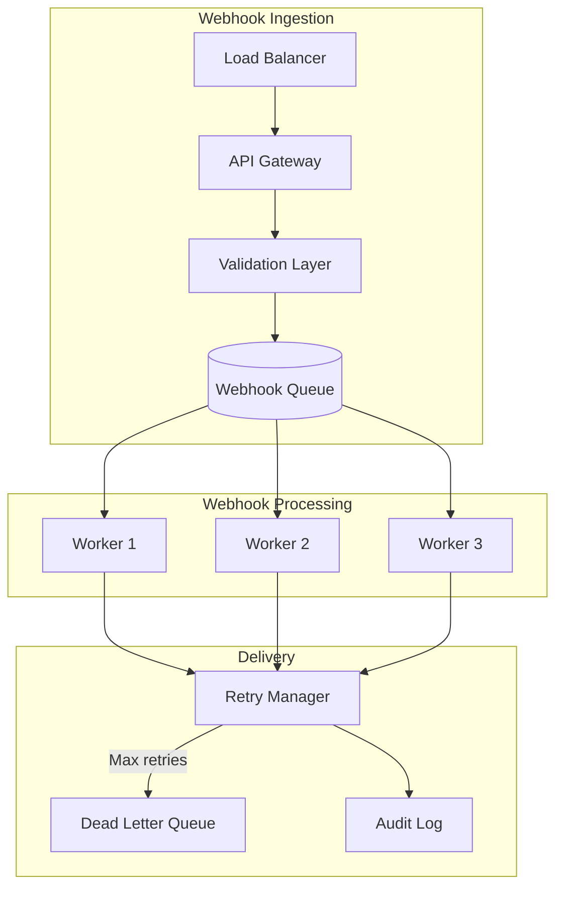

# Fiduciary OS™ - Integration Guide

## Table of Contents
1. [Third-Party API Integrations](#third-party-api-integrations)
2. [Plaid Integration](#plaid-integration)
3. [Carrier API Integration Patterns](#carrier-api-integration-patterns)
4. [Webhook Handling](#webhook-handling)
5. [Error Handling and Retries](#error-handling-and-retries)

---

## Third-Party API Integrations

### Integration Architecture Overview



### Integration Health Matrix

| Provider | Category | Uptime SLA | Avg Latency | Rate Limit | Failover |
|----------|----------|------------|-------------|------------|----------|
| Plaid | Banking | 99.9% | 200ms | 100/min | Cached data |
| Morningstar | Investments | 99.5% | 150ms | 1000/day | Yahoo Finance |
| Bloomberg | Market Data | 99.9% | 100ms | Unlimited | N/A |
| Yahoo Finance | Market Data | 99% | 300ms | 2000/hr | Cached prices |
| FRED | Economic Data | 99.5% | 500ms | 120/hr | Cached data |
| Annuity Rate Watch | Insurance | 99% | 2s | 500/day | Wink, Inc. |
| Wink, Inc. | Insurance | 99% | 1.5s | 1000/day | Compulife |
| Compulife | Insurance | 99% | 1s | 500/day | Manual fallback |

---

## Plaid Integration

### Plaid Architecture



### Plaid Products Configuration

```javascript
// Plaid client configuration
const { Configuration, PlaidApi, PlaidEnvironments } = require('plaid');

const configuration = new Configuration({
    basePath: PlaidEnvironments[process.env.PLAID_ENV],
    baseOptions: {
        headers: {
            'PLAID-CLIENT-ID': process.env.PLAID_CLIENT_ID,
            'PLAID-SECRET': process.env.PLAID_SECRET,
        },
    },
});

const plaidClient = new PlaidApi(configuration);

// Link token creation
async function createLinkToken(userId, products = ['auth', 'transactions', 'investments']) {
    const response = await plaidClient.linkTokenCreate({
        user: { client_user_id: userId },
        client_name: 'Fiduciary OS',
        products: products,
        country_codes: ['US'],
        language: 'en',
        webhook: 'https://api.fiduciaryos.com/webhooks/plaid',
        redirect_uri: 'https://app.fiduciaryos.com/plaid/callback',
        account_filters: {
            depository: {
                account_subtypes: ['checking', 'savings'],
            },
        },
    });
    
    return response.data;
}
```

### Plaid Webhook Handling

```javascript
// Plaid webhook handler
class PlaidWebhookHandler {
    async handleWebhook(payload, signature) {
        // Verify webhook signature
        if (!this.verifyWebhook(payload, signature)) {
            throw new Error('Invalid webhook signature');
        }

        const { webhook_type, webhook_code, item_id } = payload;

        switch (webhook_type) {
            case 'TRANSACTIONS':
                await this.handleTransactionsWebhook(webhook_code, item_id, payload);
                break;
            case 'HOLDINGS':
                await this.handleHoldingsWebhook(webhook_code, item_id, payload);
                break;
            case 'ITEM':
                await this.handleItemWebhook(webhook_code, item_id, payload);
                break;
            case 'AUTH':
                await this.handleAuthWebhook(webhook_code, item_id, payload);
                break;
            default:
                logger.warn(`Unhandled webhook type: ${webhook_type}`);
        }
    }

    async handleTransactionsWebhook(code, itemId, payload) {
        switch (code) {
            case 'INITIAL_UPDATE':
            case 'HISTORICAL_UPDATE':
            case 'DEFAULT_UPDATE':
                await this.syncTransactions(itemId, payload.new_transactions);
                break;
            case 'TRANSACTIONS_REMOVED':
                await this.removeTransactions(payload.removed_transactions);
                break;
        }
    }

    async syncTransactions(itemId, newTransactionsCount) {
        const item = await this.getPlaidItem(itemId);
        
        // Fetch new transactions
        let offset = 0;
        const limit = 500;
        let hasMore = true;

        while (hasMore) {
            const response = await plaidClient.transactionsGet({
                access_token: item.accessToken,
                start_date: this.getLastSyncDate(itemId),
                end_date: new Date().toISOString().split('T')[0],
                options: { offset, count: limit },
            });

            await this.saveTransactions(itemId, response.data.transactions);
            
            offset += response.data.transactions.length;
            hasMore = offset < response.data.total_transactions;
        }

        await this.updateLastSyncDate(itemId);
    }

    verifyWebhook(payload, signature) {
        const crypto = require('crypto');
        const secret = process.env.PLAID_WEBHOOK_SECRET;
        
        const hash = crypto
            .createHmac('sha256', secret)
            .update(payload)
            .digest('hex');
        
        return crypto.timingSafeEqual(
            Buffer.from(hash),
            Buffer.from(signature)
        );
    }
}
```

### Plaid Error Handling

| Error Code | Description | Retry Strategy | User Action |
|------------|-------------|----------------|-------------|
| `ITEM_LOGIN_REQUIRED` | User needs to re-authenticate | No retry | Prompt re-link |
| `ITEM_NOT_FOUND` | Item doesn't exist | No retry | Log error |
| `INSTITUTION_NOT_RESPONDING` | Bank unavailable | Exponential backoff | Notify user |
| `RATE_LIMIT_EXCEEDED` | Too many requests | Wait + retry | Automatic |
| `INTERNAL_SERVER_ERROR` | Plaid error | Exponential backoff | Automatic |
| `PLAID_ERROR` | Generic error | Retry once | Log and alert |

```javascript
// Plaid error handler
class PlaidErrorHandler {
    async handleError(error, context) {
        const plaidError = error.response?.data;
        
        switch (plaidError?.error_code) {
            case 'ITEM_LOGIN_REQUIRED':
                await this.markItemForReauth(context.itemId);
                await this.notifyUser(context.userId, 'reauth_required');
                break;
                
            case 'INSTITUTION_NOT_RESPONDING':
                await this.scheduleRetry(context, { delay: 60000, maxRetries: 5 });
                break;
                
            case 'RATE_LIMIT_EXCEEDED':
                const retryAfter = error.response.headers['retry-after'] || 60;
                await this.scheduleRetry(context, { delay: retryAfter * 1000 });
                break;
                
            default:
                logger.error('Plaid error', { error: plaidError, context });
                await this.alertOnCall(context);
        }
    }
}
```

---

## Carrier API Integration Patterns

### Dynamic Source Router Pattern



### Carrier Hub Implementation

```typescript
// Carrier API abstraction layer
interface CarrierAPI {
    name: string;
    healthCheck(): Promise<HealthStatus>;
    getAnnuityRates(params: AnnuityParams): Promise<AnnuityQuote[]>;
    getLifeInsuranceQuotes(params: LifeParams): Promise<LifeQuote[]>;
}

class CarrierHub {
    private carriers: Map<string, CarrierAPI> = new Map();
    private circuitBreakers: Map<string, CircuitBreaker> = new Map();

    registerCarrier(carrier: CarrierAPI): void {
        this.carriers.set(carrier.name, carrier);
        this.circuitBreakers.set(
            carrier.name,
            new CircuitBreaker(carrier, {
                failureThreshold: 5,
                resetTimeout: 60000,
            })
        );
    }

    async getAnnuityRates(params: AnnuityParams): Promise<AggregatedQuotes> {
        const healthyCarriers = await this.getHealthyCarriers();
        
        const quotePromises = healthyCarriers.map(async (carrier) => {
            const cb = this.circuitBreakers.get(carrier.name)!;
            try {
                const quotes = await cb.fire(() => carrier.getAnnuityRates(params));
                return { carrier: carrier.name, quotes, success: true };
            } catch (error) {
                logger.warn(`Carrier ${carrier.name} failed`, { error });
                return { carrier: carrier.name, quotes: [], success: false, error };
            }
        });

        const results = await Promise.allSettled(quotePromises);
        
        return this.aggregateResults(results, params);
    }

    private async getHealthyCarriers(): Promise<CarrierAPI[]> {
        const healthChecks = Array.from(this.carriers.values()).map(async (carrier) => {
            const cb = this.circuitBreakers.get(carrier.name)!;
            const isOpen = cb.opened;
            return { carrier, healthy: !isOpen };
        });

        const results = await Promise.all(healthChecks);
        return results.filter(r => r.healthy).map(r => r.carrier);
    }

    private aggregateResults(
        results: PromiseSettledResult<CarrierResult>[],
        params: AnnuityParams
    ): AggregatedQuotes {
        const successful = results
            .filter((r): r is PromiseFulfilledResult<CarrierResult> => 
                r.status === 'fulfilled' && r.value.success
            )
            .map(r => r.value);

        const allQuotes = successful.flatMap(r => 
            r.quotes.map(q => ({ ...q, carrier: r.carrier }))
        );

        // Sort by yield rate descending
        allQuotes.sort((a, b) => b.yieldRate - a.yieldRate);

        return {
            quotes: allQuotes.slice(0, 10), // Top 10
            carriersContacted: results.length,
            carriersSuccessful: successful.length,
            generatedAt: new Date(),
            expiresAt: new Date(Date.now() + 24 * 60 * 60 * 1000), // 24 hours
        };
    }
}

// Circuit Breaker implementation
class CircuitBreaker {
    private failures = 0;
    private lastFailureTime?: number;
    public opened = false;

    constructor(
        private carrier: CarrierAPI,
        private config: { failureThreshold: number; resetTimeout: number }
    ) {}

    async fire<T>(fn: () => Promise<T>): Promise<T> {
        if (this.opened) {
            if (Date.now() - (this.lastFailureTime || 0) > this.config.resetTimeout) {
                this.opened = false;
                this.failures = 0;
            } else {
                throw new Error('Circuit breaker is open');
            }
        }

        try {
            const result = await fn();
            this.onSuccess();
            return result;
        } catch (error) {
            this.onFailure();
            throw error;
        }
    }

    private onSuccess(): void {
        this.failures = 0;
        this.opened = false;
    }

    private onFailure(): void {
        this.failures++;
        this.lastFailureTime = Date.now();
        
        if (this.failures >= this.config.failureThreshold) {
            this.opened = true;
            logger.error(`Circuit breaker opened for ${this.carrier.name}`);
        }
    }
}
```

### Annuity Rate Watch Integration

```typescript
class AnnuityRateWatchAPI implements CarrierAPI {
    name = 'AnnuityRateWatch';
    private baseUrl = 'https://api.annuityratewatch.com/v1';
    private apiKey: string;

    constructor(apiKey: string) {
        this.apiKey = apiKey;
    }

    async healthCheck(): Promise<HealthStatus> {
        try {
            const response = await fetch(`${this.baseUrl}/health`, {
                headers: { 'X-API-Key': this.apiKey },
            });
            return { healthy: response.ok, latency: 0 };
        } catch {
            return { healthy: false, latency: 0 };
        }
    }

    async getAnnuityRates(params: AnnuityParams): Promise<AnnuityQuote[]> {
        const response = await fetch(`${this.baseUrl}/rates`, {
            method: 'POST',
            headers: {
                'Content-Type': 'application/json',
                'X-API-Key': this.apiKey,
            },
            body: JSON.stringify({
                premium: params.principal,
                age: params.age,
                deferral_years: params.deferralPeriod,
                product_type: params.productType,
                joint_life: params.jointLife,
                cola: params.colaRider,
            }),
        });

        if (!response.ok) {
            throw new Error(`AnnuityRateWatch error: ${response.status}`);
        }

        const data = await response.json();
        return data.rates.map(this.transformRate);
    }

    private transformRate(rate: any): AnnuityQuote {
        return {
            carrier: rate.carrier_name,
            product: rate.product_name,
            rating: rate.am_best_rating,
            monthlyIncome: rate.monthly_income,
            annualIncome: rate.annual_income,
            yieldRate: rate.yield_rate,
            features: rate.features || [],
            fees: {
                annual: rate.annual_fee || 0,
                surrender: rate.surrender_charges || [],
            },
        };
    }
}
```

### Market Data Integration (Morningstar)

```typescript
class MorningstarAPI {
    private baseUrl = 'https://api.morningstar.com/v2';
    private accessToken: string;

    async authenticate(): Promise<void> {
        const response = await fetch(`${this.baseUrl}/oauth/token`, {
            method: 'POST',
            headers: { 'Content-Type': 'application/x-www-form-urlencoded' },
            body: new URLSearchParams({
                grant_type: 'client_credentials',
                client_id: process.env.MORNINGSTAR_CLIENT_ID!,
                client_secret: process.env.MORNINGSTAR_CLIENT_SECRET!,
            }),
        });

        const data = await response.json();
        this.accessToken = data.access_token;
    }

    async getSecurityData(symbols: string[]): Promise<SecurityData[]> {
        const response = await fetch(
            `${this.baseUrl}/securities?symbols=${symbols.join(',')}`,
            {
                headers: {
                    'Authorization': `Bearer ${this.accessToken}`,
                },
            }
        );

        if (response.status === 401) {
            await this.authenticate();
            return this.getSecurityData(symbols); // Retry
        }

        const data = await response.json();
        return data.securities;
    }

    async getPortfolioAnalytics(holdings: Holding[]): Promise<PortfolioAnalytics> {
        const response = await fetch(`${this.baseUrl}/portfolio/analyze`, {
            method: 'POST',
            headers: {
                'Content-Type': 'application/json',
                'Authorization': `Bearer ${this.accessToken}`,
            },
            body: JSON.stringify({ holdings }),
        });

        return response.json();
    }
}
```

---

## Webhook Handling

### Webhook Architecture



### Webhook Handler Implementation

```typescript
// Generic webhook handler
abstract class WebhookHandler<T> {
    abstract verifySignature(payload: string, signature: string, secret: string): boolean;
    abstract parsePayload(payload: string): T;
    abstract processEvent(event: T): Promise<void>;

    async handle(request: WebhookRequest): Promise<WebhookResponse> {
        const { payload, signature, headers } = request;

        // Verify signature
        if (!this.verifySignature(payload, signature, this.getSecret())) {
            return { status: 401, body: { error: 'Invalid signature' } };
        }

        // Parse and validate payload
        let event: T;
        try {
            event = this.parsePayload(payload);
        } catch (error) {
            return { status: 400, body: { error: 'Invalid payload' } };
        }

        // Queue for processing (don't block response)
        await this.queueEvent(event, headers);

        return { status: 200, body: { received: true } };
    }

    private async queueEvent(event: T, headers: Record<string, string>): Promise<void> {
        await webhookQueue.add('process-webhook', {
            handler: this.constructor.name,
            event,
            headers,
            receivedAt: new Date(),
        }, {
            attempts: 5,
            backoff: {
                type: 'exponential',
                delay: 5000,
            },
        });
    }

    protected abstract getSecret(): string;
}

// Plaid webhook handler implementation
class PlaidWebhookHandlerImpl extends WebhookHandler<PlaidWebhookEvent> {
    verifySignature(payload: string, signature: string, secret: string): boolean {
        const crypto = require('crypto');
        const hash = crypto
            .createHmac('sha256', secret)
            .update(payload)
            .digest('hex');
        return hash === signature;
    }

    parsePayload(payload: string): PlaidWebhookEvent {
        return JSON.parse(payload);
    }

    async processEvent(event: PlaidWebhookEvent): Promise<void> {
        const processor = this.getProcessor(event.webhook_type);
        await processor.process(event);
    }

    private getProcessor(type: string): WebhookProcessor {
        const processors: Record<string, WebhookProcessor> = {
            'TRANSACTIONS': new TransactionsProcessor(),
            'HOLDINGS': new HoldingsProcessor(),
            'ITEM': new ItemProcessor(),
        };
        return processors[type] || new DefaultProcessor();
    }

    protected getSecret(): string {
        return process.env.PLAID_WEBHOOK_SECRET!;
    }
}
```

### Webhook Retry Strategy

```typescript
interface RetryConfig {
    maxAttempts: number;
    backoffStrategy: 'fixed' | 'exponential' | 'linear';
    baseDelay: number;
    maxDelay: number;
}

class WebhookRetryManager {
    private config: RetryConfig = {
        maxAttempts: 10,
        backoffStrategy: 'exponential',
        baseDelay: 5000,  // 5 seconds
        maxDelay: 3600000, // 1 hour
    };

    async executeWithRetry<T>(
        operation: () => Promise<T>,
        context: RetryContext
    ): Promise<T> {
        let attempt = 0;
        
        while (attempt < this.config.maxAttempts) {
            try {
                return await operation();
            } catch (error) {
                attempt++;
                
                if (attempt >= this.config.maxAttempts) {
                    await this.sendToDeadLetterQueue(context, error);
                    throw error;
                }

                const delay = this.calculateDelay(attempt);
                logger.warn(`Retry attempt ${attempt}/${this.config.maxAttempts}`, {
                    context,
                    delay,
                    error: error.message,
                });

                await this.sleep(delay);
            }
        }

        throw new Error('Max retries exceeded');
    }

    private calculateDelay(attempt: number): number {
        const { backoffStrategy, baseDelay, maxDelay } = this.config;
        
        let delay: number;
        switch (backoffStrategy) {
            case 'fixed':
                delay = baseDelay;
                break;
            case 'linear':
                delay = baseDelay * attempt;
                break;
            case 'exponential':
            default:
                delay = baseDelay * Math.pow(2, attempt - 1);
                break;
        }
        
        return Math.min(delay, maxDelay);
    }

    private sleep(ms: number): Promise<void> {
        return new Promise(resolve => setTimeout(resolve, ms));
    }

    private async sendToDeadLetterQueue(context: RetryContext, error: Error): Promise<void> {
        await deadLetterQueue.add('failed-webhook', {
            context,
            error: error.message,
            stack: error.stack,
            failedAt: new Date(),
        });
    }
}
```

---

## Error Handling and Retries

### Error Classification

```typescript
enum ErrorCategory {
    TRANSIENT = 'TRANSIENT',      // Retryable
    PERMANENT = 'PERMANENT',      // Don't retry
    AUTHENTICATION = 'AUTH',      // Refresh credentials
    RATE_LIMIT = 'RATE_LIMIT',    // Back off and retry
    TIMEOUT = 'TIMEOUT',          // Retry with longer timeout
}

interface ClassifiedError {
    category: ErrorCategory;
    retryable: boolean;
    retryDelay?: number;
    maxRetries?: number;
}

class ErrorClassifier {
    classify(error: Error, provider: string): ClassifiedError {
        // HTTP status code based classification
        const statusCode = this.extractStatusCode(error);
        
        switch (statusCode) {
            case 429: // Rate limit
                return {
                    category: ErrorCategory.RATE_LIMIT,
                    retryable: true,
                    retryDelay: this.extractRetryAfter(error) || 60000,
                    maxRetries: 5,
                };
                
            case 401:
            case 403:
                return {
                    category: ErrorCategory.AUTHENTICATION,
                    retryable: false,
                };
                
            case 408:
            case 504:
                return {
                    category: ErrorCategory.TIMEOUT,
                    retryable: true,
                    retryDelay: 5000,
                    maxRetries: 3,
                };
                
            case 500:
            case 502:
            case 503:
                return {
                    category: ErrorCategory.TRANSIENT,
                    retryable: true,
                    retryDelay: 1000,
                    maxRetries: 5,
                };
                
            case 400:
            case 404:
            case 422:
                return {
                    category: ErrorCategory.PERMANENT,
                    retryable: false,
                };
                
            default:
                // Network errors, timeouts
                if (error.message.includes('ECONNRESET') ||
                    error.message.includes('ETIMEDOUT') ||
                    error.message.includes('ENOTFOUND')) {
                    return {
                        category: ErrorCategory.TRANSIENT,
                        retryable: true,
                        retryDelay: 2000,
                        maxRetries: 5,
                    };
                }
                
                return {
                    category: ErrorCategory.PERMANENT,
                    retryable: false,
                };
        }
    }

    private extractStatusCode(error: Error): number | undefined {
        return (error as any).response?.status || (error as any).statusCode;
    }

    private extractRetryAfter(error: Error): number | undefined {
        const retryAfter = (error as any).response?.headers?.['retry-after'];
        return retryAfter ? parseInt(retryAfter) * 1000 : undefined;
    }
}
```

### Resilient HTTP Client

```typescript
interface RequestConfig {
    url: string;
    method: 'GET' | 'POST' | 'PUT' | 'DELETE';
    headers?: Record<string, string>;
    body?: any;
    timeout?: number;
}

class ResilientHttpClient {
    private errorClassifier = new ErrorClassifier();
    private retryManager = new WebhookRetryManager();

    async request<T>(
        config: RequestConfig,
        options: { retries?: number; provider: string } = { provider: 'unknown' }
    ): Promise<T> {
        const attempt = async (): Promise<T> => {
            const controller = new AbortController();
            const timeoutId = setTimeout(
                () => controller.abort(),
                config.timeout || 30000
            );

            try {
                const response = await fetch(config.url, {
                    method: config.method,
                    headers: {
                        'Content-Type': 'application/json',
                        ...config.headers,
                    },
                    body: config.body ? JSON.stringify(config.body) : undefined,
                    signal: controller.signal,
                });

                clearTimeout(timeoutId);

                if (!response.ok) {
                    const error = new Error(`HTTP ${response.status}: ${response.statusText}`);
                    (error as any).response = response;
                    throw error;
                }

                return await response.json();
            } catch (error) {
                clearTimeout(timeoutId);
                throw error;
            }
        };

        try {
            return await attempt();
        } catch (error) {
            const classified = this.errorClassifier.classify(error as Error, options.provider);
            
            if (!classified.retryable) {
                throw error;
            }

            return this.retryManager.executeWithRetry(attempt, {
                provider: options.provider,
                url: config.url,
                method: config.method,
            });
        }
    }
}
```

### Integration Health Monitoring

```typescript
interface IntegrationHealth {
    provider: string;
    status: 'healthy' | 'degraded' | 'down';
    lastCheck: Date;
    responseTime: number;
    errorRate: number;
    successRate: number;
    lastError?: string;
}

class IntegrationHealthMonitor {
    private healthStatus: Map<string, IntegrationHealth> = new Map();

    async checkHealth(provider: string, checkFn: () => Promise<void>): Promise<void> {
        const startTime = Date.now();
        
        try {
            await checkFn();
            
            this.updateHealth(provider, {
                status: 'healthy',
                lastCheck: new Date(),
                responseTime: Date.now() - startTime,
            });
        } catch (error) {
            this.updateHealth(provider, {
                status: 'down',
                lastCheck: new Date(),
                responseTime: Date.now() - startTime,
                lastError: (error as Error).message,
            });
            
            await this.alertOnFailure(provider, error as Error);
        }
    }

    private updateHealth(provider: string, update: Partial<IntegrationHealth>): void {
        const current = this.healthStatus.get(provider) || {
            provider,
            status: 'healthy',
            lastCheck: new Date(),
            responseTime: 0,
            errorRate: 0,
            successRate: 100,
        };

        this.healthStatus.set(provider, { ...current, ...update });
    }

    getHealth(provider?: string): IntegrationHealth | IntegrationHealth[] {
        if (provider) {
            return this.healthStatus.get(provider)!;
        }
        return Array.from(this.healthStatus.values());
    }

    private async alertOnFailure(provider: string, error: Error): Promise<void> {
        await alertingService.sendAlert({
            severity: 'high',
            title: `Integration Failure: ${provider}`,
            message: error.message,
            provider,
            timestamp: new Date(),
        });
    }
}
```

---

## Integration Testing

### Contract Testing

```typescript
// Pact contract testing example
import { Pact } from '@pact-foundation/pact';

describe('Plaid Integration Contract', () => {
    const provider = new Pact({
        consumer: 'FiduciaryOS',
        provider: 'Plaid',
        port: 1234,
    });

    beforeAll(() => provider.setup());
    afterAll(() => provider.finalize());
    afterEach(() => provider.verify());

    it('should exchange public token for access token', async () => {
        await provider.addInteraction({
            state: 'public token exists',
            uponReceiving: 'exchange public token',
            withRequest: {
                method: 'POST',
                path: '/item/public_token/exchange',
                headers: { 'Content-Type': 'application/json' },
                body: {
                    client_id: 'test_client',
                    secret: 'test_secret',
                    public_token: 'public-sandbox-test',
                },
            },
            willRespondWith: {
                status: 200,
                headers: { 'Content-Type': 'application/json' },
                body: {
                    access_token: 'access-sandbox-test',
                    item_id: 'item-test',
                    request_id: 'request-test',
                },
            },
        });

        const result = await plaidClient.itemPublicTokenExchange({
            public_token: 'public-sandbox-test',
        });

        expect(result.data.access_token).toBe('access-sandbox-test');
    });
});
```

---

*Document Version: 1.0*
*Last Updated: January 2025*
*Owner: Integration Engineering Team*
