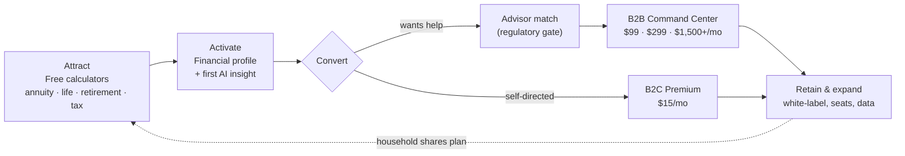

# Fiduciary OS

**A two-sided financial-planning platform: free planning tools for households, a white-label command center for the advisors who serve them.**

> [!IMPORTANT]
> **Status: pre-launch blueprint.** This repository holds the business plan, financial model, target architecture, and a working **backend API prototype**. There is no frontend yet, no compliance certification, and several revenue mechanics need regulatory review before anything goes to market. See [Before go-to-market](#before-go-to-market).

---

## Contents

- [The value flow](#the-value-flow)
- [What exists today](#what-exists-today)
- [Quick start](#quick-start)
- [Repository map](#repository-map)
- [Business model at a glance](#business-model-at-a-glance)
- [Before go-to-market](#before-go-to-market)
- [Upgrade roadmap (open-source accelerators)](#upgrade-roadmap)
- [Document index](#document-index)

---

## The value flow

Every feature in this repo should earn its place on one path: **a household gets a real answer for free → trusts the platform with its data → either pays for more, or asks for an advisor → the advisor pays for the tools that serve that client.**



| Stage | What the user gets | What the business gets | Where it lives | Status |
|---|---|---|---|---|
| **Attract** | Instant answers: guaranteed-income estimate, protection gap, withdrawal-rate check, tax estimate | Organic traffic, top-of-funnel | `POST /api/v1/calculations/*` | Prototype (simplified formulas) |
| **Activate** | A saved financial profile and a personalised insight | Registered user, first value moment | `/profile`, `/ai`, `/ai-v2` | Prototype |
| **Convert (B2C)** | Ongoing tracking, portfolio and crypto views, document vault | Subscription revenue | `/portfolio`, `/market`, `/crypto`, `/documents` | Prototype; vault upload is a stub |
| **Convert (B2B)** | A qualified, pre-educated client | Advisor SaaS revenue | — | Not built; design in docs |
| **Retain** | One plan shared between household and advisor | Net revenue retention | — | Not built |

The [roadmap](VALUE_FLOW_AND_REPO_ROADMAP.md) maps open-source projects onto each of these stages.

---

## What exists today

| Area | Reality |
|---|---|
| **Backend API** (`fiduciary-os/backend`) | Express + TypeScript + Prisma. Type-checks, builds, and passes its test suite. |
| **Database** | SQLite via Prisma (the docs describe PostgreSQL + TimescaleDB as the target). |
| **Auth** | Email/password with bcrypt and JWT access/refresh tokens. No SSO, MFA, or advisor/firm roles yet. |
| **Calculators** | Annuity, life insurance, retirement, tax. Rule-of-thumb formulas, not actuarial or tax-code engines. |
| **AI insights** | Anthropic (`/ai`) and Moonshot Kimi (`/ai-v2`) clients, each with canned fallback text when no key is set. |
| **Market data** | Alpha Vantage and CoinGecko clients; fall back to **randomised mock prices** when no key is set. |
| **Insurance quotes** | **Illustrative only.** Generated from a hard-coded table of named carriers, not from any carrier or quoting API. |
| **Document vault** | Metadata records only; no file storage or encryption is implemented. |
| **Frontend** | **Not in the repo.** Older docs describe a React app under `frontend/`; it does not exist yet. |
| **Infra** | `docker-compose.yml` references Dockerfiles and `infra/` that do not exist. CI runs the backend only. |
| **Business docs** | Strategy, market, competitive, valuation, funding, and a 7-sheet CSV financial model. |

---

## Quick start

Requires Node.js 20+.

```bash
cd fiduciary-os/backend
cp .env.example .env          # SQLite by default; set JWT_SECRET to a long random string
npm ci
npx prisma migrate deploy     # creates prisma/dev.db
npm run dev                   # http://localhost:3001
```

Check it is alive:

```bash
curl http://localhost:3001/health
```

Run the checks CI runs:

```bash
npm run type-check
DATABASE_URL=file:./test.db JWT_SECRET=test npx jest --runInBand
npm run build
```

Optional keys in `.env` switch the AI and market endpoints from fallback to live data: `ANTHROPIC_API_KEY`, `KIMI_API_KEY`, `ALPHA_VANTAGE_API_KEY`.

### API surface (prefix `/api/v1`)

| Group | Endpoints |
|---|---|
| `auth` | `POST /register` · `/login` · `/refresh` · `/logout` |
| `users`, `profile`, `portfolio` | CRUD for the signed-in user's own records |
| `calculations` | `POST /annuity` · `/life-insurance` · `/retirement` · `/tax` |
| `ai` / `ai-v2` | profile, portfolio, retirement, market insights; "Symphony" playbook |
| `market` | quotes, batch quotes, portfolio analytics, illustrative insurance quotes, market summary |
| `crypto` | prices, trending, coin detail, crypto portfolio, market summary |
| `documents` | list, get, create (metadata), delete |
| `/health` | `/` · `/ready` · `/live` (no prefix, no auth) |

Full target spec: [API_Specification.md](API_Specification.md).

---

## Repository map

```
.
├── README.md                         ← you are here
├── VALUE_FLOW_AND_REPO_ROADMAP.md    ← open-source accelerators mapped to the value flow
├── FIDUCIARY_OS_MASTER_INDEX.md      ← index of the full documentation suite (target state)
│
├── Strategy & market
│   ├── VC_Executive_Summary.md
│   ├── Market_Analysis_Report.md
│   ├── Business_Strategy_Plan.md
│   └── Competitive_Analysis.md
│
├── Financial model
│   ├── FINANCIAL_MODEL_PACKAGE.md    ← guide to the CSVs and valuation docs
│   ├── 01_Assumptions.csv … 07_Scenario_Analysis.csv
│   ├── Unit_Economics.md · Valuation_Analysis.md · Funding_Strategy.md
│
├── Architecture (target state)
│   ├── System_Architecture.md · API_Specification.md · Database_Design.md
│   ├── Security_Architecture.md · Integration_Guide.md · Deployment_Architecture.md
│
├── .github/workflows/backend-ci.yml
└── fiduciary-os/
    ├── backend/                      ← the running code
    │   ├── src/{routes,services,middleware,config}
    │   ├── prisma/                   ← schema, migrations, seed
    │   └── tests/
    ├── docker-compose.yml · Makefile ← partly reference missing frontend/infra
    └── README.md
```

---

## Business model at a glance

| Line | Price | Notes |
|---|---|---|
| B2B Solo | $99/mo | Independent advisor |
| B2B Growth | $299/mo | Team |
| B2B Enterprise | $1,500+/mo | White-label, RIA / broker-dealer |
| B2C Premium | $15/mo | Freemium upgrade |
| Performance partnership | 25–45% revenue share on placed premium | **See regulatory gate below** |

Base-case model: $1.98M revenue in Year 1 → $28.0M in Year 5 ([FINANCIAL_MODEL_PACKAGE.md](FINANCIAL_MODEL_PACKAGE.md)).

> [!WARNING]
> **The LTV/CAC figures in the model overstate unit economics by roughly 10×.** `06_SaaS_Metrics.csv` computes Solo LTV as $59,400, which equals $99 × 600 months (a 50-year lifetime, before gross margin). Using the model's own inputs — 75% gross margin, 1.5% monthly B2B churn, 5% B2C churn — LTV is ARPU × margin ÷ churn:
>
> | Segment | LTV | CAC | LTV/CAC |
> |---|---|---|---|
> | Solo | $4,950 | $500 | **9.9×** (model says 118.8×) |
> | Growth | $14,950 | $1,500 | **10.0×** (119.6×) |
> | Enterprise | $75,000 | $8,000 | **9.4×** (112.5×) |
> | B2C Premium | $225 | $30 | **7.5×** (90.0×) |
>
> ~10× is still strong, and payback periods are unaffected. Fix the sheet before any investor sees it. Separately, `VC_Executive_Summary.md` targets $51.7M ARR in Year 5 while the model projects $19.95M; pick one.

---

## Before go-to-market

These are the gaps between what the documents say and what is true today. Each one is a credibility or regulatory risk if it reaches a customer, partner, or investor as written.

1. **Remove unearned compliance claims.** Earlier READMEs stated "SOC 2 Type II compliant", "WCAG 2.1 AA compliant", and "bank-grade security". None has been audited or tested. They have been removed from the READMEs; the architecture docs still describe them as targets and should stay worded that way.
2. **Insurance quotes must not look real.** `generateCarrierQuotes()` attaches premiums, A.M. Best-style ratings, feature lists, and logos to named carriers (Northwestern Mutual, New York Life, MassMutual, State Farm, Prudential, Haven Life) with no carrier relationship. Some of that data is already stale — [Haven Life stopped accepting applications](https://coverager.com/haven-life-no-longer-accepting-applications/). Replace with a licensed quoting partner, or anonymise ("Carrier A") and label every figure illustrative.
3. **Revenue share on insurance premiums needs a licensed structure.** Commission splits and per-placement revenue share generally require an insurance license, and advisor-matching can be a paid referral arrangement. Get a securities/insurance attorney's opinion and a named licensed channel partner before modelling this revenue. (This is not legal advice.)
4. **AI output needs guardrails.** The AI endpoints produce personalised financial guidance. Add disclosures, a "not a recommendation" boundary, logging of every prompt/response for supervision, and an evaluation suite (see [roadmap](VALUE_FLOW_AND_REPO_ROADMAP.md#4-trust-compliance-and-ai-safety)).
5. **Mock data must be visible.** Market endpoints silently return randomised prices when no API key is set. Return a `"source": "mock"` flag, or fail closed in production.
6. **Fix the financial model** (LTV, ARR mismatch above) and update dates — the package is stamped "December 2024".
7. **This repository is public** and the financial package is marked "confidential and proprietary". Decide which is true.

---

## Upgrade roadmap

[VALUE_FLOW_AND_REPO_ROADMAP.md](VALUE_FLOW_AND_REPO_ROADMAP.md) lists about 30 vetted open-source projects (license, adoption, what each adds, and what it would replace) grouped by value-flow stage, with a phased plan. The short list:

| Need | Pick | Why |
|---|---|---|
| Frontend look & feel | [shadcn/ui](https://github.com/shadcn-ui/ui) + [Tremor](https://github.com/tremorlabs/tremor) | Owned, themeable components; finance-grade charts and KPI cards |
| Ship the UI fast | [shadcn-admin](https://github.com/satnaing/shadcn-admin) | Vite + TanStack Router + shadcn dashboard shell, MIT |
| Real tax math | [PolicyEngine US](https://github.com/PolicyEngine/policyengine-us) (via its API) | Replaces the bracket approximation with a maintained rules engine |
| Auth for advisors + firms | [Better Auth](https://github.com/better-auth/better-auth) | Multi-tenant orgs, 2FA, replaces hand-rolled JWT |
| Fine-grained access | [OpenFGA](https://github.com/openfga/openfga) | Advisor ↔ household ↔ firm permissions |
| Funnel measurement | [PostHog](https://github.com/PostHog/posthog) | Analytics, flags, experiments in one tool |
| AI supervision | [Langfuse](https://github.com/langfuse/langfuse) + [promptfoo](https://github.com/promptfoo/promptfoo) | Trace every AI answer; test for unsuitable advice before release |
| Compliance program | [Comp AI](https://github.com/trycompai/comp) | Open-source path to an actual SOC 2 |

---

## Document index

| Audience | Start here |
|---|---|
| Investors | [VC_Executive_Summary.md](VC_Executive_Summary.md) → [Valuation_Analysis.md](Valuation_Analysis.md) → [Unit_Economics.md](Unit_Economics.md) |
| Operators / GTM | [Business_Strategy_Plan.md](Business_Strategy_Plan.md) · [Competitive_Analysis.md](Competitive_Analysis.md) · [Market_Analysis_Report.md](Market_Analysis_Report.md) |
| Finance | [FINANCIAL_MODEL_PACKAGE.md](FINANCIAL_MODEL_PACKAGE.md) · CSVs `01`–`07` · [Funding_Strategy.md](Funding_Strategy.md) |
| Engineers | [fiduciary-os/README.md](fiduciary-os/README.md) · [System_Architecture.md](System_Architecture.md) · [API_Specification.md](API_Specification.md) · [Database_Design.md](Database_Design.md) |
| Security / compliance | [Security_Architecture.md](Security_Architecture.md) (target controls, not attested) |
| Everything | [FIDUCIARY_OS_MASTER_INDEX.md](FIDUCIARY_OS_MASTER_INDEX.md) |

---

Code in `fiduciary-os/` is MIT-licensed ([LICENSE](fiduciary-os/LICENSE)).
