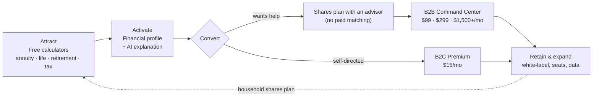

# Fiduciary OS

**A two-sided financial-planning platform: free planning tools for households, a white-label command center for the advisors who serve them.**

> [!IMPORTANT]
> **Status: pre-launch blueprint (October 2026).** This repository holds the business plan, a reproducible financial model, the target architecture, and a working **backend API prototype** with AI and data-provenance safeguards. There is no frontend yet and no compliance certification. See [Open items before launch](#open-items-before-launch).

---

## Contents

- [The value flow](#the-value-flow)
- [What exists today](#what-exists-today)
- [Quick start](#quick-start)
- [Repository map](#repository-map)
- [Business model at a glance](#business-model-at-a-glance)
- [Trust and safety controls](#trust-and-safety-controls)
- [Open items before launch](#open-items-before-launch)
- [Upgrade roadmap (open-source accelerators)](#upgrade-roadmap)
- [Document index](#document-index)

---

## The value flow

Every feature in this repo should earn its place on one path: **a household gets a clear answer for free → trusts the platform with its data → either pays for more, or works on the plan with an advisor → the advisor pays for the tools that serve that client.** Revenue comes only from subscriptions, never from product placement.



| Stage | What the user gets | What the business gets | Where it lives | Status |
|---|---|---|---|---|
| **Attract** | Instant, clearly labelled estimates: annuity income, protection gap, withdrawal-rate check, tax | Organic traffic, top-of-funnel | `POST /api/v1/calculations/*` | Prototype (simplified formulas) |
| **Activate** | A saved financial profile and an educational AI explanation with disclosures | Registered user, first value moment | `/profile`, `/ai`, `/ai-v2` | Prototype |
| **Convert (B2C)** | Ongoing tracking, portfolio and crypto views, document vault | Subscription revenue | `/portfolio`, `/market`, `/crypto`, `/documents` | Prototype; vault upload is a stub |
| **Convert (B2B)** | Advisors run their own clients' plans in a branded workspace | Advisor SaaS revenue | — | Not built; design in docs |
| **Retain** | One plan shared between household and advisor | Net revenue retention | — | Not built |

The [roadmap](VALUE_FLOW_AND_REPO_ROADMAP.md) maps open-source projects onto each of these stages.

---

## What exists today

| Area | Reality |
|---|---|
| **Backend API** (`fiduciary-os/backend`) | Express + TypeScript + Prisma. Type-checks, builds, and passes 41 tests in CI. |
| **Database** | SQLite via Prisma (the docs describe PostgreSQL + TimescaleDB as the target). |
| **Auth** | Email/password with bcrypt and JWT access/refresh tokens. No SSO, MFA, or advisor/firm roles yet. |
| **Calculators** | Annuity, life insurance, retirement, tax (2024 federal brackets). Rule-of-thumb formulas, labelled illustrative with a disclaimer on every response. |
| **AI explanations** | Anthropic (`/ai`) and Moonshot Kimi (`/ai-v2`) behind one gateway: education-only system prompt, output guardrails that withhold recommendations or promised returns, PII stripped before model calls, every prompt/response logged to `ai_interactions`, disclosure on every response. Canned sample text without a key; refused in production. |
| **Market data** | Alpha Vantage and CoinGecko clients. Every response carries `source` (`live` / `mock`). Mock prices are fixed placeholders with zero change, and are refused (HTTP 503) in production. Portfolio risk metrics that are not computed are listed as unavailable rather than invented. |
| **Insurance figures** | **Illustrative only.** Anonymised carriers ("Illustrative Carrier A–F"), no ratings or logos, `source: illustrative`, and a disclaimer on every response. No carrier or quoting-partner integration exists. |
| **Document vault** | Metadata records only; no file storage or encryption is implemented. |
| **Frontend** | **Not in the repo.** Older docs describe a React app under `frontend/`; it does not exist yet. |
| **Infra** | `docker-compose.yml` references Dockerfiles and `infra/` that do not exist. CI runs the backend only. |
| **Business docs** | Strategy, market, competitive, valuation, funding, and a 7-sheet CSV financial model. |

---

## Quick start

Requires Node.js 20+.

```bash
cd fiduciary-os/backend
cp .env.example .env          # SQLite by default; set JWT_SECRET to a long random string
npm ci
npx prisma migrate deploy     # creates prisma/dev.db
npm run dev                   # http://localhost:3001
```

Check it is alive:

```bash
curl http://localhost:3001/health
```

Run the checks CI runs:

```bash
npm run type-check
DATABASE_URL=file:./test.db JWT_SECRET=test npx jest --runInBand
npm run build
```

Optional keys in `.env` switch the AI and market endpoints from placeholder to live data: `ANTHROPIC_API_KEY`, `KIMI_API_KEY`, `ALPHA_VANTAGE_API_KEY`. With `NODE_ENV=production`, endpoints without a live source return 503 instead of placeholders.

Live AI evaluation (needs an API key, not run in CI):

```bash
ANTHROPIC_API_KEY=... npm run eval:ai
```

### API surface (prefix `/api/v1`)

| Group | Endpoints |
|---|---|
| `auth` | `POST /register` · `/login` · `/refresh` · `/logout` |
| `users`, `profile`, `portfolio` | CRUD for the signed-in user's own records |
| `calculations` | `POST /annuity` · `/life-insurance` · `/retirement` · `/tax` |
| `ai` / `ai-v2` | profile, portfolio, retirement, market explanations; "Symphony" overview. Responses include `disclosure`, `notARecommendation`, `source`, `guardrail`, `interactionId` |
| `market` | quotes, batch quotes, portfolio analytics, illustrative insurance figures, coverage rule of thumb, market summary |
| `crypto` | prices, trending, coin detail, crypto portfolio, market summary |
| `documents` | list, get, create (metadata), delete |
| `/health` | `/` · `/ready` · `/live` (no prefix, no auth) |

Full target spec: [API_Specification.md](API_Specification.md).

---

## Repository map

```
.
├── README.md                         ← you are here
├── VALUE_FLOW_AND_REPO_ROADMAP.md    ← open-source accelerators mapped to the value flow
├── FIDUCIARY_OS_MASTER_INDEX.md      ← index of the full documentation suite (target state)
│
├── Strategy & market
│   ├── VC_Executive_Summary.md
│   ├── Market_Analysis_Report.md
│   ├── Business_Strategy_Plan.md
│   └── Competitive_Analysis.md
│
├── Financial model
│   ├── FINANCIAL_MODEL_PACKAGE.md    ← guide to the model (v2)
│   ├── model/build_model.py          ← regenerates CSVs 02–07
│   ├── 01_Assumptions.csv … 07_Scenario_Analysis.csv
│   ├── Unit_Economics.md · Valuation_Analysis.md · Funding_Strategy.md
│
├── Architecture (target state)
│   ├── System_Architecture.md · API_Specification.md · Database_Design.md
│   ├── Security_Architecture.md · Integration_Guide.md · Deployment_Architecture.md
│
├── .github/workflows/backend-ci.yml
└── fiduciary-os/
    ├── backend/                      ← the running code
    │   ├── src/{routes,services,middleware,config}
    │   ├── prisma/                   ← schema, migrations, seed
    │   ├── evals/                    ← live AI evaluation suite (promptfoo)
    │   └── tests/
    ├── docker-compose.yml · Makefile ← partly reference missing frontend/infra
    └── README.md
```

---

## Business model at a glance

| Line | Price | Notes |
|---|---|---|
| B2B Solo | $99/mo | Independent advisor |
| B2B Growth | $299/mo | Team |
| B2B Enterprise | $1,500+/mo | White-label, RIA / broker-dealer |
| B2C Premium | $15/mo | Freemium upgrade |
| Insurance revenue share | — | **Excluded.** Not modelled until securities/insurance counsel has reviewed it and a licensed channel partner is named |

Base case (model v2, regenerated by `python3 model/build_model.py`):

| | Year 1 | Year 3 | Year 5 |
|---|---|---|---|
| Revenue | $1.44M | $8.00M | $21.05M |
| ARR | $1.37M | $7.59M | $19.95M |
| EBITDA | −$1.11M | −$1.36M | $1.99M |

| Segment | LTV | CAC | LTV/CAC | Payback |
|---|---|---|---|---|
| Solo | $4,950 | $500 | 9.9× | 6.7 mo |
| Growth | $14,950 | $1,500 | 10.0× | 6.7 mo |
| Enterprise | $120,000 | $8,000 | 15.0× | 6.7 mo |
| B2C Premium | $255 | $30 | 8.5× | 2.4 mo |

All are assumptions until measured. Details: [FINANCIAL_MODEL_PACKAGE.md](FINANCIAL_MODEL_PACKAGE.md).

---

## Trust and safety controls

What protects users and the company today. Each item is enforced in code or in the model, not just described.

| Area | Control | Where |
|---|---|---|
| **Claims** | No compliance certification is claimed. SOC 2, WCAG and FINRA appear only as *targets, not attested* | All docs; [Security_Architecture.md](Security_Architecture.md) |
| **AI explanations** | Education-only system prompt; output guardrails withhold promised returns, buy/sell directives, carrier picks and advisor impersonation; names and emails stripped before model calls; disclosure and `notARecommendation` on every response | `src/services/aiGuardrails.ts`, `aiPolicy.json` |
| **AI supervision** | Every prompt and response logged to `ai_interactions` (kept if the user is deleted); guardrail eval corpus in CI; live eval suite via `npm run eval:ai` | `src/services/aiGateway.ts`, `tests/`, `evals/` |
| **Data provenance** | `source` (`live`, `mock`, `fallback`, `illustrative`) on every market, crypto, calculator and AI response; placeholders refused (HTTP 503) when `NODE_ENV=production` | `src/utils/dataSource.ts` |
| **Insurance figures** | Anonymised carriers, no ratings or logos, labelled illustrative with a disclaimer; no carrier integration until a licensed quoting partner is in place | `src/services/unifiedAiService.ts` |
| **Revenue model** | Subscriptions only. No revenue tied to insurance or investment placement, and no paid advisor matching | `model/build_model.py` |
| **Financial model** | One reproducible source for every figure; LTV = ARPU × margin ÷ churn | `python3 model/build_model.py` |

---

## Open items before launch

- [ ] **Make this repository private.** It is currently public and contains material marked confidential.
- [ ] **Decide on the code license.** `fiduciary-os/LICENSE` is MIT, which lets anyone who obtained a copy reuse the code. Making the repository private does not revoke that for existing copies.
- [ ] **Confirm or remove the `[Confirm]` placeholders** in [VC_Executive_Summary.md](VC_Executive_Summary.md) (headquarters, team, founder background, traction) before it is shared.
- [ ] **Rebuild valuation comparables** from a sourced data provider; see [Valuation_Analysis.md](Valuation_Analysis.md).
- [ ] **Get securities and insurance counsel's opinion** on the advisor workspace and any future insurance features, and name a licensed quoting partner before showing real quotes. *(Not legal advice.)*
- [ ] **Run `npm run eval:ai`** against the production model before AI features go live, and set up human review of the `ai_interactions` log.
- [ ] **Build the frontend** (see the [roadmap](VALUE_FLOW_AND_REPO_ROADMAP.md#1-experience--aesthetics)) and fix or remove the `docker-compose.yml` and `Makefile` targets that reference missing `frontend/` and `infra/` folders.
- [ ] **Replace model assumptions with measured data** (churn, CAC, conversion) as soon as there are customers.

---

## Upgrade roadmap

[VALUE_FLOW_AND_REPO_ROADMAP.md](VALUE_FLOW_AND_REPO_ROADMAP.md) lists about 30 vetted open-source projects (license, adoption, what each adds, and what it would replace) grouped by value-flow stage, with a phased plan. The short list:

| Need | Pick | Why |
|---|---|---|
| Frontend look & feel | [shadcn/ui](https://github.com/shadcn-ui/ui) + [Tremor](https://github.com/tremorlabs/tremor) | Owned, themeable components; finance-grade charts and KPI cards |
| Ship the UI fast | [shadcn-admin](https://github.com/satnaing/shadcn-admin) | Vite + TanStack Router + shadcn dashboard shell, MIT |
| Real tax math | [PolicyEngine US](https://github.com/PolicyEngine/policyengine-us) (via its API) | Replaces the bracket approximation with a maintained rules engine |
| Auth for advisors + firms | [Better Auth](https://github.com/better-auth/better-auth) | Multi-tenant orgs, 2FA, replaces hand-rolled JWT |
| Fine-grained access | [OpenFGA](https://github.com/openfga/openfga) | Advisor ↔ household ↔ firm permissions |
| Funnel measurement | [PostHog](https://github.com/PostHog/posthog) | Analytics, flags, experiments in one tool |
| AI supervision | [Langfuse](https://github.com/langfuse/langfuse) + [promptfoo](https://github.com/promptfoo/promptfoo) | Trace every AI answer; test for unsuitable advice before release |
| Compliance program | [Comp AI](https://github.com/trycompai/comp) | Open-source path to an actual SOC 2 |

---

## Document index

| Audience | Start here |
|---|---|
| Investors | [VC_Executive_Summary.md](VC_Executive_Summary.md) → [Valuation_Analysis.md](Valuation_Analysis.md) → [Unit_Economics.md](Unit_Economics.md) |
| Operators / GTM | [Business_Strategy_Plan.md](Business_Strategy_Plan.md) · [Competitive_Analysis.md](Competitive_Analysis.md) · [Market_Analysis_Report.md](Market_Analysis_Report.md) |
| Finance | [FINANCIAL_MODEL_PACKAGE.md](FINANCIAL_MODEL_PACKAGE.md) · CSVs `01`–`07` · [Funding_Strategy.md](Funding_Strategy.md) |
| Engineers | [fiduciary-os/README.md](fiduciary-os/README.md) · [System_Architecture.md](System_Architecture.md) · [API_Specification.md](API_Specification.md) · [Database_Design.md](Database_Design.md) |
| Security / compliance | [Security_Architecture.md](Security_Architecture.md) (target controls, not attested) |
| Everything | [FIDUCIARY_OS_MASTER_INDEX.md](FIDUCIARY_OS_MASTER_INDEX.md) |

---

Code in `fiduciary-os/` is currently MIT-licensed ([LICENSE](fiduciary-os/LICENSE)); see [Open items before launch](#open-items-before-launch). Business documents and the financial model are confidential.
