# Fiduciary OS™ - Security Architecture

> [!IMPORTANT]
> **Target-state design.** This document describes the controls Fiduciary OS intends to implement. None has been independently audited or attested: there is no SOC 2 report, no FINRA registration, and no completed penetration test. Do not describe the platform as compliant with any framework until the relevant audit or assessment is complete. The controls implemented in code today are listed in [fiduciary-os/README.md](fiduciary-os/README.md#security-posture).

## Table of Contents
1. [Security Framework Overview](#security-framework-overview)
2. [Authentication Flows](#authentication-flows)
3. [Data Encryption Strategy](#data-encryption-strategy)
4. [Compliance Mapping](#compliance-mapping)
5. [Incident Response Plan](#incident-response-plan)
6. [Security Monitoring](#security-monitoring)

---

## Security Framework Overview

### Defense in Depth Architecture

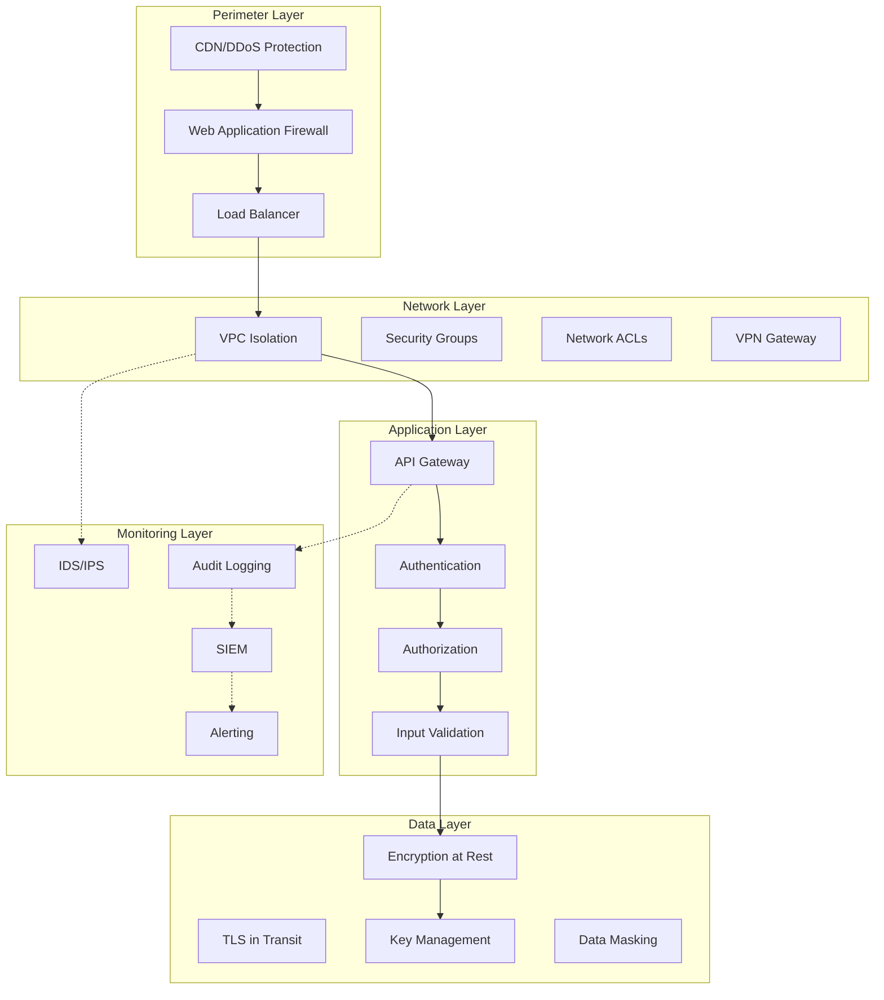

### Security Principles

| Principle | Implementation |
|-----------|----------------|
| **Least Privilege** | RBAC with minimal permissions, service accounts with specific scopes |
| **Defense in Depth** | Multiple security layers at network, application, and data levels |
| **Zero Trust** | Verify every request, no implicit trust within network |
| **Secure by Default** | Encryption enabled, secure configurations out of the box |
| **Audit Everything** | Comprehensive logging of all security-relevant events |

---

## Authentication Flows

### Multi-Factor Authentication (MFA)

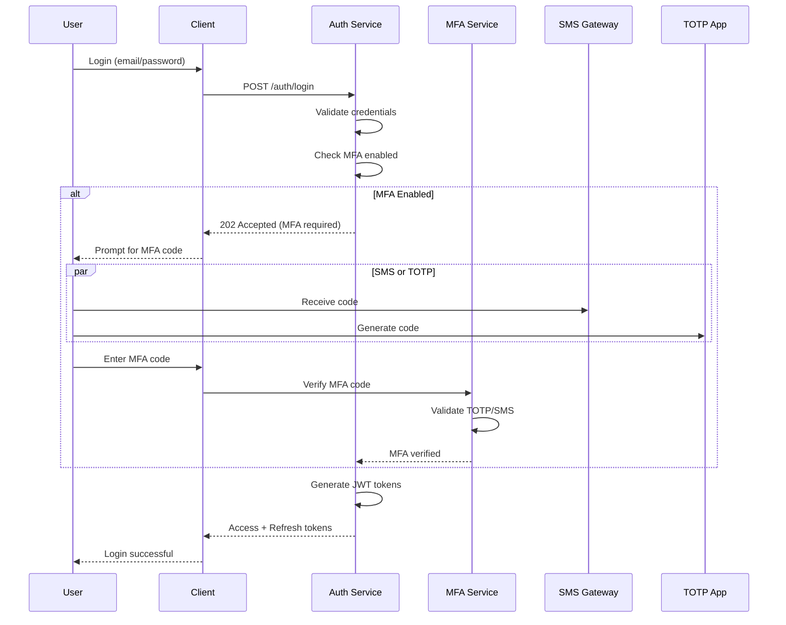

### Password Security

| Requirement | Implementation |
|-------------|----------------|
| Minimum Length | 12 characters |
| Complexity | Upper, lower, number, special char |
| Common Password Check | Against breached password database |
| Hashing Algorithm | Argon2id (memory-hard) |
| Salt | Random 32-byte per password |
| Rotation | Not forced, but encouraged |

```javascript
// Password hashing (Node.js)
const argon2 = require('argon2');

async function hashPassword(password) {
    return await argon2.hash(password, {
        type: argon2.argon2id,
        memoryCost: 65536,  // 64 MB
        timeCost: 3,
        parallelism: 4,
        saltLength: 32
    });
}

async function verifyPassword(hash, password) {
    return await argon2.verify(hash, password);
}
```

### Session Management

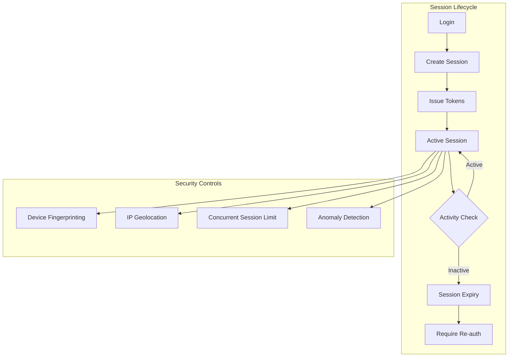

**Session Configuration**:
| Setting | Value |
|---------|-------|
| Access Token TTL | 15 minutes |
| Refresh Token TTL | 7 days |
| Session Idle Timeout | 30 minutes |
| Absolute Timeout | 8 hours |
| Max Concurrent Sessions | 5 per user |
| Device Binding | Optional (high-security mode) |

### API Authentication

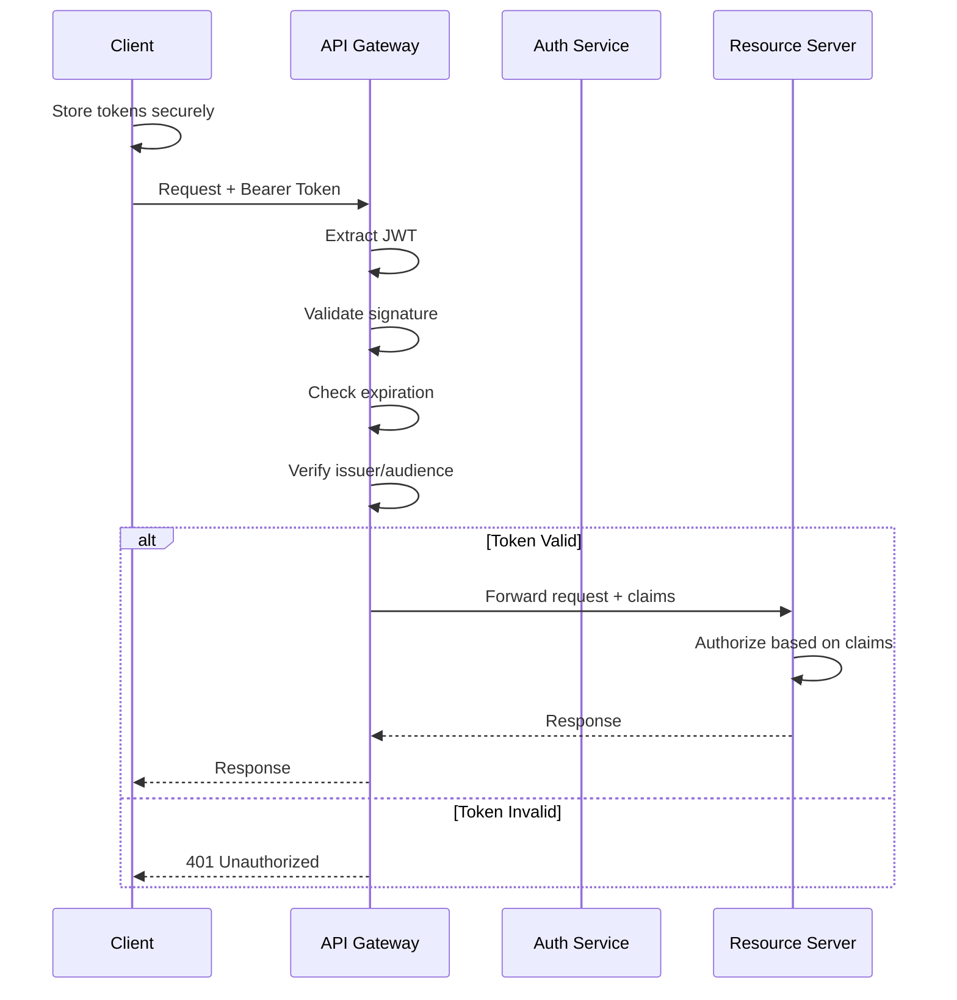

---

## Data Encryption Strategy

### Encryption at Rest

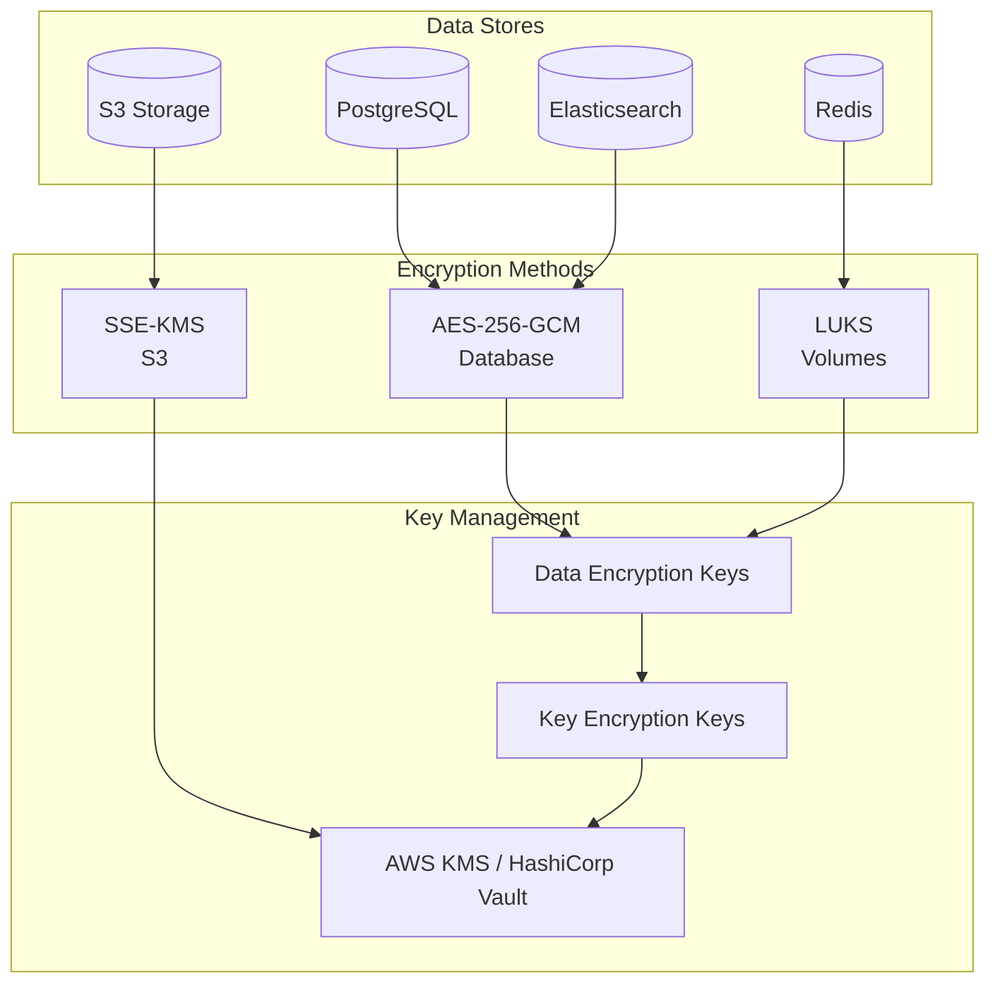

### Database Encryption

```sql
-- PostgreSQL column-level encryption
-- Using pgcrypto extension

-- Enable extension
CREATE EXTENSION IF NOT EXISTS pgcrypto;

-- Encrypt sensitive columns
CREATE TABLE users (
    id UUID PRIMARY KEY DEFAULT gen_random_uuid(),
    email VARCHAR(255) NOT NULL,
    ssn_encrypted BYTEA,  -- Encrypted SSN
    -- ... other columns
);

-- Encryption function
CREATE OR REPLACE FUNCTION encrypt_sensitive(data TEXT, key TEXT)
RETURNS BYTEA AS $$
BEGIN
    RETURN pgp_sym_encrypt(data, key, 'cipher-algo=aes256');
END;
$$ LANGUAGE plpgsql;

-- Decryption function
CREATE OR REPLACE FUNCTION decrypt_sensitive(encrypted BYTEA, key TEXT)
RETURNS TEXT AS $$
BEGIN
    RETURN pgp_sym_decrypt(encrypted, key);
END;
$$ LANGUAGE plpgsql;

-- Example usage
INSERT INTO users (email, ssn_encrypted)
VALUES ('user@example.com', encrypt_sensitive('123-45-6789', '${ENCRYPTION_KEY}'));
```

### Encryption in Transit

| Protocol | Version | Configuration |
|----------|---------|---------------|
| TLS | 1.3 (min 1.2) | HSTS enabled, perfect forward secrecy |
| Certificate | ECDSA P-256 | 90-day rotation (Let's Encrypt) |
| Cipher Suites | TLS 1.3 only | No legacy cipher support |
| HSTS | max-age=31536000 | includeSubDomains, preload |

```nginx
# NGINX TLS Configuration
server {
    listen 443 ssl http2;
    
    ssl_certificate /etc/ssl/certs/fiduciaryos.crt;
    ssl_certificate_key /etc/ssl/private/fiduciaryos.key;
    
    # TLS 1.3 only
    ssl_protocols TLSv1.3;
    ssl_prefer_server_ciphers off;
    
    # HSTS
    add_header Strict-Transport-Security "max-age=31536000; includeSubDomains; preload" always;
    
    # Security headers
    add_header X-Frame-Options "SAMEORIGIN" always;
    add_header X-Content-Type-Options "nosniff" always;
    add_header X-XSS-Protection "1; mode=block" always;
    add_header Referrer-Policy "strict-origin-when-cross-origin" always;
    add_header Content-Security-Policy "default-src 'self'; script-src 'self' 'unsafe-inline'; style-src 'self' 'unsafe-inline';" always;
}
```

### Key Management

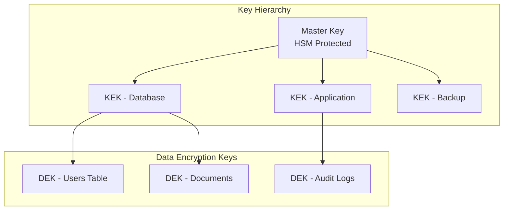

**Key Rotation Schedule**:
| Key Type | Rotation Frequency | Method |
|----------|-------------------|--------|
| Master Key | Annually | Manual ceremony |
| KEKs | Quarterly | Automated |
| DEKs | Monthly | Automated re-encryption |
| API Keys | On demand | Self-service rotation |

---

## Compliance Mapping

*Planned control mapping, not an attestation.*

### SOC 2 Type II Controls (target)

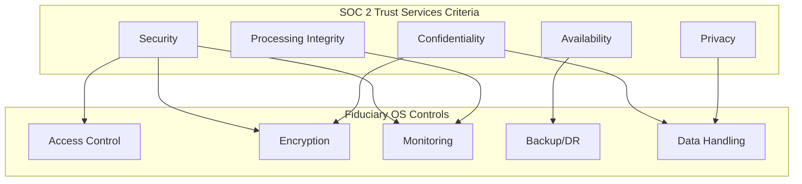

| Trust Criteria | Control | Implementation |
|----------------|---------|----------------|
| **Security** | Access Control | RBAC, MFA, SSO |
| **Security** | Network Security | VPC, WAF, DDoS protection |
| **Availability** | System Monitoring | 99.9% uptime SLA |
| **Availability** | Disaster Recovery | RTO 1h, RPO 5min |
| **Processing Integrity** | Data Validation | Input validation, checksums |
| **Processing Integrity** | Audit Trails | Immutable audit logs |
| **Confidentiality** | Encryption | AES-256 at rest, TLS 1.3 |
| **Privacy** | Data Minimization | Purpose limitation, retention |

### GDPR Compliance

| Requirement | Implementation |
|-------------|----------------|
| **Lawful Basis** | Consent for marketing, contract for services |
| **Data Minimization** | Collect only necessary data |
| **Purpose Limitation** | Data used only for stated purposes |
| **Storage Limitation** | 7-year retention for financial data |
| **Accuracy** | Self-service profile updates |
| **Integrity/Confidentiality** | Encryption, access controls |
| **Accountability** | Audit logs, DPO appointment |

**Data Subject Rights**:
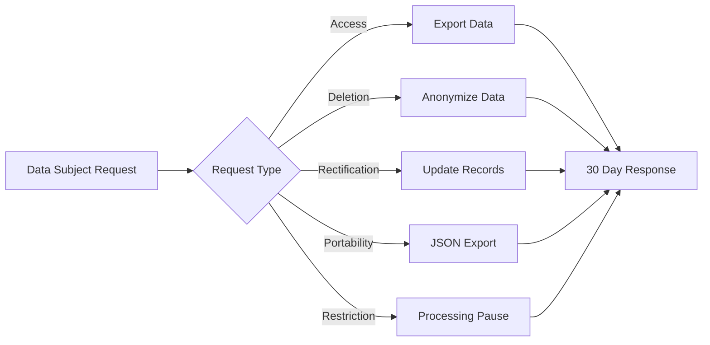

### FINRA/Broker-Dealer Requirements (applies only if a broker-dealer customer or partner requires it)

| Requirement | Fiduciary OS Implementation |
|-------------|----------------------------|
| **Books & Records** | 7-year retention, WORM storage for audit logs |
| **Supervision** | Advisor activity monitoring, exception reports |
| **Customer Data Protection** | Encryption, access controls, data loss prevention |
| **Business Continuity** | DR plan tested annually, backup verification |
| **Cybersecurity** | Annual penetration testing, vulnerability management |

### CCPA Compliance

| Requirement | Implementation |
|-------------|----------------|
| **Notice** | Privacy policy at collection point |
| **Access** | Self-service data export |
| **Deletion** | Account deletion workflow |
| **Opt-out** | "Do Not Sell" link (not applicable - no data sales) |
| **Non-Discrimination** | Equal service regardless of privacy choices |

---

## Incident Response Plan

### Incident Classification

| Severity | Definition | Examples | Response Time |
|----------|------------|----------|---------------|
| **Critical (P1)** | System down, data breach | Ransomware, unauthorized access | 15 minutes |
| **High (P2)** | Major functionality impaired | Service degradation, suspected breach | 1 hour |
| **Medium (P3)** | Minor functionality affected | Feature bug, performance issue | 4 hours |
| **Low (P4)** | Cosmetic or non-urgent | UI glitch, documentation error | 24 hours |

### Incident Response Workflow

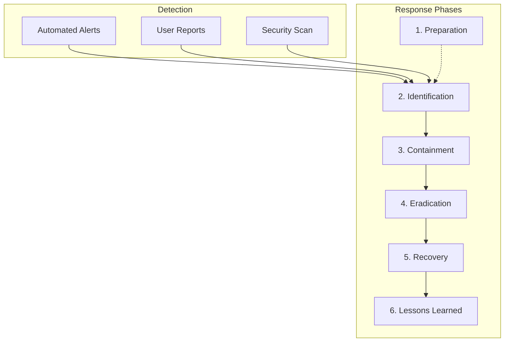

### Security Incident Response Procedures

#### Data Breach Response (P1)

```
T+0min:   Automated alert triggered
T+5min:   On-call engineer acknowledges
T+10min:  Security team notified
T+15min:  Incident commander assigned
T+30min:  Initial assessment complete
T+1hr:    Containment measures activated
T+2hrs:   Legal/Compliance notified
T+4hrs:   External forensics engaged (if needed)
T+24hrs:  Preliminary report to leadership
T+72hrs:  Detailed incident report
```

#### Containment Actions

| Action | Description | Owner |
|--------|-------------|-------|
| Isolate affected systems | Remove from network | Infrastructure |
| Revoke compromised credentials | Reset passwords, revoke tokens | Security |
| Enable enhanced logging | Increase log verbosity | Operations |
| Preserve evidence | Create forensic images | Security |
| Notify stakeholders | Legal, executives, customers | Incident Commander |

### Communication Plan

| Audience | Timing | Channel | Content |
|----------|--------|---------|---------|
| Internal Team | Immediate | Slack P1 channel | Incident details |
| Leadership | Within 1 hour | Email/Phone | Executive summary |
| Legal/Compliance | Within 2 hours | Secure email | Regulatory implications |
| Customers | Within 72 hours | Email/In-app | Breach notification if required |
| Regulators | As required | Formal filing | FINRA, state regulators |

---

## Security Monitoring

### Security Operations Center (SOC)

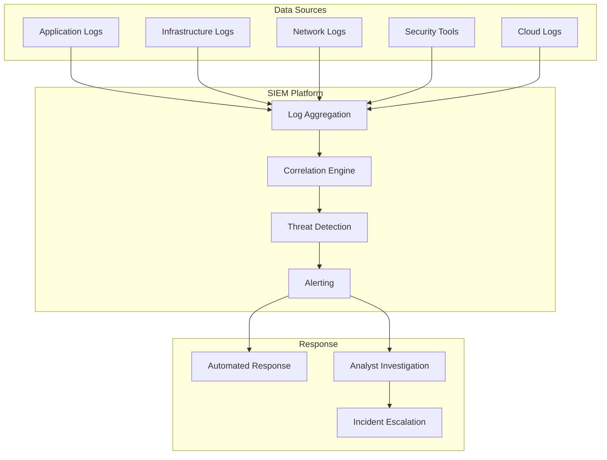

### Monitored Security Events

| Event Type | Log Source | Detection Method | Alert Threshold |
|------------|------------|------------------|-----------------|
| Failed logins | Auth Service | Count per user/IP | 5 in 5 minutes |
| Privilege escalation | Audit logs | Role change events | Any occurrence |
| Data export | Application logs | Bulk data access | >1000 records |
| API abuse | API Gateway | Rate limit exceeded | Any occurrence |
| Suspicious access | Access logs | Off-hours access | Outside business hours |
| Malware detection | EDR | Threat signature | Any detection |
| Data exfiltration | DLP | Sensitive data pattern | Any detection |

### Alert Severity Matrix

| Alert Type | Severity | Response |
|------------|----------|----------|
| Multiple failed logins | Medium | Auto-block IP after 10 attempts |
| Successful login from new country | High | Require MFA, notify user |
| Admin action outside business hours | Medium | Log and review |
| Database query returning >10k records | High | Require approval |
| API key used from unknown IP | Critical | Revoke key, notify owner |
| WAF blocked SQL injection attempt | Medium | Log and monitor |
| Unusual data access pattern | High | Analyst investigation |

### Vulnerability Management

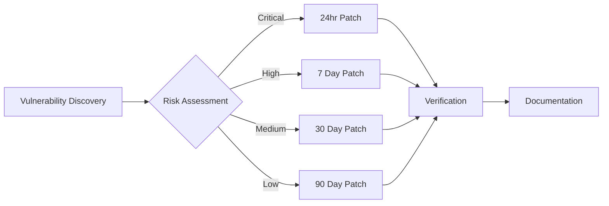

| Severity | CVSS Score | Patch Timeline | Exception Process |
|----------|------------|----------------|-------------------|
| Critical | 9.0-10.0 | 24 hours | CISO approval required |
| High | 7.0-8.9 | 7 days | Security team approval |
| Medium | 4.0-6.9 | 30 days | Standard change process |
| Low | 0.1-3.9 | 90 days | Standard change process |

### Penetration Testing Schedule

| Test Type | Frequency | Scope | Provider |
|-----------|-----------|-------|----------|
| External Network | Quarterly | Public-facing infrastructure | Third-party |
| Internal Network | Annually | Internal systems | Third-party |
| Web Application | Quarterly | All web applications | Third-party |
| API Security | Quarterly | All APIs | Third-party |
| Mobile Application | Annually | iOS and Android apps | Third-party |
| Social Engineering | Annually | Phishing simulation | Third-party |
| Red Team Exercise | Annually | Full attack simulation | Third-party |

### Security Metrics Dashboard

| Metric | Target | Measurement |
|--------|--------|-------------|
| Mean Time to Detect (MTTD) | < 5 minutes | SIEM metrics |
| Mean Time to Respond (MTTR) | < 1 hour | Incident tracking |
| Mean Time to Contain (MTTC) | < 4 hours | Incident tracking |
| Vulnerability Patch Rate | > 95% | Vulnerability scanner |
| Critical Vulnerabilities | 0 | Vulnerability scanner |
| Security Training Completion | 100% | LMS reports |
| Phishing Simulation Click Rate | < 5% | Training platform |
| MFA Adoption Rate | > 95% | Auth service metrics |

---

## Security Checklists

### Pre-Deployment Security Checklist

- [ ] Code review completed
- [ ] SAST scan passed (no critical/high findings)
- [ ] DAST scan passed
- [ ] Dependency vulnerability scan passed
- [ ] Secrets scan passed (no hardcoded credentials)
- [ ] Infrastructure as Code security scan passed
- [ ] Security unit tests passed
- [ ] Privacy impact assessment completed
- [ ] Data flow diagram updated
- [ ] Security documentation updated

### Production Security Checklist

- [ ] WAF rules active and tested
- [ ] DDoS protection enabled
- [ ] TLS 1.3 configured
- [ ] Security headers configured
- [ ] Database encryption enabled
- [ ] Backup encryption verified
- [ ] Audit logging enabled
- [ ] SIEM integration active
- [ ] Monitoring dashboards configured
- [ ] Incident response runbook updated
- [ ] On-call rotation configured
- [ ] Security contacts documented

---

*Document Version: 1.1*
*Last Updated: October 2026 (illustrative-only insurance data; compliance stated as targets)*
*Owner: Security Engineering Team*
*Classification: Confidential*
