# Fiduciary OS™ - System Architecture

## Executive Summary

Fiduciary OS™ is a dual-sided B2B/B2C financial advisory platform designed to serve both individual consumers ("My Financial Life" portal) and financial advisors ("Advisor Command Center"). The platform features a modular "Fleet of Navigators" architecture supporting specialized financial tools for annuities, life insurance, investments, and retirement planning.

---

## High-Level Architecture

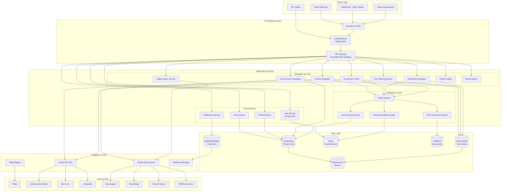

---

## Component Breakdown

### 1. Frontend Layer

| Component | Technology | Purpose |
|-----------|------------|---------|
| B2C Portal (My Financial Life) | React 18+, TypeScript | Consumer-facing financial tools |
| B2B Portal (Advisor Command Center) | React 18+, TypeScript | White-label advisor platform |
| Mobile App | React Native | iOS/Android companion app |
| Design System | Tailwind CSS + Custom Components | Consistent UI/UX |
| State Management | Zustand/Redux Toolkit | Global state management |
| Charts/Visualizations | Chart.js, D3.js | Financial data visualization |

### 2. API Gateway Layer

| Component | Technology | Purpose |
|-----------|------------|---------|
| API Gateway | Kong or AWS API Gateway | Request routing, rate limiting |
| Load Balancer | NGINX / AWS ALB | Traffic distribution |
| CDN | CloudFront / Cloudflare | Static asset delivery |
| WAF | AWS WAF / Cloudflare | DDoS protection, SQL injection prevention |

### 3. Core Services

#### 3.1 Authentication Service
- **Technology**: Node.js/Express or Go
- **Responsibilities**:
  - OAuth 2.0 / OpenID Connect implementation
  - JWT token generation and validation
  - Multi-factor authentication (MFA)
  - Session management
  - Role-based access control (RBAC)

#### 3.2 User Service
- **Technology**: Node.js/NestJS
- **Responsibilities**:
  - User registration and profile management
  - KYC/AML verification workflows
  - Advisor-client relationship mapping
  - User preferences and settings

#### 3.3 Profile Service
- **Technology**: Node.js/NestJS
- **Responsibilities**:
  - Financial profile management
  - Risk tolerance assessment
  - Goal tracking and milestones
  - Financial DNA scoring

#### 3.4 Notification Service
- **Technology**: Node.js/Bull Queue
- **Responsibilities**:
  - Email notifications (SendGrid/AWS SES)
  - SMS alerts (Twilio)
  - Push notifications (Firebase)
  - In-app notification center

### 4. Navigator Services (Fleet of Navigators)

#### 4.1 Annuity Navigator™
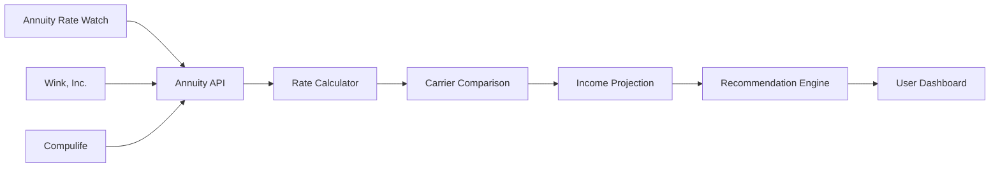

**Key Features**:
- Multi-carrier rate aggregation
- Income projection modeling
- COLA rider analysis
- Joint life option calculations

#### 4.2 Life Insurance Navigator™
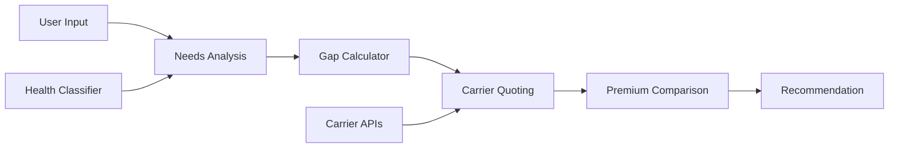

**Key Features**:
- Protection gap analysis
- Health class estimation
- Multi-carrier quoting
- Term vs. permanent comparison

#### 4.3 Investment X-Ray™
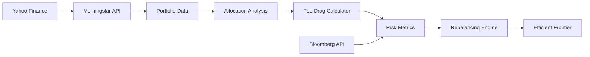

**Key Features**:
- Portfolio allocation breakdown
- Fee drag analysis
- Sharpe/Sortino ratio calculations
- Rebalancing recommendations
- Efficient frontier positioning

#### 4.4 Retirement Income Navigator™ (The Maestro)
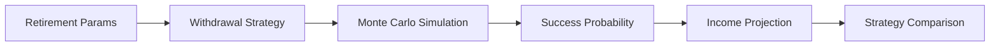

**Key Features**:
- Multiple withdrawal strategies (4% rule, dynamic, guardrails)
- Monte Carlo simulation
- Longevity stress testing
- Social Security optimization

### 5. Intelligence Layer

#### 5.1 AI/ML Service
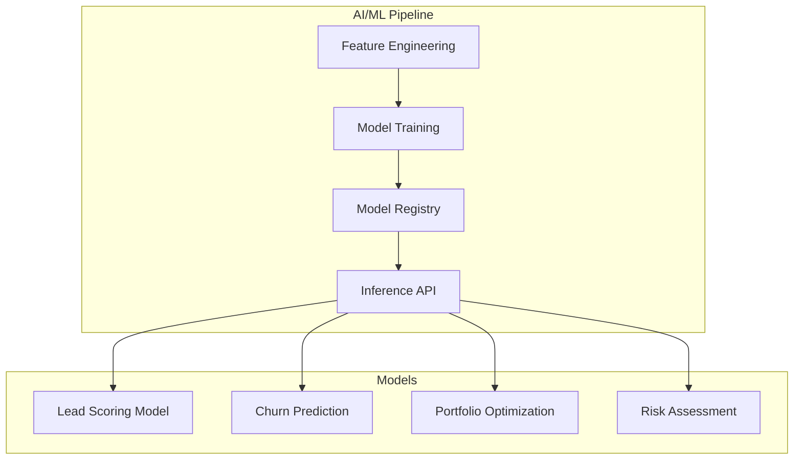

**Technologies**:
- Python/FastAPI for service layer
- scikit-learn, XGBoost for ML models
- MLflow for model registry
- AWS SageMaker or GCP Vertex AI for training

#### 5.2 NLP Document Analysis
**Capabilities**:
- Insurance policy document parsing
- 401(k) statement extraction
- Tax document analysis
- Named entity recognition for financial entities

**Technologies**:
- Python/spaCy or AWS Comprehend
- OpenAI GPT-4 for complex document understanding
- Tesseract OCR for scanned documents

#### 5.3 Recommendation Engine
- Collaborative filtering for product recommendations
- Content-based filtering for educational content
- Hybrid approach combining both

### 6. Data Layer

#### 6.1 Primary Database (PostgreSQL)
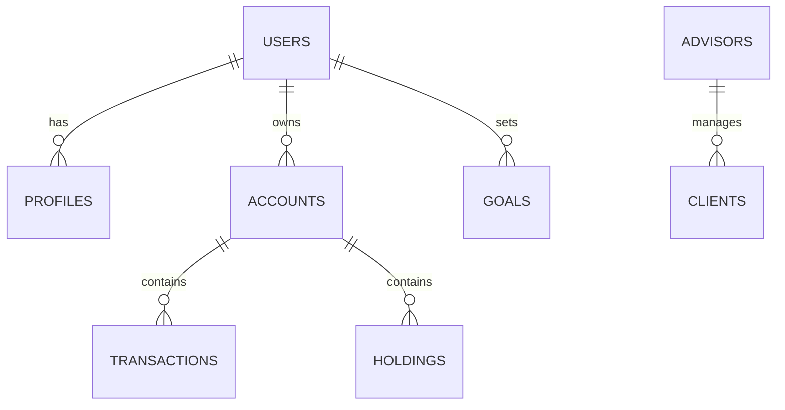

**Configuration**:
- Primary-Replica setup for read scaling
- Connection pooling via PgBouncer
- Automated backups (hourly incremental, daily full)

#### 6.2 Time Series Database (TimescaleDB)
**Use Cases**:
- Portfolio value history
- Market data caching
- Annuity rate history
- User activity metrics

#### 6.3 Cache Layer (Redis)
**Use Cases**:
- Session storage
- API response caching
- Rate limiting counters
- Real-time leaderboards

#### 6.4 Search (Elasticsearch)
**Use Cases**:
- Document search in The Vault
- Advisor directory search
- Product search across carriers

#### 6.5 Object Storage (S3/MinIO)
**Use Cases**:
- Secure document storage (The Vault)
- User profile images
- Exported reports
- Audit logs

#### 6.6 Message Queue (RabbitMQ/Kafka)
**Use Cases**:
- Async job processing
- Event-driven attribution tracking
- Real-time notifications
- Data pipeline processing

---

## Service Architecture Recommendation

### Microservices vs. Monolith Analysis

| Criteria | Microservices | Modular Monolith | Recommendation |
|----------|---------------|------------------|----------------|
| Team Size | Multiple teams | Small team | **Start with Modular Monolith** |
| Deployment Complexity | High | Low | Modular Monolith for MVP |
| Scalability | Independent scaling | Scale as unit | Microservices for specific high-load services |
| Data Consistency | Eventual consistency | Strong consistency | Strong consistency preferred for financial data |
| Development Velocity | Slower initially | Faster | Modular Monolith for faster iteration |

### Recommended Architecture: Hybrid Approach

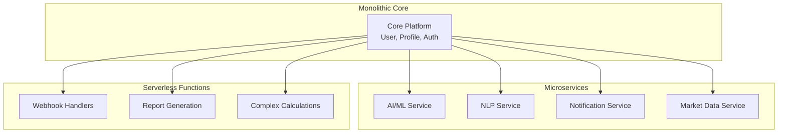

**Rationale**:
1. **Core Platform as Modular Monolith**: Faster development, easier testing, ACID transactions
2. **AI/ML as Separate Service**: Different scaling needs, Python-based stack
3. **Market Data as Separate Service**: High throughput requirements, specialized caching
4. **Serverless for Spiky Workloads**: Webhooks, report generation

---

## Data Flow Diagrams

### 1. User Registration Flow
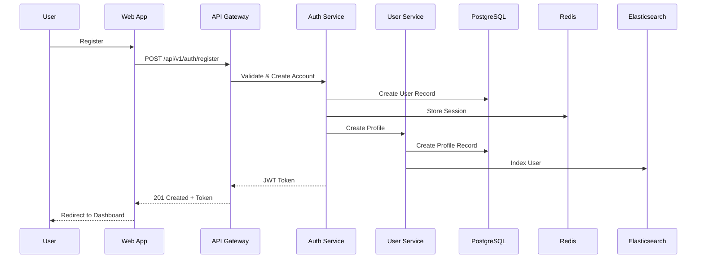

### 2. Annuity Quote Flow
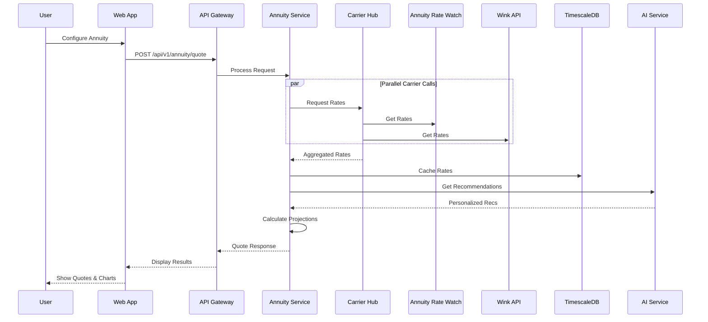

### 3. Portfolio Analysis Flow
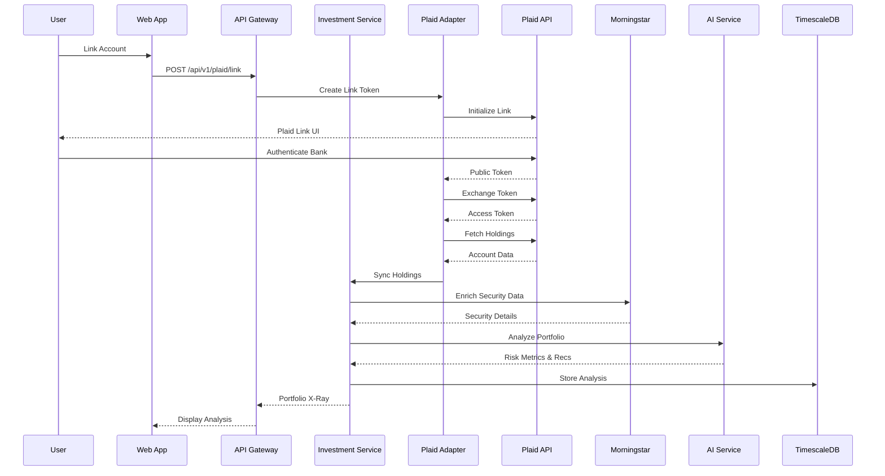

### 4. Document Analysis Flow (NLP)
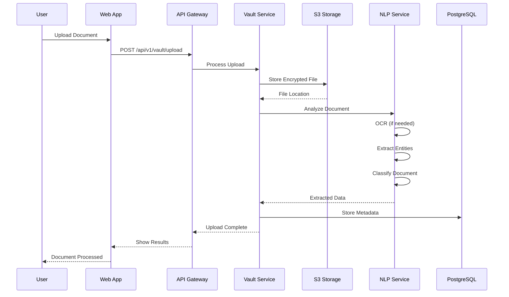

---

## Integration Architecture

### Dynamic Source Router
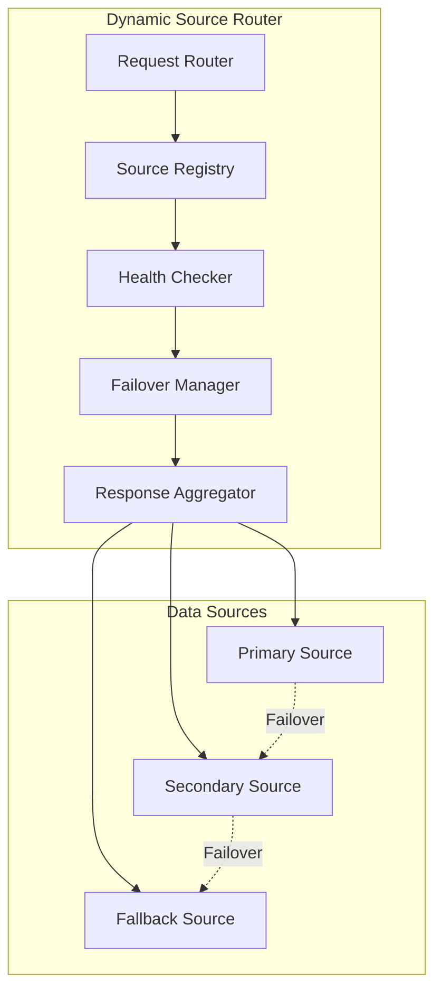

**Implementation Details**:
- Circuit breaker pattern for resilience
- Configurable timeout and retry policies
- Response caching with TTL
- Source priority configuration

### Event-Driven Attribution Tracking
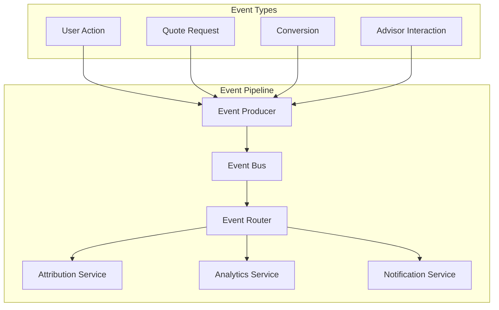

**Event Schema**:
```json
{
  "event_id": "uuid",
  "event_type": "quote_requested",
  "timestamp": "2025-01-15T10:30:00Z",
  "user_id": "user_uuid",
  "session_id": "session_uuid",
  "advisor_id": "advisor_uuid",
  "source": "annuity_navigator",
  "properties": {
    "product_type": "fixed_indexed",
    "principal": 200000,
    "deferral_period": 5
  },
  "attribution": {
    "utm_source": "google",
    "utm_medium": "cpc",
    "utm_campaign": "retirement_2025"
  }
}
```

---

## Technology Stack Summary

| Layer | Technology | Alternative |
|-------|------------|-------------|
| Frontend | React 18+, TypeScript | Vue 3, Angular |
| Mobile | React Native | Flutter |
| API Gateway | Kong | AWS API Gateway, NGINX |
| Core Services | Node.js/NestJS | Go, Python/FastAPI |
| AI/ML | Python/FastAPI | - |
| Primary DB | PostgreSQL 15+ | MySQL 8 |
| Time Series | TimescaleDB | InfluxDB |
| Cache | Redis 7+ | Memcached |
| Search | Elasticsearch | OpenSearch |
| Message Queue | RabbitMQ | Apache Kafka |
| Object Storage | AWS S3 | MinIO, GCS |
| Container Orchestration | Kubernetes | AWS ECS |
| CI/CD | GitHub Actions | GitLab CI, Jenkins |
| Monitoring | Datadog | New Relic, Grafana |
| Logging | ELK Stack | Splunk |

---

## Scalability Considerations

### Horizontal Scaling Strategy
1. **Stateless Services**: All application services designed to be stateless
2. **Database Read Replicas**: Read-heavy queries served by replicas
3. **Caching Strategy**: Multi-layer caching (CDN, Redis, Application)
4. **Async Processing**: Heavy computations offloaded to background jobs

### Performance Targets
| Metric | Target | Measurement |
|--------|--------|-------------|
| API Response Time (p95) | < 200ms | API Gateway metrics |
| Page Load Time | < 2s | Real User Monitoring |
| Database Query Time (p95) | < 50ms | PostgreSQL logs |
| Report Generation | < 30s | Background job metrics |
| Document Processing | < 60s | NLP service metrics |

---

## Next Steps

1. **Infrastructure Setup**: Provision development and staging environments
2. **Core Services Implementation**: Start with Auth, User, and Profile services
3. **Database Migration Strategy**: Design schema versioning and migration plan
4. **API Contract Definition**: Finalize OpenAPI specifications
5. **Security Audit**: Conduct initial security review
6. **Performance Baseline**: Establish performance benchmarks

---

*Document Version: 1.0*
*Last Updated: January 2025*
*Owner: Engineering Architecture Team*
