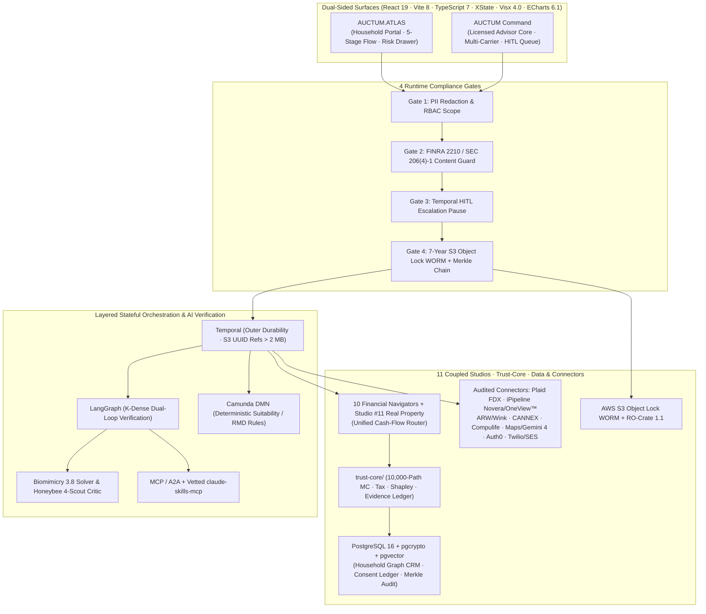

# Unified Platform Blueprint: AUCTUM.ATLAS & AUCTUM Command (Fiduciary OS™)

**Version:** 2.0 · **Date:** November 2026 · **Status:** Canonical Architecture Specification  
**Financial Baseline:** [`model/build_model.py`](model/build_model.py) · [`Unit_Economics.md`](Unit_Economics.md) · [`FINANCIAL_MODEL_PACKAGE.md`](FINANCIAL_MODEL_PACKAGE.md) · [`07_Scenario_Analysis.csv`](07_Scenario_Analysis.csv)

---

## 0. Executive Summary

This blueprint resolves the structural split between the **AUCTUM.ATLAS** consumer brand specification—a warm, plain-language household stewardship portal governed by strict educational boundaries—and the **Fiduciary OS™** institutional/investor technical suite. Unifying both into a single dual-sided ecosystem establishes two clearly bounded surfaces over one shared deterministic foundation:

- **AUCTUM.ATLAS (Consumer / Household Portal):** Plain-language family learning, cash-flow planning, and multi-generational stewardship following a continuous 5-stage household cycle (`Discover & Orient` → `Learn & Assess` → `Map & Model` → `Verify & Escalate` → `Steward & Transfer`).
- **AUCTUM Command (powered by Fiduciary OS™ — Licensed Advisor & Compliance Core):** Institutional advisor workstation with multi-carrier quoting, K-Dense Dual-Record Provenance inspection, Temporal Human-in-the-Loop (HITL) approval queues, and FINRA 4511 WORM archiving.

Both surfaces are powered by deterministic calculation engines (`trust-core/`), a native **PostgreSQL 16 + `pgcrypto` + `pgvector`** Household Graph CRM (formally decommissioning `MASTERNEX.os`), a WCAG 2.2 AA **Visx 4.0 + Apache ECharts 6.1 + D3** visualization layer, **K-Dense Dual-Loop Verification & Dual-Record Provenance**, a **Temporal + LangGraph + Camunda DMN + MCP/A2A** orchestration spine, **4 Runtime Compliance Gates**, and audited financial, insurance, spatial, and identity connectors.

---

## 1. Pillar 1 — Bifurcated Plain-Language Lexicon, Brand Voice & Regulatory Framing

### 1.1 Brand Voice & Approved Vocabulary
- **Voice Archetype:** *Sage-and-Caregiver* — calm, structured, transparent, non-coercive, and plain-spoken.
- **Canonical H1 Tagline (`AUCTUM.ATLAS`):** `"Build a Future for Your Family, One Step at a Time."`
- **9 Approved Household Voice Terms:** *stewardship, legacy, foundation, roadmap, nurture, clarity, resilience, goals, education*.

### 1.2 Exact 10-Row Bifurcated Plain-Language Lexicon
Every UI string and report label routes through a surface-aware lexicon (`atlas` vs. `command`) so institutional vocabulary never leaks onto consumer screens:

| Platform Concept | Legacy Fiduciary OS Wording | Reimagined Household Copy (`AUCTUM.ATLAS`) | Reimagined Advisor Copy (`AUCTUM Command`) |
|---|---|---|---|
| Ecosystem Identity | Fiduciary OS™ / My Financial Life™ | AUCTUM.ATLAS — Your Family Wealth System | AUCTUM Command — Fiduciary Planning Suite |
| Composite Metric | Financial DNA Score™ (72 → 89) | Family Resilience Checkup (Steady → Well-Prepared) | Household Resilience Index (HRI 72 → 89) |
| Reallocation Engine | Symphony Composer™ ("Net Zero Drag") | Family Cash-Flow Planner (Put Tax Savings to Work) | Unified Cash-Flow & Policy Router |
| Tax Module | Tax Navigator™ ("$11,204 Windfall") | Tax-Smart Savings Guide (Estimated Tax Efficiency) | Multi-Year Tax & Bracket Projection Engine |
| Annuity + GUL Pairing | Fiduciary Asset Immunization / Legacy Shield | Income & Inheritance Balance Model | Carrier Income + Estate Restoration Modeler |
| Carrier Hub | Dynamic Source Router™ | Transparent Carrier Comparison | Multi-Carrier Quote & Suitability Router |
| Portfolio Module | Investment X-Ray™ (0.0075 → 0.0003 drag) | Fee & Diversification Checkup (0.75% → 0.03%) | Portfolio Analytics & Expense Audit |
| Digital Assets | Crypto Comfort % (5.00% threshold) | High-Volatility Asset Guardrail (Up to 5%) | Alternative & Digital Asset Allocation Cap |
| Document Store | The Vault (SHA-256 AES-256 Storage) | Family Document Binder (Encrypted & Organized) | WORM Fiduciary Document Vault (FINRA 4511) |
| Primary CTA | Run Simulation / Audit Asset Allocation | Map Our Next Family Step | Generate Compliant Planning Illustration |

### 1.3 Automated Copy & Compliance Linting (`lint:copy`)
A mandatory CI and pre-dispatch copy gate (`check-copy-lexicon.mjs`) fails builds and blocks outbound messaging when any prohibited pattern appears:
- **6 Banned Promotional Phrases:** `"get rich fast"`, `"Act now!"`, `"your nest egg is doomed"`, `"investment vehicles"`, `"beat the market"`, `"guaranteed growth"`.
- **Banned Legacy Unsourced Claims:** `"1.25x Leverage Factor"`, `"Tax Windfall"`, `"Complete Principal Preservation"`, and unsourced `"11.10%"` FIA payout figures.
- **Surface & Brand Hygiene Rules:** Zero B2B advisor jargon leaking onto `AUCTUM.ATLAS` B2C surfaces; hard block on deprecated/prohibited ecosystem strings (`Luminall`, `Property Insight`, `Vivella`, `Verified partner`, `group sell`, unqualified `"verified"`).

### 1.4 Regulatory Framing Controls
- **Persistent Educational Disclaimer:** Mounted on all consumer calculators and educational pages: *"General educational illustration; not personalized investment, tax, or legal advice."*
- **SEC Marketing Rule 206(4)-1 Risk Drawer:** An inline, expandable `<RiskDrawer />` component mounted on every forward-looking chart detailing market volatility, inflation sensitivity, fee assumptions, and carrier credit-rating dependencies.
- **FINRA Rule 2210 Guardrails:** Fair-and-balanced presentation enforcement blocking promissory language, cherry-picked returns, or unsubstantiated comparisons.
- **CAN-SPAM, TCPA & GDPR/CCPA Consent Ledger:** Database-enforced `ConsentRecord` table capturing explicit double-opt-in proof hashes per channel (`email`, `sms`, `voice`), physical mailing address, 10-day CAN-SPAM opt-out SLA, and a hard dispatch block on SendGrid/AWS SES and Twilio whenever an active opt-in record is absent.

---

## 2. Pillar 2 — End-to-End 5-Stage Lifecycle Flow, 11 Coupled Studios, 7 Surfaces & PostgreSQL CRM

### 2.1 Continuous 5-Stage Household Lifecycle
Designed for *The Planner Parent*, *The NextGen Heir*, and *The Family Advisor*:

1. **Discover & Orient:** Zero-login **3-Slider Household Checkup** (monthly take-home pay, target retirement age, dependents; zero PII collected) providing immediate plain-language orientation.
2. **Learn & Assess:** Deterministic **6-step XState Onboarding Wizard** (`≤10` steps, strict transition guards) paired with **5-minute interactive micro-lessons** embedded alongside each calculator.
3. **Map & Model:** Unified **Household Wealth Canvas** driving **11 Coupled Studios** synchronized through the single **Unified Cash-Flow Router** (any slider change updates net worth, tax, liquidity, protection, and estate outputs in real time):
   - *10 Core Financial Studios (Navigators):* (1) Annuity / Income & Inheritance Balance Model, (2) Life Insurance / Transparent Carrier Comparison, (3) Investment Analytics / Fee & Diversification Checkup, (4) Retirement Income Guardrails, (5) Tax-Smart Savings Guide, (6) Estate & Beneficiary Planning, (7) Healthcare & Long-Term Care, (8) High-Volatility / Digital Asset Guardrail, (9) Risk & Stress Analytics, (10) Family Document Binder / WORM Vault.
   - *Studio #11 — Real Property & Tangible Asset Studio:* Adapted from `AUCTUM.Insights` (PropertyInsight AI), supporting **Long-Term Buy & Hold**, **BRRRR Value-Add**, and **Short-Term Rental (STR)** underwriting (`NOI`, `Cap Rate`, `Cash-on-Cash`, `DSCR`, `Price/Sq. Ft.`), 30-year amortization schedules, 10-year equity & cumulative cash-flow curves, 2³ Design-of-Experiments (DOE) stress testing, Google Maps `AdvancedMarkerElement` spatial clustering, Gemini 4 Interactions market grounding, and 1-click `.md` Committee Memo export.
4. **Verify & Escalate:** Household Quorum & Human Handoff featuring a persistent `"Talk to a Licensed Advisor"` CTA and durable Temporal HITL approval queues for regulated actions.
5. **Steward & Transfer:** Multi-Generational Portal and touch-optimized **Mobile Policy & Task Tracker** fed by live underwriting and policy-status events from iPipeline OneView™.

### 2.2 Seven Platform Surfaces
1. **Public Homepage** (3-Slider Checkup, educational overview, zero PII)
2. **Onboarding & Learning Hub** (6-step XState wizard + 5-minute micro-lessons)
3. **Household Wealth Canvas** (synchronized 10-studio planning dashboard)
4. **Real Property & Tangible Asset Studio** (Studio #11 underwriting, spatial map, Committee Memo)
5. **Advisor Command Center** (live PostgreSQL CRM, 1-click multi-carrier quote matrix, K-Dense Provenance Viewer, Temporal HITL queue)
6. **Outreach & Compliance Hub** (Consent Ledger, copy-linted campaigns, FINRA 2210 pre-flight logs)
7. **Mobile Policy & Task Tracker** (touch-optimized collapsible accordions, iPipeline OneView™ status feeds)

### 2.3 PostgreSQL 16 + `pgcrypto` + `pgvector` Household Graph CRM (Decommissioning `MASTERNEX.os`)
- **Core Relational Entities:** `Household`, `Person`, `HouseholdMember` (typed multi-generational edges: `parent_of`, `trust_beneficiary`, `power_of_attorney`), `CrmAccount`, `Appointment`, `LifeEvent`, `ConsentRecord`, and append-only Merkle-chained `ProvenanceRecord` (serialized via `pg_advisory_xact_lock`, with RLS policies and triggers blocking `UPDATE`, `DELETE`, and `TRUNCATE`).
- **Encryption & Privacy Routines:** Column-level AES-256-GCM SSN encryption via `pgcrypto` + AWS KMS envelope keys; native PL/pgSQL `export_user_data(user_id)` (30-day GDPR/CCPA JSON portability) and `soft_delete_user(user_id)` (scrubs PII and Plaid tokens while preserving statutory WORM audit metadata).
- **Formal `MASTERNEX.os` Decommissioning:** Technical inspection confirmed `MASTERNEX.os` contains **zero** native CRM entities and introduces FINRA Regulatory Notice 24-09 third-party vendor-supervision risk. All 7 legacy env-gated HTTP endpoints are replaced natively by PostgreSQL 16 + `pgcrypto`, deterministic `trust-core` Shapley math, Camunda DMN, K-Dense Provenance, and native PropertyInsight underwriting; the `masternex` Docker container and service proxy are formally decommissioned.

---

## 3. Pillar 3 — WCAG 2.2 Visualization System & 6 Signature Interactive Charts

### 3.1 Visualization Stack & WCAG 2.2 AA Contract
- **Primary SVG / React Layer:** **Visx 4.0** (`@visx/*`, `@visx/a11y`, modular ~15 KB footprint) for crisp interactive SVG charts with full DOM keyboard navigation.
- **High-Density Canvas Engine:** **Apache ECharts 6.1** (tree-shaken Canvas renderer with `sampling: 'lttb'`) for 10,000-path Monte Carlo fans and multi-carrier parallel coordinates.
- **Layout Math & Mapping:** **D3.js 7.9** layout math only (`d3-sankey`, `d3-hierarchy`, `d3-scale`) plus **Google Maps `AdvancedMarkerElement`** (with graceful local-first fallback).
- **Mandatory Accessibility & Visual Tokens:**
  - Every chart renders inside `<AccessibleChartFrame />` with a synchronized **Accessible Data Table** (WCAG 2.2 1.1.1, 1.4.1, 1.4.11 ≥3:1 non-text contrast, 2.1.1 full keyboard navigation).
  - **Albers/Itten Color Palette:** `#1B365D` (Navy — foundation/principal), `#2E6F5E` (Sage — resilience/growth), `#C27D2C` (Amber — caution/trade-offs), `#B83A3A` (Crimson — deficits/gaps only), always paired with dashed strokes, icons, or direct data labels so color is never the sole channel.
  - **Motion & Typography:** `220ms cubic-bezier(0.16, 1, 0.3, 1)` transitions respecting `prefers-reduced-motion`; `font-variant-numeric: tabular-nums` on every financial figure.

### 3.2 Six Signature Interactive Charts

| # | Signature Chart | Engine | Core Analytical Encoding |
|---|---|---|---|
| 1 | **Household Cash-Flow & Legacy Canopy** | Visx 4.0 + `d3-sankey` | Multi-stage income-to-allocation Sankey + 5/10/20/30-yr Compound Ribbon and GUL estate multiple |
| 2 | **10,000-Path Longevity & Withdrawal Confidence Fan** | ECharts 6.1 (`sampling: 'lttb'`) | 10th / 25th / 50th / 75th / 90th percentile survival bands + Base Income Floor guardrail band |
| 3 | **Fee-Drag Divergence & Compounding Recovery Area** | Visx 4.0 | Dual-curve cumulative wealth gap (e.g., `$1M` at `0.75%` vs. `0.03%` over 10/20/30 years) with shaded recovery delta |
| 4 | **Multi-Generational Household & Beneficiary Constellation** | Visx 4.0 + `d3-hierarchy` | 3-generation family graph (`parent_of`, `trust_beneficiary`, `power_of_attorney`) with shape+icon gap alerts |
| 5 | **Real Property Equity, Amortization & Spatial Cluster Map** | Canvas + Google Maps `AdvancedMarkerElement` | 30-yr principal/interest amortization, 10-yr forced-appreciation equity curves, and parcel cluster map |
| 6 | **Multi-Carrier Protection & Efficiency Frontier** | ECharts 6.1 Parallel Coordinates | Side-by-side comparison across Annual Premium, Benefit/Premium Multiple, Liquidity, Chronic Illness, and LTC riders |

### 3.3 Hard Static Ratio Ban
Unsourced static marketing ratios—specifically the legacy `"1.25x Leverage Factor"` and unsourced `"11.10%"` FIA initial payout—are **hard-disabled in production**. Every forward-looking chart and simulation endpoint must explicitly declare `assumptionSource: 'timestamped_api' | 'user_declared_hypothetical'` and mount `<RiskDrawer />`.

---

## 4. Pillar 4 — K-Dense Dual-Loop AI, Provenance, Vetted Skills & Nature-Inspired Governance

### 4.1 K-Dense Dual-Loop Verification
All analytical AI workflows run through a strict two-loop verification architecture with **zero LLM mental math in prose**:
- **Outer Planning Loop:** Initial Planning → Orchestrator → Planning Review (validates scope, constraints, and required disclosures).
- **Inner Implementation Loop:** Coding Planning → Sandboxed Python / Deterministic `trust-core` Execution → Coding Review + Math/Compliance Critic (rejects any prose number not traceable to verified deterministic execution).

### 4.2 Dual-Record Provenance & RO-Crate 1.1 WORM Export
- **Living Lab Notebook:** Agent-authored human-readable narrative of methodology, trade-offs, and assumptions.
- **Unforgeable Provenance Log:** Host-observed record of every tool invocation, input hash, and output hash—the agent has zero write tools to mutate this log.
- **Frozen Analysis Plan & Sensitivity Sweep:** SHA-256 hash-chained assumption snapshot plus 2–16 parameter sensitivity runs, exported as a checksummed **RO-Crate 1.1 ZIP** archive stored in 7-year WORM storage.

### 4.3 Vetted `claude-skills-mcp` & `mimeo` Skill Governance
- Every external skill package must pass a mandatory pre-deployment behavioral security scan (`cisco-ai-skill-scanner --use-behavioral`) before admission to the MCP allowlist.
- Document-generation skills (`docx`, `pdf`, `pptx`, `xlsx`) are sourced directly from `anthropics/skills` and allowlisted per role.
- `K-Dense-AI/mimeo` is strictly restricted to read-only tone and pedagogy checklists inside the Onboarding & Learning Hub—never used for financial calculations or regulated advice.

### 4.4 Biomimicry 3.8 Life's Principles & Honeybee Democracy Governance
- **Biomimicry 3.8 (6 Life's Principles Mapped to Software):**
  1. *Multi-Constraint Cash-Flow Solver* (prevents yield maximization from depleting liquidity or protection buffers).
  2. *Guardrail Retirement & 95% VaR Stress Studio* (adapts withdrawals dynamically to drawdown regimes).
  3. *Life-Event & Local Cost Attunement* (re-baselines plans on birth, retirement, relocation, or tax changes).
  4. *Scaffolded Literacy Progression* (unlocks complexity progressively via 5-minute micro-lessons).
  5. *Data Minimization & Zero-Dark-Pattern UX* (`soft_delete_user`, zero coercive CTAs).
  6. *Collective Consensus* (transparent multi-stakeholder decision weights).
- **Honeybee Democracy Household Alignment Mode:** Spouses and heirs score household priorities independently before weighted merge, preventing anchoring bias.
- **4-Scout Swarm Critic Gate:** Four specialized critics (Math/Deterministic, Regulatory/FINRA, Liquidity/Risk, Plain-Language/Lexicon) evaluate complex planning outputs; **non-convergence automatically triggers Gate 3 HITL advisor escalation**.

---

## 5. Pillar 5 — Audited Connector Economics, Orchestration Spine & 4 Runtime Compliance Gates

### 5.1 Audited Connector Matrix

| Domain | Connector | Economic, Security & Failover Controls |
|---|---|---|
| **Account Aggregation** | **Plaid FDX** | Event-driven `/transactions/sync` cursors only (no background polling). **Free tier** capped at manual/CSV/1 user-refreshed checking account (or Sandbox); multi-institution aggregation strictly gated to **B2C Premium (`$15/mo`)** and **Advisor seats** to protect 85% B2C gross margin. Rate limits: `100 req/day/Item`, `5/min` Balance cap. Failover: MX / Finicity / TimescaleDB cache. |
| **Annuity & Order Routing** | **iPipeline Novera API Hub & OneView™** | Annuity order routing, AFFIRM suitability checks, and live underwriting/policy status feeds into the Mobile Policy Tracker. |
| **Annuity Rates** | **Annuity Rate Watch API** | Timestamped carrier rate schedules; circuit-breaker failover to **Wink, Inc.** |
| **Cross-Border Income** | **CANNEX** | Phase 4 US & Canadian income annuities and RRIF schedules. |
| **Term / Life Quoting** | **Compulife API** | Tiered annual pricing (`$490/yr` 1,200/mo, `$985/yr` 6,000/mo, `$1,540/yr` 30,000/mo); single server IP lock; mandatory `REMOTE_IP` anti-scraping parameter (24-hour lockout on omission); separate US and Canada Auth IDs. |
| **Spatial & Market Grounding** | **Google Maps Platform + Gemini 4 Interactions** | Maps SDK (`importLibrary`, `AdvancedMarkerElement`, `PlaceAutocompleteElement`) + Gemini 4 (`POST /v1beta/interactions`, `Api-Revision: 2026-05-20`, `previous_interaction_id`, `thinking_level`, live `google_search` + `google_maps` citations); local-first fallback when offline. |
| **Identity & Cryptography** | **Auth0/OIDC + PKCE + Argon2id + AWS KMS** | OIDC + PKCE + MFA (`15m` access / `7d` refresh); Argon2id (`64 MB, t=3, p=4, 32-byte salt`); AWS KMS + `pgcrypto` AES-256-GCM; TLS 1.3 ECDSA P-256 (90-day cert rotation). |
| **Lifecycle Messaging** | **Twilio + SendGrid / AWS SES** | Hard-gated behind PostgreSQL `ConsentRecord` double-opt-in check and FINRA 2210 / CAN-SPAM / TCPA pre-flight copy linter. |

### 5.2 Layered Stateful Orchestration Spine
- **Temporal (Outer Durability Spine):** Orchestrates multi-week household lifecycles, 30-day GDPR exports, and HITL advisor reviews. Any payload **`> 2 MB`** is persisted to encrypted AWS S3 and passed as a compact UUID reference to stay safely below Temporal's 2 MB gRPC payload limit.
- **LangGraph (Bounded Inner Reasoning Graph):** Runs K-Dense Dual-Loop verification inside bounded, retryable Temporal activities.
- **Camunda DMN (Deterministic Decision Tables):** Executes auditable regulatory rules (state suitability thresholds, RMD/Medicare eligibility, banned-word policies) outside probabilistic LLM weights.
- **MCP & A2A Interoperability:** Model-agnostic tool and agent contracts across Gemini 4, Claude, and open-weight models.

### 5.3 Four Runtime Compliance Gates
Aligned with **FINRA Notice 24-09**, **proposed Notice 26-14**, **SEC Rule 17a-4(f)**, **FINRA Rule 4511**, **SEC Rule 204-2**, and **CFTC Rule 1.31**:
1. **Gate 1 — PII Redaction & Scope Gate:** Strips SSNs, account numbers, and sensitive identifiers pre-LLM and enforces RBAC tool allowlists.
2. **Gate 2 — FINRA 2210 / SEC 206(4)-1 Content Guard:** Blocks guarantee claims and individualized investment/insurance recommendations on educational surfaces; injects mandatory disclosures and Risk Drawer flags.
3. **Gate 3 — HITL Escalation Pause:** Durable Temporal pause queuing suitability, policy replacement, or tax-strategy outputs for named licensed advisor sign-off.
4. **Gate 4 — Dual-Record 7-Year WORM Archiving:** Persists immutable records to **AWS S3 Object Lock (Compliance mode, 7-year retention)** paired with the **PostgreSQL Append-Only Merkle Hash Chain** and PL/pgSQL `export_user_data` / `soft_delete_user` routines.

---

## 6. Pillar 6 — Reconciled Unit Economics & Year 5 Financial Model Alignment

All operating metrics trace reproducibly to [`model/build_model.py`](model/build_model.py), [`Unit_Economics.md`](Unit_Economics.md), [`FINANCIAL_MODEL_PACKAGE.md`](FINANCIAL_MODEL_PACKAGE.md), [`04_Income_Statement.csv`](04_Income_Statement.csv), [`06_SaaS_Metrics.csv`](06_SaaS_Metrics.csv), and [`07_Scenario_Analysis.csv`](07_Scenario_Analysis.csv).

### 6.1 Reconciled Four-Tier Unit Economics (`LTV = Monthly ARPU × Gross Margin ÷ Monthly Churn`)

| Segment | Monthly ARPU | Gross Margin | Monthly Churn | LTV (`ARPU×GM÷Churn`) | CAC | LTV/CAC | Payback (`CAC÷(ARPU×GM)`) |
|---|---:|---:|---:|---:|---:|---:|---:|
| **Solo** | `$99` | `75%` | `1.5%` | **`$4,950`** | `$500` | **`9.9×`** | `6.73 mo` (`6.7 mo`) |
| **Growth** | `$299` | `75%` | `1.5%` | **`$14,950`** | `$1,500` | **`10.0×`** (`9.97×`) | `6.69 mo` (`6.7 mo`) |
| **Enterprise** | `$1,500` | `80%` | `1.0%` | **`$120,000`** | `$8,000` | **`15.0×`** | `6.67 mo` (`6.7 mo`) |
| **B2C Premium** | `$15` | `85%` | `5.0%` | **`$255`** | `$30` | **`8.5×`** | `2.35 mo` (`2.4 mo`) |

### 6.2 Year 5 Revenue & ARR Reconciliation Table

| Case | Year 5 ARR | Year 5 Total Revenue | Year 5 EBITDA | Governance / Licensing Status |
|---|---:|---:|---:|---|
| **v2.0 Pure-SaaS Conservative (70%)** | `$13.96M` (`$13,963,875`) | `$14.73M` (`$14,734,999`) | `−$3.06M` (`−$3,061,303`) | Active v2.0 model (`07_Scenario_Analysis.csv`); zero placement rev-share |
| **v2.0 Pure-SaaS Base Case (Canonical)** | **`$19.95M`** (`$19,948,393`) | **`$21.05M`** (`$21,049,999`) | **`$1.99M`** (`$1,990,697`) | **Canonical active model** (`04_Income_Statement.csv`, `06_SaaS_Metrics.csv`); B2B `$8.90M` + B2C `$12.15M` |
| **v2.0 Pure-SaaS Optimistic (140%)** | `$27.93M` (`$27,927,750`) | `$29.47M` (`$29,469,999`) | `$8.73M` (`$8,726,697`) | Active v2.0 model (`07_Scenario_Analysis.csv`); zero placement rev-share |
| **Legacy v1 Base Reference (Superseded)** | `$19.95M` | `$28.02M` | — | **Superseded** (`$21.05M` SaaS + `~$6.97M` excluded unlicensed insurance rev-share); retained for audit trail only |
| **Gated Licensed-Partner Upside Case** | — | **`$51.7M`** | — | **Non-base strategic upside**; strictly gated on written securities/insurance counsel opinion, named licensed agency/BD channel partner, and compliant non-commission fee structure |

---

## 7. Phased Rollout Roadmap (Phases 1–4) & Flagger Canary Governance

### 7.1 Mandatory Flagger Progressive Delivery Gate
Every production promotion across Phases 1–4 is governed by **Flagger** automated canary analysis:
- **Initial Canary Traffic Weight:** **10%**
- **Health Check Interval:** **30 seconds**
- **Automatic Rollback Triggers:** HTTP 5xx / error rate **> 1.0%** OR p95 latency **> 500 ms** (plus zero tolerance for compliance-gate failures or WORM archive write errors).

### 7.2 Four-Phase Rollout Schedule

| Phase | Timeline | Core Deliverables | Connector & Governance Exit Criteria |
|---|---|---|---|
| **Phase 1 — Foundation & Trust Core** | **Months 1–6** | Durable `trust-core` evidence ledger; WCAG 2.2 AA Design System (Visx 4.0 + ECharts 6.1 + Accessible Data Tables); 6-step XState onboarding + 3-Slider Checkup; PostgreSQL 16 + `pgcrypto` Household Graph CRM (`MASTERNEX.os` decommissioned); Family Document Binder (Argon2id + OAuth 2.0 PKCE + S3 Object Lock); 2 core literacy studios (Budgeting & Fee Recovery, Retirement Guardrails). | Compulife pilot (`$490/yr`); Plaid Trial (`≤10` Prod Items); `lint:copy` CI gate green; 25+ advisor/household discovery interviews; Flagger canary (`10%`, `30s`, `≤1%` err, `≤500 ms` p95). |
| **Phase 2 — Multi-Studio Coupling & Live Connectors** | **Months 7–15** | Unified Cash-Flow Router linking Tax, Retirement, Life Insurance + **Studio #11 Real Property & Tangible Asset Studio** (Google Maps `AdvancedMarkerElement`, 2³ DOE, `.md` Committee Memo); Advisor Command Center live CRM & quote matrix. | Annuity Rate Watch (Wink failover) + iPipeline Novera/OneView™; event-driven Plaid FDX gated to B2C Premium & Advisor seats only; FINRA 2210 / CAN-SPAM / TCPA pre-flight linter on Twilio & SendGrid/SES. |
| **Phase 3 — Durable AI Orchestration & Swarm Verification** | **Months 16–24** | Temporal + LangGraph + Camunda DMN spine (S3 UUID refs for `>2 MB` payloads); K-Dense Dual-Loop AI Coach + Frozen Analysis Plan + Provenance Log + RO-Crate 1.1 WORM export; Honeybee Democracy Household Alignment Mode & 4-Scout Swarm Critic Gate. | Vetted `claude-skills-mcp` (`cisco-ai-skill-scanner --use-behavioral` pass); Gemini 4 Interactions grounding (`Api-Revision: 2026-05-20`); 100% HITL escalation coverage on regulated outputs. |
| **Phase 4 — Cross-Border Scale & Multi-Generational Ecosystem** | **Years 3–5** | CANNEX Canadian expansion (RRIFs & Canadian payout annuities, separate Compulife CA Auth ID); 3-generation Household Constellations + NextGen Heir literacy tracks; audited MCP/A2A/REST APIs for CPA & estate-attorney collaboration. | 7-year S3 Object Lock WORM & regional data residency attested; SOC 2 Type II audit completed; multi-region DR verified. |

---

## 8. Five Immediate Founder Decisions (with Decision #5 Audit Resolution)

| # | Decision | Options | Recommended Default | Economic / Regulatory Rationale | Status |
|---|---|---|---|---|---|
| **1** | **Primary Launch Wedge** | (A) B2B-First Advisor-Sponsored vs. (B) Direct-to-Family B2C | **B2B-First Advisor-Sponsored** with free B2C educational wedge | `$99–$299/mo` advisor seats absorb `$1,000+/mo` Plaid base minimums and anchor regulated distribution without burning B2C margin. | Pending Founder Sign-Off |
| **2** | **CRM Core** | (A) Custom PostgreSQL 16 + `pgcrypto` Household Graph CRM vs. (B) Managed Third-Party CRM | **Custom PostgreSQL 16 + `pgcrypto` Household Graph CRM** | Native multi-generational graph roles, zero vendor lock-in, native `export_user_data`/`soft_delete_user`, direct FINRA 4511 & S3 WORM alignment. | **Adopted in M1** (Confirm) |
| **3** | **AI Coach Agency Policy** | (A) Deterministic Educational Interpreter (sandboxed Python + Camunda DMN + HITL) vs. (B) Autonomous Recommender | **Deterministic Educational Interpreter + Mandatory HITL** | Eliminates unlicensed investment/insurance advice risk under SEC/FINRA rules and guarantees zero LLM mental math. | **Adopted in M2/M4** (Confirm) |
| **4** | **Financial Literacy Curriculum** | (A) Proprietary 5-minute micro-lessons (SEC Investor.gov & CFP Board anchored) vs. (B) Third-Party Licensing | **Proprietary 5-minute micro-lessons** governed by read-only `mimeo` pedagogy checklists | Full brand-voice compliance with the Sage-and-Caregiver lexicon, zero per-seat royalty drag, tight coupling to interactive calculators. | Pending Founder Sign-Off |
| **5** | **Restricted Source Verification & `MASTERNEX.os` Decommissioning** | Audit Drive folder `15lAFlPFTUTNs0uymgE_iBJ8yickAAWU2` and determine fate of `MASTERNEX.os` | **Archive v1 Drive suite; formally decommission `MASTERNEX.os`** | **AUDITED & RESOLVED:** Live `gdrive` audit confirmed folder `15lAFlPFTUTNs0uymgE_iBJ8yickAAWU2` (`Fiduciary OS`) is **accessible** and contains **18 legacy v1 `.docx`/Google Docs files** (`API_Specification.docx`, `Business_Strategy_Plan.docx`, `Competitive_Analysis.docx`, `Database_Design.docx`, `Deployment_Architecture.docx`, `Fiduciary OS B2B Partnership Agreement.docx`, `Fiduciary OS Blog Post`, 2× `Fiduciary OS™ - Master Documentation Index`, `FIDUCIARY_OS_MASTER_INDEX.docx`, `Funding_Strategy.docx`, `Integration_Guide.docx`, `Market_Analysis_Report.docx`, `README.docx`, `Security_Architecture.docx`, `System_Architecture.docx`, `Unit_Economics.docx`, `Valuation_Analysis.docx`). Inspection of `MASTERNEX.os` confirmed **zero** native CRM entities and FINRA 24-09 vendor-supervision risk; formally decommissioned across code, Docker Compose, and architecture. | **Audited & Resolved** |

---

## 9. Cross-Ecosystem Brand Namespace & `@auctum/engine` Governance Note

### 9.1 Brand Namespace Conflict & Tier B Isolation Resolution
- **Identified Conflict:** The cross-ecosystem *Next-Gen Gig Platform Architecture* specification (Tab 2, `01-brand-architecture.md` / `18-portfolio-expansion.md`) assigns **Atlas** to Tier A Layer 3 (Roofing / Storm Restoration, Atlas Amber `#D08A3E`) and places **Fiduciary OS** in Tier B Layer 4 as an *Independent Portfolio Licensee* (separate data cluster, separate billing, standalone design system, prohibited from displaying the `Verified by AUCTUM` seal at launch). Conversely, the *AUCTUM.ATLAS Platform Architecture Redesign* unifies **AUCTUM.ATLAS** (Consumer Family Wealth Portal) and **AUCTUM Command (powered by Fiduciary OS™)** (Licensed Advisor Core) under the Albers/Itten wealth palette (`#1B365D`, `#2E6F5E`, `#C27D2C`, `#B83A3A`).
- **Governance Resolution for Founder Sign-Off:**
  1. Within this wealth-platform repository, **AUCTUM.ATLAS** designates the Consumer Family Wealth Portal and **AUCTUM Command (powered by Fiduciary OS™)** designates the Licensed Advisor Core.
  2. Maintain **strict Tier B infrastructure and legal isolation**: separate PostgreSQL cluster, separate billing/Stripe tenant, separate AWS KMS key hierarchy, standalone Albers/Itten design tokens, and **no** `Verified by AUCTUM` roofing/gig seal displayed on any wealth surface.
  3. Prior to public trademark filing or cross-brand launch, founders must formally ratify migrating the Roofing / Storm Restoration vertical to a distinct sub-brand (e.g., `AUCTUM.ROOF` or `RoofPro`) so `AUCTUM.ATLAS` remains exclusively the Family Wealth Portal.

### 9.2 Optional `@auctum/engine` Field Attestation Governance
- **Future Studio #11 Integration Hook:** Studio #11 (**Real Property & Tangible Asset Studio**) may optionally integrate the zero-dependency `@auctum/engine` verification kernel (11 primitives, 10 invariants `I-1..I-10`, 12 conformance checks `C-01..C-12`, SHA-256 linear chain + RFC 6962 Merkle transparency log + `<5 KB` browser verifier) and `Auctum Vanguard` field capture (`LiteRT` int8 on-device PII redaction, ARCore/IMU spatial binding, Play Integrity API anti-spoofing) to attach cryptographically attested property inspections to real-asset underwriting memos.
- **Compliance Boundary:** Any such field-attestation integration is strictly **opt-in**, gated behind written legal review enforcing the **RESPA Section 8(a)** anti-kickback firewall and **TREC Rule 531.20** unlicensed data-entry safe harbor, and is **not required** for Phases 1–3 launch.
