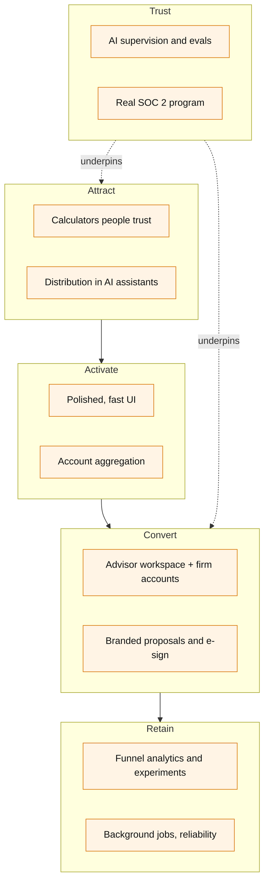

# Value Flow & Open-Source Upgrade Roadmap

**Purpose:** identify open-source GitHub projects that raise Fiduciary OS's value — product quality, credibility, speed to market, and visual polish — and sequence them against the business value flow.

**Snapshot:** October 2026. Star counts and licenses were read from each project's GitHub page at that time; re-check before adopting.

---

## How to read this

Each recommendation answers four questions:

- **Stage** — which step of the value flow it strengthens (Attract → Activate → Convert → Retain → Trust).
- **Replaces** — the current file or gap in this repo it improves.
- **License fit** — whether it can be embedded in proprietary code.
- **Effort** — S (days), M (1–3 weeks), L (a month or more).

### License rule of thumb

| License | How to use it in a closed-source SaaS |
|---|---|
| MIT · Apache-2.0 · ISC · CC0 | Embed, modify, ship. Keep the notice. |
| MIT core + `ee/` directory | Core is free; enterprise folders need a commercial license. |
| **AGPL-3.0** | Run it **as a separate service** (own container, own repo). If you modify it and users reach it over a network, you must publish those modifications. **Do not copy AGPL code into the Fiduciary OS codebase.** |

---

## The value flow, mapped

---

## 1. Experience & aesthetics

**Stage:** Activate

The repo has no frontend. These let a small team ship one that looks institutional on day one, while keeping full ownership of the code (copy-in components, not a locked UI kit).

| Project | ★ | License | What it adds | Replaces | Effort |
|---|---|---|---|---|---|
| [shadcn-ui/ui](https://github.com/shadcn-ui/ui) | 125k | MIT | Accessible Radix-based components you own and theme. De-facto standard for React SaaS. | Missing `frontend/` | S |
| [satnaing/shadcn-admin](https://github.com/satnaing/shadcn-admin) | 15.8k | MIT | Complete dashboard shell: Vite, TanStack Router, sidebar, auth pages, tables, dark mode. Start the Advisor Command Center here. | Missing `frontend/` scaffold | S |
| [tremorlabs/tremor](https://github.com/tremorlabs/tremor) | 3.6k | Apache-2.0 | Copy-paste KPI cards, area/bar/donut charts, trackers styled for financial dashboards. | "GlassCard / KPICard" described in docs | S |
| [recharts/recharts](https://github.com/recharts/recharts) | 27.6k | MIT | Charting layer under Tremor; use directly for retirement-income ribbons and Monte Carlo fan charts. | Chart.js plan | S |
| [TanStack/table](https://github.com/TanStack/table) | 28.4k | MIT | Headless tables for holdings, client books, carrier comparisons. | — | S |
| [lucide-icons/lucide](https://github.com/lucide-icons/lucide) | 24.4k | ISC | Consistent stroke icon set (already bundled with shadcn). | — | S |
| [motiondivision/motion](https://github.com/motiondivision/motion) | 34.2k | MIT | Restrained micro-interactions: number tick-ups on scores, panel transitions. | — | S |
| [magicuidesign/magicui](https://github.com/magicuidesign/magicui) | 22.1k | MIT | Animated marketing-site sections (hero, bento grids, number tickers) for the B2C landing page. Use sparingly in the product itself. | — | S |

**Design direction.** Keep the existing dark theme intent, but make trust the dominant signal: one restrained accent (the docs' cyan), generous whitespace, tabular figures for every number (`font-variant-numeric: tabular-nums`), and charts that always show the assumption behind them. Advisors sell to people who are nervous about money; calm beats flashy.

---

## 2. Financial engines

**Stage:** Attract

The free calculators are the top of the funnel. Today they are rule-of-thumb formulas (for example, `/calculations/tax` hard-codes one year's brackets and applies **single** brackets to head-of-household filers; `/retirement` maps withdrawal rate to a fixed success percentage). Credible numbers are what make a household come back and an advisor willing to put their name next to the output.

| Project | ★ | License | What it adds | Replaces | Effort |
|---|---|---|---|---|---|
| [PolicyEngine/policyengine-us](https://github.com/PolicyEngine/policyengine-us) | 166 | **AGPL-3.0** | Maintained rules engine for US federal and state tax and benefits. Call PolicyEngine's hosted API or run it as a separate Python service. | `/calculations/tax` | M |
| [PSLmodels/Tax-Calculator](https://github.com/PSLmodels/Tax-Calculator) | 308 | CC0-1.0 | Federal income and payroll tax microsimulation; public-domain, so it can be embedded. Federal only. | `/calculations/tax` (alternative) | M |
| [formulajs/formulajs](https://github.com/formulajs/formulajs) | 820 | MIT | Excel-compatible `PMT`, `FV`, `NPER`, `NPV`, `IRR` in JavaScript. Advisors can reconcile results to their own spreadsheets. | Ad-hoc annuity math | S |
| [boknows/cFIREsim-open](https://github.com/boknows/cFIREsim-open) | 157 | Apache-2.0 | Reference implementation of historical-cycle retirement simulation. Port the method to TypeScript alongside a Monte Carlo engine. | `/calculations/retirement` | M |
| [ghostfolio/ghostfolio](https://github.com/ghostfolio/ghostfolio) | 9.4k | **AGPL-3.0** | Mature open-source wealth tracker on a near-identical stack (NestJS, Prisma, PostgreSQL, Redis). Study its time-weighted return and fee calculations; do not copy code. | `/market/portfolio-analytics` (random day change) | Reference |
| [OpenBB-finance/OpenBB](https://github.com/OpenBB-finance/OpenBB) | 73.5k | **AGPL-3.0** | Unified market-data platform over many providers. Run as a separate data service to replace single-vendor Alpha Vantage and mock prices. | `unifiedAiService` market data | M |

**Distribution through AI assistants.** Publishing the calculators as an MCP server puts them inside Claude and other assistants — a new top-of-funnel channel. Others are already doing this for retirement planning ([NowCapital](https://claudemarket.ai/mcp/XmeleeLabs/mcp-server-nowcapital), [Cinderfi](https://www.getdrio.com/mcp/com-cinderfi-retirement-planning/md)).

| Project | ★ | License | What it adds | Effort |
|---|---|---|---|---|
| [modelcontextprotocol/typescript-sdk](https://github.com/modelcontextprotocol/typescript-sdk) | 13.1k | MIT / Apache-2.0 | Expose `annuity`, `life-insurance`, `retirement`, `tax` as MCP tools, each response carrying disclosures and a link back to the platform. | S |

---

## 3. Platform foundation

**Stage:** Convert

The B2B product needs firms, advisors, households, and the permissions between them. The current auth is a single `role` string on a user.

| Project | ★ | License | What it adds | Replaces | Effort |
|---|---|---|---|---|---|
| [better-auth/better-auth](https://github.com/better-auth/better-auth) | 29.5k | MIT | Sessions, 2FA, multi-tenant organizations, social/SSO. Removes hand-rolled JWT handling. | `routes/auth.ts`, `middleware/auth.ts` | M |
| [openfga/openfga](https://github.com/openfga/openfga) | 5.7k | Apache-2.0 | Relationship-based access (Zanzibar model): *advisor X may view household Y because firm Z assigned them*. Auditable. | `requireRole()` | M |
| [plaid/quickstart](https://github.com/plaid/quickstart) | 749 | MIT | Reference Link flow for account aggregation (Node + React). Real balances replace manual holdings entry. | Manual `PUT /portfolio` | M |
| [diegomura/react-pdf](https://github.com/diegomura/react-pdf) | 16.8k | MIT | Firm-branded plan and proposal PDFs from React components — the white-label artifact advisors hand to clients. | "Proposal Generation" (docs only) | M |
| [documenso/documenso](https://github.com/documenso/documenso) | 15.2k | **AGPL-3.0** | Self-hosted e-signature for engagement letters and acknowledgements. Run as its own service. | — | M |
| [resend/react-email](https://github.com/resend/react-email) | 19.6k | MIT | Branded lifecycle email (welcome, plan ready, advisor intro) built in React. | — | S |

---

## 4. Trust, compliance, and AI safety

**Stage:** Trust

This is the layer that turns the platform from a demo into something a compliance officer will sign off on.

| Project | ★ | License | What it adds | Replaces | Effort |
|---|---|---|---|---|---|
| [langfuse/langfuse](https://github.com/langfuse/langfuse) | 32.4k | MIT (core) | Trace every AI prompt and response with user, model, cost, and latency. Gives supervisors a reviewable record of what the AI told each client. | Nothing logs AI output today | S |
| [promptfoo/promptfoo](https://github.com/promptfoo/promptfoo) | 24.2k | MIT | Test suites for AI output: flag guarantees, product pushing, missing disclosures, unsuitable advice for a risk profile. Run in CI. Now part of OpenAI. | — | S |
| [trycompai/comp](https://github.com/trycompai/comp) | 1.9k | **AGPL-3.0** (open core) | Policies, controls, evidence collection toward SOC 2 / ISO 27001 — the path to *earning* the claim the old README made. Internal tool, run separately. | Unattested claims | L |
| [open-telemetry/opentelemetry-js](https://github.com/open-telemetry/opentelemetry-js) | 3.5k | Apache-2.0 | Traces and metrics across API, jobs, and AI calls; vendor-neutral. | `morgan` + `winston` only | S |

---

## 5. Growth & reliability

**Stage:** Retain

| Project | ★ | License | What it adds | Effort |
|---|---|---|---|---|
| [PostHog/posthog](https://github.com/PostHog/posthog) | 37.5k | MIT (core) | Funnel analytics for Attract → Activate → Convert, feature flags, experiments, session replay. Measures the flywheel the business plan depends on. | S |
| [growthbook/growthbook](https://github.com/growthbook/growthbook) | 8.1k | MIT (core) | Warehouse-native A/B testing if PostHog's experiments outgrow you. | S |
| [taskforcesh/bullmq](https://github.com/taskforcesh/bullmq) | 9.4k | MIT | Redis-backed job queue (Redis is already configured): nightly portfolio refresh, AI batch insights, email sends, retries. | S |
| [asteasolutions/zod-to-openapi](https://github.com/asteasolutions/zod-to-openapi) + [scalar/scalar](https://github.com/scalar/scalar) | 1.6k / 16.3k | MIT / MIT | Generate the OpenAPI spec from code and serve an interactive API reference — needed for white-label and partner integrations. Current release needs Zod 4; the backend is on Zod 3 (use v7.3.4 or upgrade). | S |

---

## Phased plan

Sequenced so each phase produces something sellable or demonstrable, and nothing customer-facing ships before the trust gates.

| Phase | Outcome | Adopt | Exit criteria |
|---|---|---|---|
| **0 · Credibility gates** | Nothing in the repo overstates reality | — (fixes listed in [README](README.md#before-go-to-market)) | Claims removed, quotes anonymised, model corrected, counsel engaged on revenue share |
| **1 · Consumer MVP** | Public calculators with a real UI | shadcn-admin, shadcn/ui, Tremor, Recharts, formulajs, PostHog | Four calculators live; funnel instrumented from first visit to registration |
| **2 · Trustworthy AI** | AI insights a supervisor can review | Langfuse, promptfoo, MCP SDK | Every AI response traced; eval suite blocks unsafe output in CI; calculators published as MCP tools |
| **3 · Advisor product** | First paying firm | Better Auth, OpenFGA, react-pdf, react-email, Plaid | Firm → advisor → household permissions; branded PDF plan; aggregated accounts |
| **4 · Scale & attest** | Enterprise-ready | PolicyEngine, OpenBB, BullMQ, OpenTelemetry, zod-to-openapi + Scalar, Documenso, Comp AI | PostgreSQL in production, published API reference, SOC 2 Type I audit scheduled |

---

## Not recommended

| Project | Why not |
|---|---|
| Copying AGPL code (Ghostfolio, OpenBB, PolicyEngine, Documenso, Comp AI) into this codebase | Would obligate releasing Fiduciary OS source to network users. Run them as separate services instead. |
| Any "free carrier quote" scraper | Carrier pricing without an appointment or licensed quoting partner is the same risk as the current hard-coded table. |
| Heavy component kits with their own design language (Material, Ant) | Fights white-labelling; shadcn's owned-code model is a better fit for firm branding. |
