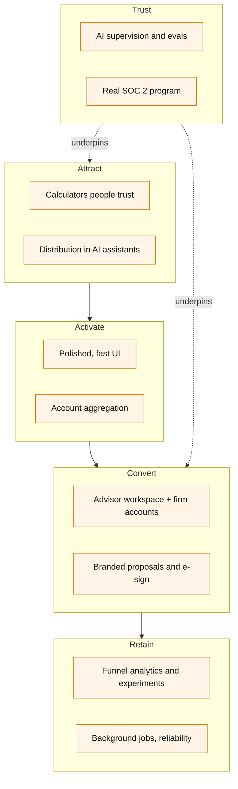

# Value Flow & Open-Source Upgrade Roadmap

**Purpose:** identify open-source GitHub projects and audited connectors that raise the unified **AUCTUM.ATLAS** (Consumer Household Portal) + **AUCTUM Command (powered by Fiduciary OS™)** (Licensed Advisor Core) ecosystem — product quality, credibility, speed to market, and WCAG 2.2 visual polish — sequenced against the canonical architecture in [`UNIFIED_PLATFORM_BLUEPRINT.md`](UNIFIED_PLATFORM_BLUEPRINT.md).

**Snapshot:** November 2026. Star counts and licenses were read from each project's GitHub page at that time; re-check before adopting.

---

## How to read this

Each recommendation answers four questions:

- **Stage** — which step of the value flow it strengthens (Attract → Activate → Convert → Retain → Trust).
- **Replaces** — the current file or gap in this repo it improves.
- **License fit** — whether it can be embedded in proprietary code.
- **Effort** — S (days), M (1–3 weeks), L (a month or more).

### License rule of thumb

| License | How to use it in a closed-source SaaS |
|---|---|
| MIT · Apache-2.0 · ISC · CC0 | Embed, modify, ship. Keep the notice. |
| MIT core + `ee/` directory | Core is free; enterprise folders need a commercial license. |
| **AGPL-3.0** | Run it **as a separate service** (own container, own repo). If you modify it and users reach it over a network, you must publish those modifications. **Do not copy AGPL code into the Fiduciary OS codebase.** |

---

## The value flow, mapped

---

## 1. Experience & aesthetics

**Stage:** Activate

The unified frontend (`React 19 + Vite 8 + TypeScript 7`) serves both **AUCTUM.ATLAS** (plain-language household stewardship) and **AUCTUM Command** (institutional advisor workstation) from a single owned-component architecture with mandatory WCAG 2.2 AA accessibility.

| Project | ★ | License | What it adds | Replaces | Effort |
|---|---|---|---|---|---|
| [shadcn-ui/ui](https://github.com/shadcn-ui/ui) | 125k | MIT | Accessible Radix-based components you own and theme. De-facto standard for React SaaS. | Ad-hoc UI primitives | S |
| [satnaing/shadcn-admin](https://github.com/satnaing/shadcn-admin) | 15.8k | MIT | Dashboard shell scaffold (Vite, sidebar, auth pages, tables) adapted for AUCTUM Command. | Legacy admin wireframe | S |
| [airbnb/visx](https://github.com/airbnb/visx) (**Visx 4.0**) | 19.5k | MIT | Primary SVG/React charting layer (`@visx/a11y`, modular ~15 KB) for Canopy, Fee-Drag Recovery, and Beneficiary Constellation charts. | Legacy Chart.js / Recharts plan | S |
| [apache/echarts](https://github.com/apache/echarts) (**ECharts 6.1**) | 62k | Apache-2.0 | High-density Canvas renderer (`sampling: 'lttb'`) for 10,000-path Longevity Fans and Multi-Carrier Parallel Coordinates. | Unscalable SVG simulations | S |
| [d3/d3](https://github.com/d3/d3) (**D3.js 7.9** layout math) | 109k | ISC | Pure layout math (`d3-sankey`, `d3-hierarchy`, `d3-scale`) paired with Visx React rendering. | Hand-rolled graph math | S |
| [statelyai/xstate](https://github.com/statelyai/xstate) (**XState**) | 28k | MIT | Deterministic 6-step Onboarding Wizard (`≤10` steps) and 5-stage household lifecycle state machine. | Ad-hoc multi-step form state | S |
| [TanStack/table](https://github.com/TanStack/table) | 28.4k | MIT | Headless tables for holdings, client books, carrier comparisons, and paired **Accessible Data Tables**. | — | S |
| [lucide-icons/lucide](https://github.com/lucide-icons/lucide) | 24.4k | ISC | Consistent stroke icon set (paired with shape/label cues so color is never the sole channel). | — | S |
| [motiondivision/motion](https://github.com/motiondivision/motion) | 34.2k | MIT | Restrained `220ms cubic-bezier(0.16, 1, 0.3, 1)` transitions honoring `prefers-reduced-motion`. | — | S |

**Design direction.** Enforce the WCAG 2.2 AA **Albers/Itten palette** (`#1B365D` navy foundation, `#2E6F5E` sage resilience, `#C27D2C` amber caution, `#B83A3A` crimson deficits only), pair every chart with an **Accessible Data Table** and inline **SEC 206(4)-1 Risk Drawer**, use `font-variant-numeric: tabular-nums` for every figure, and gate every release with automated `lint:copy` (`check-copy-lexicon.mjs`) enforcing the 10-row bifurcated lexicon.

---

## 2. Financial engines

**Stage:** Attract

The free calculators are the top of the funnel. Today they are rule-of-thumb formulas (for example, `/calculations/tax` hard-codes one year's brackets and applies **single** brackets to head-of-household filers; `/retirement` maps withdrawal rate to a fixed success percentage). Credible numbers are what make a household come back and an advisor willing to put their name next to the output.

| Project | ★ | License | What it adds | Replaces | Effort |
|---|---|---|---|---|---|
| [PolicyEngine/policyengine-us](https://github.com/PolicyEngine/policyengine-us) | 166 | **AGPL-3.0** | Maintained rules engine for US federal and state tax and benefits. Call PolicyEngine's hosted API or run it as a separate Python service. | `/calculations/tax` | M |
| [PSLmodels/Tax-Calculator](https://github.com/PSLmodels/Tax-Calculator) | 308 | CC0-1.0 | Federal income and payroll tax microsimulation; public-domain, so it can be embedded. Federal only. | `/calculations/tax` (alternative) | M |
| [formulajs/formulajs](https://github.com/formulajs/formulajs) | 820 | MIT | Excel-compatible `PMT`, `FV`, `NPER`, `NPV`, `IRR` in JavaScript. Advisors can reconcile results to their own spreadsheets. | Ad-hoc annuity math | S |
| [boknows/cFIREsim-open](https://github.com/boknows/cFIREsim-open) | 157 | Apache-2.0 | Reference implementation of historical-cycle retirement simulation. Port the method to TypeScript alongside a Monte Carlo engine. | `/calculations/retirement` | M |
| [ghostfolio/ghostfolio](https://github.com/ghostfolio/ghostfolio) | 9.4k | **AGPL-3.0** | Mature open-source wealth tracker on a near-identical stack (NestJS, Prisma, PostgreSQL, Redis). Study its time-weighted return and fee calculations; do not copy code. | `/market/portfolio-analytics` (random day change) | Reference |
| [OpenBB-finance/OpenBB](https://github.com/OpenBB-finance/OpenBB) | 73.5k | **AGPL-3.0** | Unified market-data platform over many providers. Run as a separate data service to replace single-vendor Alpha Vantage and mock prices. | `unifiedAiService` market data | M |

**Distribution through AI assistants.** Publishing the calculators as an MCP server puts them inside Claude and other assistants — a new top-of-funnel channel. Others are already doing this for retirement planning ([NowCapital](https://claudemarket.ai/mcp/XmeleeLabs/mcp-server-nowcapital), [Cinderfi](https://www.getdrio.com/mcp/com-cinderfi-retirement-planning/md)).

| Project | ★ | License | What it adds | Effort |
|---|---|---|---|---|
| [modelcontextprotocol/typescript-sdk](https://github.com/modelcontextprotocol/typescript-sdk) | 13.1k | MIT / Apache-2.0 | Expose `annuity`, `life-insurance`, `retirement`, `tax` as MCP tools, each response carrying disclosures and a link back to the platform. | S |

---

## 3. Platform foundation & audited connectors

**Stage:** Convert

Both AUCTUM.ATLAS and AUCTUM Command share a native **PostgreSQL 16 + `pgcrypto` + `pgvector` Household Graph CRM** (`Household`, `Person`, `HouseholdMember`, `CrmAccount`, `Appointment`, `LifeEvent`, `ConsentRecord`, AES-256-GCM SSN encryption, `export_user_data` / `soft_delete_user`) — formally replacing `MASTERNEX.os` — plus audited commercial connectors governed by strict unit-economics and failover controls.

| Component / Project | License / Model | What it adds | Replaces | Effort |
|---|---|---|---|---|
| **PostgreSQL 16 + `pgcrypto` + `pgvector`** | PostgreSQL | Native Household Graph CRM, multi-gen roles, AES-256-GCM SSN encryption, Merkle audit table, PL/pgSQL GDPR/CCPA routines. | `MASTERNEX.os` (decommissioned) | M |
| **Auth0 / OIDC + PKCE + Argon2id + AWS KMS** | Commercial / OSS | Enterprise SSO/MFA (15m access / 7d refresh), Argon2id (`64 MB, t=3, p=4`), envelope KMS keys, TLS 1.3 ECDSA P-256. | Hand-rolled JWT auth | M |
| [openfga/openfga](https://github.com/openfga/openfga) | Apache-2.0 | Relationship-based access (Zanzibar model): *advisor X may view household Y because firm Z assigned them*. | `requireRole()` | M |
| **Plaid FDX (`/transactions/sync` cursors)** | Commercial API | Event-driven account aggregation; Free tier capped at manual/CSV/1 user-refreshed checking account; multi-institution gated to B2C Premium (`$15/mo`) & Advisor seats; failover to MX/Finicity/TimescaleDB. | Manual `PUT /portfolio` & costly polling | M |
| **iPipeline Novera / OneView™ + Annuity Rate Watch / Wink + CANNEX + Compulife** | Commercial APIs | Live annuity order/AFFIRM suitability & policy status (OneView™), timestamped annuity schedules (ARW/Wink), Phase 4 US/CA income annuities (CANNEX), and term quoting (Compulife `REMOTE_IP` + separate US/CA Auth IDs). | Unsourced static carrier tables | M |
| **Google Maps `AdvancedMarkerElement` + Gemini 4 Interactions** | Commercial APIs | Studio #11 spatial parcel clustering (`importLibrary`, `PlaceAutocompleteElement`) and grounded market comps (`POST /v1beta/interactions`, `Api-Revision: 2026-05-20`, `google_search` + `google_maps`). | Static property comps | M |
| **Twilio + SendGrid / AWS SES** + [resend/react-email](https://github.com/resend/react-email) | Commercial / MIT | Lifecycle email & SMS strictly gated behind PostgreSQL `ConsentRecord` double-opt-in and FINRA 2210 / CAN-SPAM / TCPA copy lint. | Ungated notifications | S |
| [diegomura/react-pdf](https://github.com/diegomura/react-pdf) & [documenso/documenso](https://github.com/documenso/documenso) | MIT / **AGPL-3.0** | Firm-branded plan PDFs and self-hosted e-signature (run Documenso as a separate container). | "Proposal Generation" (docs only) | M |

---

## 4. Trust, compliance, and AI safety

**Stage:** Trust

This layer embeds regulatory supervision directly into runtime execution so every AI turn, calculation, and advisor sign-off is deterministically auditable.

| Component / Project | License / Model | What it adds | Replaces | Effort |
|---|---|---|---|---|
| **Temporal + LangGraph + Camunda DMN + MCP/A2A** | MIT / Apache-2.0 | Layered orchestration spine: Temporal outer durability (payloads `>2 MB` stored in encrypted S3 with compact UUID refs), LangGraph inner reasoning, Camunda DMN deterministic suitability/RMD tables, MCP/A2A interoperability. | Ad-hoc synchronous AI calls | L |
| **K-Dense Dual-Loop Verification & Dual-Record Provenance + RO-Crate 1.1** | Apache-2.0 / Native | Outer Planning + Inner Sandboxed Execution/Math Review (zero LLM mental math); Living Lab Notebook + unforgeable host-observed Provenance Log + SHA-256 Frozen Analysis Plan + RO-Crate 1.1 ZIP WORM export. | Unverified prose math | M |
| **Vetted `claude-skills-mcp` (`cisco-ai-skill-scanner --use-behavioral`)** | MIT / Apache-2.0 | Behavioral security scan gate prior to skill admission; allowlisted `docx`/`pdf`/`pptx`/`xlsx` from `anthropics/skills`; read-only `mimeo` pedagogy checklists. | Unscanned agent tools | S |
| **Biomimicry 3.8 + Honeybee Democracy 4-Scout Swarm Critic** | Native | Multi-Constraint Cash-Flow Solver, independent spouse/heir alignment scoring, and 4-scout convergence gate with automatic HITL escalation on disagreement. | Single-pass unconstrained solver | M |
| **4 Runtime Compliance Gates + 7-Year S3 Object Lock WORM + Postgres Merkle Chain** | Native / AWS | (1) PII Redaction & Scope Gate, (2) FINRA 2210 / SEC 206(4)-1 Content Guard, (3) Temporal HITL Escalation Pause, (4) 7-year S3 Object Lock WORM + `pg_advisory_xact_lock` append-only Merkle ledger + `export_user_data`/`soft_delete_user`. | Unlogged AI output | M |
| [langfuse/langfuse](https://github.com/langfuse/langfuse) & [promptfoo/promptfoo](https://github.com/promptfoo/promptfoo) | MIT | Prompt/response tracing and CI adversarial evals flagging guarantees, product pushing, and missing disclosures. | Manual QA spot-checks | S |
| [trycompai/comp](https://github.com/trycompai/comp) & [open-telemetry/opentelemetry-js](https://github.com/open-telemetry/opentelemetry-js) | **AGPL-3.0** / Apache-2.0 | SOC 2 / ISO 27001 evidence collection (separate service) and vendor-neutral OpenTelemetry traces/metrics. | Unattested compliance claims | M |

---

## 5. Growth & reliability

**Stage:** Retain

| Project | ★ | License | What it adds | Effort |
|---|---|---|---|---|
| [PostHog/posthog](https://github.com/PostHog/posthog) | 37.5k | MIT (core) | Funnel analytics for Attract → Activate → Convert, feature flags, experiments, session replay. Measures the flywheel the business plan depends on. | S |
| [growthbook/growthbook](https://github.com/growthbook/growthbook) | 8.1k | MIT (core) | Warehouse-native A/B testing if PostHog's experiments outgrow you. | S |
| [taskforcesh/bullmq](https://github.com/taskforcesh/bullmq) | 9.4k | MIT | Redis-backed job queue (Redis is already configured): nightly portfolio refresh, AI batch insights, email sends, retries. | S |
| [asteasolutions/zod-to-openapi](https://github.com/asteasolutions/zod-to-openapi) + [scalar/scalar](https://github.com/scalar/scalar) | 1.6k / 16.3k | MIT / MIT | Generate the OpenAPI spec from code and serve an interactive API reference — needed for white-label and partner integrations. Current release needs Zod 4; the backend is on Zod 3 (use v7.3.4 or upgrade). | S |

---

## Phased plan

Aligned with [`UNIFIED_PLATFORM_BLUEPRINT.md`](UNIFIED_PLATFORM_BLUEPRINT.md#7-phased-rollout-roadmap-phases-14--flagger-canary-governance). Every production release across Phases 1–4 is gated by **Flagger progressive canary delivery** (**10%** traffic weight, **30s** health check interval, automatic rollback if **error rate > 1%** or **p95 latency > 500 ms**).

| Phase | Timeline | Outcome & Core Stack | Exit Criteria |
|---|---|---|---|
| **Phase 1 · Foundation & Trust Core** | **Months 1–6** | Durable `trust-core` ledger; WCAG 2.2 AA UI (Visx 4.0 + ECharts 6.1 + Accessible Data Tables); 6-step XState onboarding + 3-Slider Checkup; PostgreSQL 16 + `pgcrypto` Household Graph CRM (`MASTERNEX.os` removed); Family Document Binder (Argon2id + PKCE + S3 Object Lock); 2 core literacy studios. | Compulife pilot (`$490/yr`); Plaid Trial (`≤10` Prod Items); `lint:copy` green; 25+ discovery interviews; Flagger canary thresholds passing. |
| **Phase 2 · Multi-Studio Coupling & Live Connectors** | **Months 7–15** | Unified Cash-Flow Router linking Tax, Retirement, Life Insurance + **Studio #11 Real Property & Tangible Asset Studio** (Google Maps `AdvancedMarkerElement`); live Advisor Command Center CRM & quote matrix. | Annuity Rate Watch (Wink failover) + iPipeline Novera/OneView™; event-driven Plaid FDX (B2C Premium & Advisor seats only); FINRA 2210 / CAN-SPAM / TCPA pre-flight linter on Twilio & SendGrid/SES. |
| **Phase 3 · Durable AI Orchestration & Swarm Verification** | **Months 16–24** | Temporal + LangGraph + Camunda DMN spine (S3 UUID refs for `>2 MB` payloads); K-Dense Dual-Loop AI Coach + Frozen Analysis Plan + Provenance Log + RO-Crate 1.1 WORM export; Honeybee Democracy Household Alignment & 4-Scout Swarm Critic. | Vetted `claude-skills-mcp` (`cisco-ai-skill-scanner --use-behavioral`); Gemini 4 Interactions grounding; 100% HITL escalation coverage on regulated outputs. |
| **Phase 4 · Cross-Border Scale & Multi-Generational Ecosystem** | **Years 3–5** | CANNEX Canadian expansion (RRIFs & Canadian payout annuities, separate Compulife CA Auth ID); 3-generation Household Constellations + NextGen Heir literacy tracks; audited MCP/A2A/REST APIs for CPA & estate-attorney collaboration. | 7-year S3 Object Lock WORM & regional data residency attested; SOC 2 Type II audit completed; multi-region DR verified. |

---

## Not recommended

| Project / Practice | Why not |
|---|---|
| Copying AGPL code (Ghostfolio, OpenBB, PolicyEngine, Documenso, Comp AI) into this codebase | Would obligate releasing Fiduciary OS source to network users. Run them as separate services instead. |
| Any "free carrier quote" scraper | Carrier pricing without an appointment or licensed quoting partner is the same risk as the current hard-coded table. |
| Heavy component kits with their own design language (Material, Ant) | Fights white-labelling; shadcn's owned-code model is a better fit for firm branding. |
| **`MASTERNEX.os`** (decommissioned) | Contains zero native CRM entities and introduces FINRA Regulatory Notice 24-09 vendor-supervision risk; formally replaced by PostgreSQL 16 + `pgcrypto` Household Graph CRM and native `trust-core` / Camunda DMN / K-Dense Provenance services. |
| **Unsourced static marketing ratios** (`1.25x Leverage Factor`, unsourced `11.10%` FIA payout) | Hard-banned in production UI; all charts must render strictly from timestamped carrier API schedules or explicit user-declared hypothetical assumptions with a mounted SEC 206(4)-1 Risk Drawer. |
| **Unbounded Free-tier Plaid background polling** | Causes negative gross margin inversion on `$0` users; enforce event-driven `/transactions/sync` cursors gated to B2C Premium (`$15/mo`) and Advisor seats, with Free tier capped at manual/CSV/1 user-refreshed checking account. |
